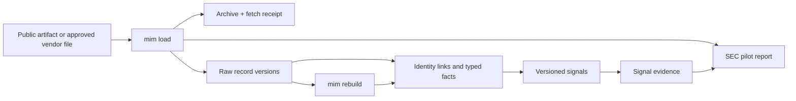

# Money in Motion source audit

Full text of all 53 files from commit 8ac68530259c1505ef8e99bb4d818e9997a72ce5.

Review identity attribution, evidence provenance, replay and rebuild, and ingestion at scale. Cite original file paths and line numbers. Rank the best opportunities to consolidate duplicated code.

## Start with the application logic

- src/mim/cli.py dispatches all load, rebuild, and audit commands.
- src/mim/loaders/sec_ingestion.py implements shared archival, replay, and rebuild logic.
- src/mim/loaders/ contains the parsers, entity resolution, and signal detectors for all seven sources.
- src/mim/normalize/ implements contact normalization, and src/mim/audit/ implements integrity and evidence checks.
- migrations/ defines the schema and source registry. tests/ covers expected behavior.

## File list

- README.md
- docs/CURRENT_HANDOFF_STATE.md
- docs/ARCHITECTURE.md
- docs/GOALS_AND_ACCEPTANCE.md
- docs/ORCHESTRATOR_HANDOFF.md
- docs/SEC_PILOT.md
- docs/SOURCE_LEDGER.md
- migrations/001_core_schema.sql
- migrations/002_sec_form345_source.sql
- migrations/003_sec_form_d_source.sql
- migrations/004_linkedin.sql
- migrations/005_contact_points.sql
- migrations/006_healthcare_and_plans.sql
- migrations/007_form_d_name_index.sql
- pyproject.toml
- scripts/test-offline
- src/mim/__init__.py
- src/mim/__main__.py
- src/mim/audit/__init__.py
- src/mim/audit/database.py
- src/mim/audit/linkedin_sample.py
- src/mim/audit/sec_pilot.py
- src/mim/cli.py
- src/mim/loaders/__init__.py
- src/mim/loaders/cms_open_payments.py
- src/mim/loaders/contact_vendor.py
- src/mim/loaders/dol_form5500.py
- src/mim/loaders/government_csv.py
- src/mim/loaders/linkedin.py
- src/mim/loaders/linkedin_input.py
- src/mim/loaders/linkedin_reservations.py
- src/mim/loaders/nppes.py
- src/mim/loaders/sec_form345.py
- src/mim/loaders/sec_form345_cli.py
- src/mim/loaders/sec_form345_input.py
- src/mim/loaders/sec_form345_projection.py
- src/mim/loaders/sec_form345_signals.py
- src/mim/loaders/sec_form_d.py
- src/mim/loaders/sec_form_d_input.py
- src/mim/loaders/sec_form_d_projection.py
- src/mim/loaders/sec_form_d_signals.py
- src/mim/loaders/sec_ingestion.py
- src/mim/local_postgres.py
- src/mim/normalize/__init__.py
- src/mim/normalize/contact.py
- tests/conftest.py
- tests/test_contact_points_gate.py
- tests/test_harness.py
- tests/test_healthcare_and_plans_gate.py
- tests/test_linkedin_gate.py
- tests/test_sec_form345_gate.py
- tests/test_sec_form_d_gate.py
- tests/test_sec_pilot.py

## README.md

SHA-256 087f5fc758fadd4785b26c9093d474c9953bc72c16ff408d5175c9b02745bd5f

~~~~~~~~text
# Money in Motion

Money in Motion is a standalone PostgreSQL project for collecting public and licensed RIA prospect records with inspectable source evidence. It loads SEC filings, reviewed LinkedIn evidence, authorized contact enrichment, public provider and payment data, and retirement plan filings. The [orchestrator handoff](docs/ORCHESTRATOR_HANDOFF.md) describes the evidence and replay rules.

**Start here for the current goal.** Run the [one-quarter SEC insider pilot](docs/SEC_PILOT.md) and review its evidence package. The [goals and acceptance checklist](docs/GOALS_AND_ACCEPTANCE.md) maps the project brief to the code and open audit work. See the [architecture](docs/ARCHITECTURE.md) and [source ledger](docs/SOURCE_LEDGER.md) for the evidence flow and source terms. The [handoff status](docs/CURRENT_HANDOFF_STATE.md) records the latest checks and decisions.

## Run the offline gate

Use Linux or Ubuntu in WSL as a regular user with Python 3.12+, `uv`, PostgreSQL 16+ server binaries, and the `pgcrypto` and `pg_trgm` extensions. Run these commands from this checkout. The initial dependency sync can fetch packages from PyPI.

```sh
uv sync --locked
./scripts/test-offline
```

The script starts pytest in an isolated Linux network namespace and runs all seven loaders against fictional input on a temporary PostgreSQL cluster. It checks full-table replay, malformed-row rollback, and rebuild from raw records. Direct pytest runs also guard Python networking.

If the PostgreSQL tools are installed outside `PATH`, set `MIM_POSTGRES_BIN` to their directory. On the current WSL machine, PostgreSQL 18.6 was extracted in the user cache and `uv` is in `~/.local/bin`. Reuse that setup with:

```sh
export PATH="$HOME/.local/bin:$PATH"
pg_runtime="$HOME/.cache/money-in-motion/pg18-ubuntu/root"
export MIM_POSTGRES_BIN="$pg_runtime/usr/lib/postgresql/18/bin"
export LD_LIBRARY_PATH="$pg_runtime/usr/lib/x86_64-linux-gnu${LD_LIBRARY_PATH:+:$LD_LIBRARY_PATH}"
./scripts/test-offline
```

## Create a standalone development database

Point `MIM_POSTGRES_BIN` to the server binaries if they are outside `PATH`. From the checkout root, the following creates a fresh, private development cluster and applies the migrations atomically. Keep the printed state path to reconnect to or stop it later.

```sh
export PATH="${MIM_POSTGRES_BIN:+$MIM_POSTGRES_BIN:}$PATH"
state=$(mktemp -d /tmp/mim-dev.XXXXXX)
printf 'Cluster path %s\n' "$state"
initdb -D "$state/data" --auth=trust --no-locale --encoding=UTF8 -U mim_dev
pg_ctl -D "$state/data" -l "$state/postgres.log" -w start \
  -o "-c listen_addresses='' -k $state -p 5432"
unset PGSERVICE PGHOSTADDR
export PGHOST="$state" PGPORT=5432 PGUSER=mim_dev
createdb money_in_motion
psql -X -d money_in_motion -v ON_ERROR_STOP=1 --single-transaction \
  -f migrations/001_core_schema.sql -f migrations/002_sec_form345_source.sql \
  -f migrations/003_sec_form_d_source.sql -f migrations/004_linkedin.sql \
  -f migrations/005_contact_points.sql -f migrations/006_healthcare_and_plans.sql \
  -f migrations/007_form_d_name_index.sql
```

Stop it with `pg_ctl -D "$state/data" -w stop`. Apply any missing migration files in numeric order to an existing database. For a database already at migration 006, apply `migrations/007_form_d_name_index.sql` before loading Form D or rebuilding.

## Load, rebuild, and audit

Run from the checkout with the private database running. All commands accept `--dsn` and otherwise use `MIM_DATABASE_DSN` or local libpq settings.

```sh
uv run --offline --locked mim load sec_form345 --fixture tests/fixtures/sec_form345/gate
uv run --offline --locked mim load sec_form_d --fixture tests/fixtures/sec_form_d/gate
uv run --offline --locked mim load linkedin --fixture tests/fixtures/linkedin/envelopes.jsonl
uv run --offline --locked mim load contact_vendor --fixture tests/fixtures/contact_vendor/envelopes.jsonl
uv run --offline --locked mim load nppes --fixture tests/fixtures/healthcare_and_plans/npidata_pfile_20050523-20250531.csv
uv run --offline --locked mim load cms_open_payments --fixture tests/fixtures/healthcare_and_plans/payments.csv
uv run --offline --locked mim load dol_form5500 --fixture tests/fixtures/healthcare_and_plans/f_5500_sf_2025_latest.csv
uv run --offline --locked mim audit-db
uv run --offline --locked mim rebuild
uv run --offline --locked mim audit-db
uv run --offline --locked mim audit-linkedin --sample-size 50 --output .cache/linkedin_precision_report.json
```

SEC fixtures can be TSV directories or quarterly ZIPs. Form D also accepts the SEC’s tab-delimited `.txt` files. LinkedIn and contact imports accept a JSON object, JSON array, or JSONL. NPPES, Open Payments, and Form 5500 accept local CSVs or ZIPs containing the primary CSV tables. Artifacts default to `.local/<source>`. Exact replays skip database writes. Invalid inputs produce structured JSON on stderr and roll back the batch. Rebuild clears and restores derived tables in one transaction using stored raw records and leaves fetch history intact. It takes exclusive locks on derived tables. Run it during a maintenance window on a populated database. [SEC insider datasets](https://www.sec.gov/data-research/sec-markets-data/insider-transactions-data-sets) · [SEC Form D datasets](https://www.sec.gov/data-research/sec-markets-data/form-d-data-sets)

LinkedIn facts require an explicit approved or verified match, or Scout’s attributed identity approval, plus a complete HTTP 200 response that agrees with the profile identifier. Use only vendor evidence whose contract allows raw retention and internal career analysis. An approved envelope can identify an existing local person via `person_mapping.person_id` or `person_mapping.sec_cik`. Import SEC evidence first when the mapping or cross-filing resolution depends on it.

`mim audit-db` prints a JSON report with integrity violations and counts by source, table, and signal kind. Structural violations return exit status 1. Withheld or unresolved inputs with valid fetch provenance appear in the unlinked raw counts for review.

Before scheduling a vendor lookup, call `mim reserve-linkedin PROVIDER PROFILE`. Schedule work only on `reserved`, retain its token, and call `mim release-linkedin PROVIDER PROFILE TOKEN` after importing the result or ending the attempt. Completed vendor evidence can be reused for 90 days by default. Bright Data pending receipts can be reused for 24 hours. `--refresh` bypasses completed evidence and still honors active reservations and fresh receipts. Reservation commands work entirely in PostgreSQL.

`mim audit-linkedin` generates a random sample of up to 50 distinct accepted profiles and leaves the manual result fields blank. Record verified matches divided by profiles actually reviewed, the review denominator, and the number of withheld candidates.

Contact imports require a `person_mapping` using an existing `person_id`, `sec_cik`, `linkedin`, or `npi`. The fictional fixture maps to the first SEC and LinkedIn examples above. Complete matched responses can add email, phone, and postal address records. Generic files can supply `raw_payload.contacts` entries with `kind`, `value`, and optional `label`, `verification`, and `verified_at`. Apollo and People Data Labs can also use their native person payload. Only import evidence the vendor contract permits you to retain. [Apollo People Enrichment](https://docs.apollo.io/reference/people-enrichment) · [People Data Labs person fields](https://support.peopledatalabs.com/hc/en-us/articles/30910938133147-Free-Plan-Person-Starter-Bundle)

NPPES uses the primary monthly or weekly provider file. It uses the release date from the standard filename when available and falls back to dates in the row. Open Payments links disclosures by individual NPI and backfills exact links when NPPES is loaded later. Disclosures without a resolvable individual NPI retain their raw record and fetch provenance. Agency CSVs use bounded COPY batches within one atomic artifact transaction. [NPPES downloads](https://download.cms.gov/nppes/NPI_Files.html) · [Open Payments data dictionary](https://www.cms.gov/files/document/open-payments-methodology-data-dictionary-document-january-2026.pdf)

The Form 5500 owner signal requires a short-form pension filing, fewer than 100 total participants, at least $1 million in reported year-end plan assets, and evidence that the named person owns the sponsor. Load any prior sponsor and owner evidence before loading the filing. The signal amount reports plan assets. [DOL Form 5500 datasets](https://www.dol.gov/agencies/ebsa/about-ebsa/our-activities/public-disclosure/foia/form-5500-datasets) · [2025 Form 5500-SF layout](https://askebsa.dol.gov/FOIA%20Files/2025/Latest/F_5500_SF_2025_Latest_layout.txt)

For explicit live Forms 3/4/5 downloads, set `SEC_USER_AGENT` to your organization name and contact email, then run `mim load sec_form345 --live "$SEC_ZIP_URL"`. The downloader caps requests at eight per second per process. [SEC fair access](https://www.sec.gov/search-filings/edgar-search-assistance/accessing-edgar-data)
~~~~~~~~

## docs/CURRENT_HANDOFF_STATE.md

SHA-256 b838aa91c70ad54b24096ae7cdcb67c2f26b1c9ba1b52c362c1f66785efc358c

~~~~~~~~text
# Money in Motion handoff status

## Verified on November 19, 2026

- PostgreSQL 18.6 passed all 62 tests in `./scripts/test-offline`. The seven-source gate audits a populated database, replays every artifact, deletes the archives, and runs `mim rebuild` against the populated database. It compares all core rows, including fetch history.
- The README setup and fixture commands succeeded from a fresh private database. `mim audit-db` reported zero violations before and after rebuild. It reports intentionally unresolved inputs separately.
- The official 2025 Q4 Forms 3/4/5 ZIP loaded 107,290 raw records and emitted 20,230 sale signals and 9,688 option-exercise signals. Integrity violations were zero, exact replay skipped, and all 16 core table fingerprints matched after rebuild with the ZIP unavailable. Load took 170.7 seconds and rebuild took 114.3 seconds on this host. The report is at `.local/sec-pilot/20261119T074058Z-2610kshg/summary.json` in the project. The worksheet contains five sales and five exercises. All five sale amounts were also recalculated from the archived row values. Independent review against the original filings is pending. [SEC quarterly datasets](https://www.sec.gov/data-research/sec-markets-data/insider-transactions-data-sets)
- A separate 100,000-row synthetic Open Payments run loaded in 5.3 seconds, skipped exact replay, rebuilt in 1.2 seconds, and passed the audit. Full-size agency input capacity remains unmeasured.

## Deploy this revision

Apply migration `007_form_d_name_index.sql` if 001–006 are already installed. The migration adds an index for Form D person candidates and keeps the similarity rule at 0.85. Fresh setup applies all seven migration files. See the [README](../README.md).

All seven sources have local loaders and offline gates. The review fixes cover SEC TSV irregularities, nullable and invalid trade data, fractional-cent sale amounts, Form D entity rows and amendment references, DOL count and asset formatting, merge-aware attribution, and Bright Data pending receipt expiry. Bulk public CSV loads stage up to 1,000 rows at a time within one atomic artifact transaction. Rebuild preserves fetches and raw evidence, and preserves soft merges when both identities can be reconstructed.

## Open acceptance checks

1. Finish the independent review of the 10 SEC sample rows in the existing pilot package. Use the filing accession and raw payload to check each identity, date, event, and amount. [SEC pilot guide](SEC_PILOT.md)
2. Then run one representative real Form D, NPPES, Open Payments, and DOL release in disposable databases. Record load and rebuild time, peak process memory, WAL and disk usage, records withheld, and audit results. Test Open Payments before NPPES at representative volume and verify exact-NPI backfill.
3. Confirm the vendor, approved uses, retention and deletion rules, billing units, and spending cap before paid enrichment. After real approved LinkedIn evidence is available, independently review 50 random distinct accepted matches. Record verified matches, the actual number reviewed, and withheld candidate count. LinkedIn precision and the real contact enrichment pilot are pending. [Source ledger](SOURCE_LEDGER.md)
~~~~~~~~

## docs/ARCHITECTURE.md

SHA-256 dcbca81231f57abec965ccb4e81db2a698a6b6360f8d14124829428a6e31f45c

~~~~~~~~text
# Project goal and architecture

**Goal.** Maintain an evidence-backed PostgreSQL reference database for RIAs. A reviewer should be able to trace a person, company, dated event, or normalized contact field back through the matching decision to the source record and its archived artifact.

The first operating goal is one real SEC insider quarter with reproducible results and a completed filing review. The original build scope includes public and contract-authorized evidence, seven loaders, and offline replay tests. Scoring, outreach, and Helmsted client-data integration belong to later work.



## Read the code in this order

| Area | Entry and responsibility |
| --- | --- |
| Commands | `src/mim/cli.py` owns load, rebuild, audit, reservation, and pilot entry points. |
| Shared ingestion | `src/mim/loaders/sec_ingestion.py` handles content-addressed archives, the load transaction, replay keys, signal evidence writes, and rebuild order across all seven sources. |
| Narrow SEC slice | `sec_form345.py` wires the SEC reader, projection, and detector. `sec_form345_input.py` preserves source rows and footnotes. `sec_form345_projection.py` resolves CIKs and constructs typed trades. `sec_form345_signals.py` reconciles sales and exercises and attaches evidence. |
| Integrity audit | `src/mim/audit/database.py` checks raw provenance, signal evidence, contact dates, and merge cycles. The SEC pilot adds a trade-specific evidence check. |
| Pilot and test isolation | `src/mim/local_postgres.py` starts a socket-only database and applies the migrations for both the test suite and the pilot. `src/mim/audit/sec_pilot.py` verifies the table state and writes the review package. |
| Other sources | Each loader owns its source-specific parsing and attribution rules. The handoff describes the implemented gates and their evidence boundaries. |

`core.raw_records` hashes source payload versions. `core.fetches` records the input receipt and archive SHA-256. `core.record_links` explains entity attribution, and `core.signal_evidence` ties each signal to the rows that support it. Original artifacts retain file bytes and raw payloads retain the source fields consumed by the loaders. Rebuild clears derived tables and replays raw evidence in arrival order before reconciling signals. It preserves soft-merge pointers when both endpoints can be recovered from evidence. Identifier lookups follow these pointers once the relevant identities exist. Other manual changes need durable source evidence to survive rebuild. Government CSVs stage bounded COPY batches while keeping the whole artifact transaction atomic.

## Keep the code easier to audit

- Use the unified `mim` commands for operational work. The pilot and the tests now share the same local database setup.
- Keep the source parser, identity projection, and detector recognizable in the SEC path. Their tests make it possible to change one layer and identify what changed in the audit output.
- After the real SEC pilot, compare the two SEC TSV readers before extracting another shared helper. Consolidate only the behavior verified by fixtures and the real quarter. Keep source-specific header and attribution rules near their source.
- Add a `#GOAL` header to executable code and migrations. Put operational instructions in the README or the pilot guide and rules that explain evidence in this architecture document or the orchestrator handoff.
~~~~~~~~

## docs/GOALS_AND_ACCEPTANCE.md

SHA-256 860e89beff1ca8ece44c3a892a6c67b8408311801493b65c69543ea28fbb7c10

~~~~~~~~text
# Project goals and audit checklist

**Project goal.** Build a standalone PostgreSQL reference database for registered investment advisers. For each prospect, establish identity and career context, record dated financial or career events, and provide normalized contact points. A reviewer should be able to trace each projected fact to the source evidence and inspect how the person or organization was matched.

**Current gate.** Complete independent filing review for the machine-verified SEC Forms 3/4/5 2025 Q4 pilot before expanding to other real sources. See the [current handoff status](CURRENT_HANDOFF_STATE.md) for verified test counts, pilot results, and remaining acceptance work.

The competitive background in the supplied brief explains why the records matter. This project’s scope is the standalone evidence database. Scoring, intent and search features, outreach, outcome-based ranking, client introductions, and Helmsted client-data integration sit outside this gate.

## Milestones from the project brief

| Goal | Implemented evidence | Remaining acceptance work |
| --- | --- | --- |
| 1. Database and SEC insiders | Migration `001_core_schema.sql` matches the brief’s DDL. The loader resolves issuer and person CIKs, preserves holdings and filing context, and emits sales and option exercises. See `tests/test_sec_form345_gate.py` and `tests/test_sec_pilot.py`. | Load one real quarter. Verify the sampled owner, issuer, accession, dates, transaction codes, quantities, prices, and evidence against EDGAR. |
| 2. Form D | The loader links offerings and related people and handles supported cumulative amendments. See `tests/test_sec_form_d_gate.py`. | Validate a real release and review ambiguous name matches and amendment chains. |
| 3. LinkedIn | Reviewed vendor files create career, education, and location facts. Same-provider snapshots support job-change, promotion, and retirement signals. Reservation and sampling tools are present. See `tests/test_linkedin_gate.py`. | Confirm vendor terms and use the reservation workflow in a paid pilot. Independently review 50 random accepted matches. |
| 4. Contact points | Approved envelope shapes hydrate normalized email, phone, postal address, and dated verification evidence. Reviewed LinkedIn evidence supplies the LinkedIn URL. See `tests/test_contact_points_gate.py` and `tests/test_linkedin_gate.py`. | Validate real exports, choose an operating vendor, and record actual verification coverage and cost. |
| 5. Physicians and plan sponsors | NPPES links providers and practices by NPI and emits practice signals. Open Payments retains disclosures and links exact individual NPIs when they resolve. Form 5500 links sponsors by EIN and emits signals when qualifying plan assets and ownership are supported. See `tests/test_healthcare_and_plans_gate.py`. | Validate representative agency archives, payment-link coverage, and ownership evidence. The initial Form 5500 signal cutoff is $1 million in reported year-end plan assets for a qualifying small pension plan. |

## Operating rules from the project brief

| Rule | What the auditor should inspect |
| --- | --- |
| 1. Keep Helmsted client data out | The project uses a standalone schema and file loaders. Confirm that the inputs in any real pilot contain only public or contract-authorized vendor evidence. |
| 2. Cite evidence for every fact | Follow entity links and identifiers through `core.record_links` and the identifier tables. Follow facts through their raw-record references and signals through `core.signal_evidence`. Follow raw records through `core.fetches` to the archived artifact. Source registrations and fetch receipts are control metadata. |
| 3. Preserve raw evidence, reuse paid lookups, and support rebuild | ZIP and file inputs retain their original bytes. Raw records retain source fields and may carry joined context or local linkage metadata. `mim rebuild` uses stored raw evidence. The paid caller must use the reservation workflow to reuse eligible LinkedIn results. |
| 4. Make exact replay safe | Compare table counts and fingerprints, including `core.fetches`, before and after replay of the same artifact. The SEC pilot performs that check and runs a rebuild with the archive temporarily unavailable. |
| 5. Keep political donation data out | The source catalog covers the seven listed sources. Confirm the provenance of vendor data before adding it. |
| 6. Obtain LinkedIn evidence through a vendor | The importer consumes reviewed vendor files. Confirm that procurement and collection follow approved vendor channels. |
| 7. Identify live SEC access and rate-limit it | The SEC downloader requires an identifying organization and contact email and has a project cap of eight requests per second per process. Its request guard was tested offline. |
| 8. Register licenses and permitted uses before loading | Migrations 002–006 register the sources. The loader checks registration before ingesting. See [the source ledger](SOURCE_LEDGER.md) for practical terms and open vendor decisions. |
| 9. Obtain approval before productizing or sharing source data | Product and redistribution approval remains a business decision. Confirm the applicable terms before any external distribution of actual data. |

## Definition of done

- [ ] **Trace evidence on real inputs.** Confirm that projected facts and signals have source evidence. Report intentionally unresolved raw records separately. The offline gate runs `mim audit-db` across all seven sources. Review unresolved real records by source during each pilot.
- [ ] **Repeat and rebuild real inputs.** Preserve the SEC pilot results showing an exact replay with unchanged table fingerprints and a rebuild with identical derived rows. Extend the check to the remaining real-source pilots before closing the full project gate.
- [ ] **Complete the LinkedIn review.** Draw 50 random accepted matches, check each independently, and report confirmed matches divided by the number actually reviewed. Record outcomes and withheld counts. Fixture tests verify the sampler. Real-world precision remains unmeasured.
- [ ] **Complete the source ledger.** Setup and rebuild instructions and public access costs are documented. Record the selected vendor prices, retention and permitted uses under the applicable agreements, and source owners.

The [SEC pilot guide](SEC_PILOT.md) defines the first run and reviewer worksheet. The [architecture](ARCHITECTURE.md) explains the evidence flow and identifies where each layer of code lives. Python, shell, and SQL source files carry a `#GOAL` header so reviewers can identify its responsibility at the point of use.
~~~~~~~~

## docs/ORCHESTRATOR_HANDOFF.md

SHA-256 3e50cec924c61916491f844bd0a4c4889c75a1ebb24d04866a1b3c75937228a5

~~~~~~~~text
# Money in Motion orchestrator handoff

The ingestion gates cover SEC filings, reviewed LinkedIn evidence, authorized contact enrichment, NPPES, Open Payments, and Form 5500 in the standalone PostgreSQL schema. The [README](../README.md) has local setup, fixture ingestion, and rebuild commands.

Use the [current handoff status](CURRENT_HANDOFF_STATE.md) for the latest verification and the [one-quarter SEC insider pilot guide](SEC_PILOT.md) for the filing review. Give the auditor the report directory from `mim pilot-sec` and record the filing review there. Project responsibilities and source terms are indexed in the [architecture](ARCHITECTURE.md) and [source ledger](SOURCE_LEDGER.md).

The database boundary is public records and contract-approved vendor data. Helmsted client records, the main Helmsted Supabase database, and political donation records stay outside it. Keep the work focused on ingestion, resolution, and evidence.

## First ingestion gate

1. The loader accepts a quarterly ZIP or a directory of UTF-8 TSV files. It archives the artifact by content and records the archive URI and SHA-256. `core.raw_records` retains source values, joined submission and owner data, and the referenced footnotes. Accession, table, and source row key identify each raw record. [SEC quarterly downloads](https://www.sec.gov/data-research/sec-markets-data/insider-transactions-data-sets) · [SEC file formats and table definitions](https://www.sec.gov/files/insider_transactions_readme.pdf)
2. Separate issuer and reporting-owner CIKs resolve organizations and people. `FILING_DATE` drives raw and location observations, and `TRANS_DATE` drives trades and signals. The loader uses decimal arithmetic for fractional shares and prices. [SEC submission, owner, and transaction fields](https://www.sec.gov/files/insider_transactions_readme.pdf)
3. A sale generates one signal, and paired exercise legs generate one signal with both legs as evidence. Holdings remain raw evidence. Joint filers retain entity links and co-filer relationships, with trades and signals withheld. A uniquely attributable amendment updates the original signal and replaces its evidence. Ambiguous amendments retain raw evidence and leave prior signals intact. [SEC transaction-code definitions](https://www.sec.gov/files/insider_transactions_readme.pdf)
4. The offline gate checks exact replay across all `core` tables, structured errors and atomic rollback, and reconstruction from raw records. Explicit `--live` downloads require an organization and contact email in `SEC_USER_AGENT` and have a process-wide cap of eight requests per second. [SEC EDGAR access and fair-access rules](https://www.sec.gov/search-filings/edgar-search-assistance/accessing-edgar-data)

Signal reconciliation uses the latest distinct payload stored for each accession and table key. An otherwise valid SEC row with no reported transaction code or share count remains raw evidence. Work locations retain the source fields in raw JSON and use `ZZ` where the loader has no country mapping. Deterministic IDs and filing-date UTC timestamps allow offline rebuilds to reproduce the derived rows.

## Form D ingestion gate

1. The Form D loader preserves joined filing, issuer, offering, related-person, recipient, and available signature context. It resolves issuers by CIK and recognizes a primary issuer when the filing identifies one unambiguously. Organizations already known by CIK are reused. [SEC Form D data dictionary](https://www.sec.gov/files/Form_D.pdf)
2. Person resolution tries an exact normalized name with prior evidence at that issuer, then a unique name and US-state match with trigram similarity of at least 0.85. The raw links retain the resolution method and confidence. For legacy SEC owner names without structured name fields, the matcher also considers surname-first order. Rebuild replays the sources in raw-record order to reproduce these decisions.
3. Each eligible officer or promoter’s `private_raise` signal cites both the offering and that person’s role. The amount is the issuer’s cumulative reported sales for the offering. Amendments use the previous accession when supplied and fall back to a unique earlier original sharing the issuer and file number or first-sale date. Separate offerings stay separate. Ambiguous issuer attribution and unresolved amendment chains retain raw evidence without creating signals. [SEC Form D data dictionary](https://www.sec.gov/files/Form_D.pdf) · [SEC Form D amendment guidance](https://www.sec.gov/about/divisions-offices/division-corporation-finance/frequently-asked-questions-answers-form-d)

An input with a missing filing date or issuer name fails validation because the database requires those fields. [SEC Form D data dictionary](https://www.sec.gov/files/Form_D.pdf)

## LinkedIn envelope import

The contract was checked against LinkedIn Scout commit `b3967db`, including the reader-visible README, operations guide, codebase guide, request cache, and vendor fixtures. The standalone importer reads reviewed files locally. Its raw records preserve the returned payload and the metadata needed to inspect approval and URL agreement. A Scout machine match alone leaves the row in evidence review.

The importer projects career facts only from complete, approved profiles whose returned identifier agrees with the envelope. Signals compare eligible snapshots within the same provider, ordered by observation date and retrieval timestamp, with both snapshots attached as evidence. Positions describe their source snapshot as of its observation date. The LinkedIn URL is the only contact point produced in this milestone.

The shared `mim` command handles all loads, cross-source rebuild, audit sampling, and lookup reservations. Prior module commands delegate to it for compatibility. The audit samples distinct accepted profiles and leaves manual precision unset. The vendor reservation workflow establishes an atomic lease before a caller queues work and can reuse saved evidence instead.

The full offline suite passed 38 tests on PostgreSQL 18.6 using fictional envelopes and filings. It covered concurrent reservations, exact replay, rollback, and rebuilding all three sources after removing their archived fixtures.

## Contact enrichment gate

Each envelope maps to an existing person through a local UUID or a registered identifier. Load follows any soft-merge chain and records the resolved person ID with the evidence so later rebuilds can reproduce that attribution. Rebuild depends on the underlying people from earlier source records. It preserves soft-merge pointers when it can recover both endpoints. Identifiers require source evidence to be rebuilt.

Complete matched HTTP 200 responses can hydrate normalized emails, E.164 phones, and postal addresses. Pending, unsuccessful, and mismatched responses retain their raw payload and the link to the requested person. Contact rows keep the source value and evidence for the winning verification. Every sighting contributes to the date range. A newer dated check supersedes an older check, and equally dated conflicting checks prefer `invalid`, then `risky`, then `valid`.

The full offline suite passed 45 tests on PostgreSQL 18.6. It verified exact replay, atomic rollback, and identical four-source reconstruction after the archived fixtures were deleted.

## Healthcare providers and retirement plan sponsors

- NPPES links individuals and organizations by NPI. Individual primary addresses populate work locations. Group primary city and region live on the organization, with the full address in raw evidence. Recent enumerations create person-level signals dated to enumeration. Primary practice moves cite both snapshots and use the later observation date. [CMS NPPES data dissemination](https://www.cms.gov/medicare/regulations-guidance/administrative-simplification/data-dissemination)
- Open Payments creates a person link only when the disclosed individual NPI matches an existing identifier. An unresolved disclosure is still tied to the original fetch. NPPES ingestion and rebuild recheck those records. [CMS Open Payments data dictionary](https://www.cms.gov/files/document/open-payments-methodology-data-dictionary-document-january-2026.pdf)
- DOL records retain the filing acknowledgement ID and link the sponsor by EIN. When the EIN is new, a unique existing organization with the same normalized name, city, and state can receive it. A signer is linked by normalized name and prior sponsor affiliation, or the input can provide explicit owner evidence. The owner signal requires Form 5500-SF, a pension classification, fewer than 100 total participants, and at least $1 million in reported year-end plan assets. It cites the filing and the ownership evidence. [DOL dataset guide](https://www.dol.gov/sites/dolgov/files/ebsa/pdf_files/form-5500-datasets-guide.pdf) · [2025 Form 5500-SF layout](https://askebsa.dol.gov/FOIA%20Files/2025/Latest/F_5500_SF_2025_Latest_layout.txt)

The full offline suite passed 54 tests on PostgreSQL 18.6 with synthetic records, including exact replay and identical seven-source reconstruction after deleting the archived fixtures. Full-size agency archives were outside this verification run.
~~~~~~~~

## docs/SEC_PILOT.md

SHA-256 8bce2fc29a6a5a7ffa05e29360b3bb3cde36fdaab12309441ee3e8a43f58498b

~~~~~~~~text
# SEC insider pilot

**Goal.** Load one real SEC Forms 3/4/5 quarter into a disposable database and give a reviewer enough evidence to confirm who traded, which issuer was involved, when the trade occurred, and which values the filing actually reports.

## Run it in WSL

Use **2025 Q4 345** for the first pilot. Download that ZIP from the official SEC listing and save it in Windows Downloads. Run the following from this repository with the existing `uv` and PostgreSQL setup. The pilot can also find the PostgreSQL 18 binaries previously staged in the WSL user cache. [SEC Insider Transactions Data Sets](https://www.sec.gov/data-research/sec-markets-data/insider-transactions-data-sets)

```sh
export PATH="$HOME/.local/bin:$PATH"
uv run --offline --locked mim pilot-sec \
  --fixture /mnt/c/Users/nowel/Downloads/2025q4_form345.zip
```

Use the downloaded file’s actual path if the browser saves it under a different name. The command creates a new audit folder under `.local/sec-pilot/` and prints its path. Add `--output NEW_DIR` to place the package elsewhere. It starts and removes its own private PostgreSQL instance.

For automated download, use `mim pilot-sec --live "$SEC_ZIP_URL"` with the official quarter link and an exported `SEC_USER_AGENT` containing your organization and a monitored contact email. The SEC client sends that identity and stays within the project’s eight-request-per-second cap per process. [SEC access and fair-access policy](https://www.sec.gov/search-filings/edgar-search-assistance/accessing-edgar-data)

To rehearse with fictional records, run:

```sh
uv run --offline --locked mim pilot-sec --fixture tests/fixtures/sec_form345/gate
```

The synthetic rehearsal passed with 19 raw records and seven review rows. The official 2025 Q4 run passed machine checks with 107,290 raw records, zero integrity violations, and identical replay and rebuild fingerprints across all 16 core tables. Use the existing `.local/sec-pilot/20261119T074058Z-2610kshg/` package for the 10-row independent filing review. See the [current handoff status](CURRENT_HANDOFF_STATE.md).

## Give the auditor one folder

| File | What to check |
| --- | --- |
| `summary.json` | Input, archive SHA-256, counts and fingerprints for every core table, and differences after replay and rebuild. `machine_checks_passed` means those checks passed. A failed run reports its stage and error. |
| `review.csv` | Up to five sale and five exercise signals, selected deterministically by signal kind and artifact hash. Fill in the status, reviewer, filing URL, and notes. |
| `evidence.json` | The sampled signals, typed trade values, and exact archived source rows used in each decision. Join to the worksheet by `signal_id`. |
| `archive/` | The content-addressed ZIP. Compare its SHA-256 to the summary before reviewing the evidence. |

## Review against EDGAR

1. Open the original filing using the accession, issuer CIK, and filing date in the worksheet and evidence. Confirm the reporting owner’s name and CIK, issuer name and CIK, and filing accession. Record the EDGAR filing URL you actually checked. [EDGAR full-text search](https://www.sec.gov/edgar/search/) · [SEC insider data dictionary](https://www.sec.gov/files/insider_transactions_readme.pdf)
2. Check the transaction date, code, shares, unit price, and plan flag where present. For a sale, compare the reported amount inputs and the computed cents. For an exercise with paired legs, inspect both source rows. A blank amount stays unknown.
3. Set each result to `match`, `mismatch`, or `unresolved`. Record the field that disagreed or the evidence needed to resolve it. Keep the completed worksheet with the original evidence folder.
4. Accept this pilot when replay returns `skipped`, both difference lists are empty, the integrity counts are zero, and the reviewer has recorded results for the sample. Investigate any identity or amount discrepancy before creating the next pilot. `summary.json` records the machine result at generation time. The completed worksheet records the human decision.

The pilot rebuilds in its private database with the archive temporarily moved away, then returns the archive to the package. Scope is one insider dataset. The LinkedIn 50-profile precision review and the other source pilots remain separate work.
~~~~~~~~

## docs/SOURCE_LEDGER.md

SHA-256 d2f6de35603627e53feb8af8021dc8c1c787c7d09b2bc6bd14370022eade8fd1

~~~~~~~~text
# Source ledger

**Goal.** Record what each source contributes, its access model, and the basis for retaining it. The registered values are in migrations 002–006. Business ownership for these sources has yet to be assigned.

| Source | Access cost | Registered use and retention basis | Cadence |
| --- | --- | --- | --- |
| SEC Forms 3/4/5 | No access fee for public download | `government_open`. Retain and analyze public filing evidence for internal research. Cite the original filing. [SEC access](https://www.sec.gov/search-filings/edgar-search-assistance/accessing-edgar-data) | Quarterly |
| SEC Form D | No access fee for public download | `public_domain` catalog classification. Retain and analyze public offering disclosures for internal research. Cite the original filing. [SEC Form D datasets](https://www.sec.gov/data-research/sec-markets-data/form-d-data-sets) | Quarterly |
| LinkedIn vendor evidence | Paid usage. Provider, unit price, and budget pending | `vendor_contract`. Use reviewed Coresignal, People Data Labs, or Bright Data evidence only under contract terms that authorize raw retention and internal use. Record deletion and redistribution limits before a paid pilot. | On demand |
| Contact enrichment | Paid usage. Operating vendor, unit price, and budget pending | `vendor_contract`. Retain and normalize data for resolved prospects only as permitted by the vendor agreement. Record retention, deletion, and approved uses before a paid pilot. | On demand |
| NPPES | No access fee for public download | `government_open`. Retain publicly disseminated NPI and practice evidence for internal research. Cite the release. [CMS NPPES files](https://download.cms.gov/nppes/NPI_Files.html) | Monthly with weekly inputs supported |
| CMS Open Payments | No access fee for public download | `government_open`. Retain public disclosures with their payment context. Attribute to a person when the individual NPI resolves. [CMS Open Payments downloads](https://openpaymentsdata.cms.gov/datasets/download) | Annual |
| DOL Form 5500 and 5500-SF | No access fee for standard public download | `government_open`. Retain public plan filings and corroborate owner attribution. Cite the filing and the ownership evidence. [DOL Form 5500 datasets](https://www.dol.gov/agencies/ebsa/about-ebsa/our-activities/public-disclosure/foia/form-5500-datasets) | Monthly |

Track storage and operator time during the public-data pilot. Vendor price, retention period, and rights to share or redistribute data depend on the applicable agreement. Record those decisions per vendor before enabling vendor traffic.
~~~~~~~~

## migrations/001_core_schema.sql

SHA-256 175f2de2cddffd43a8bfbfc42c15a1b95d2562b6f3987d5ac050cfb8ba9711c6

~~~~~~~~text
-- #GOAL Establish the standalone evidence, entity, contact, and signal schema.

CREATE EXTENSION IF NOT EXISTS pgcrypto;
CREATE EXTENSION IF NOT EXISTS pg_trgm;   -- fuzzy name matching during resolution

CREATE SCHEMA core;

-- 1. Where data comes from -------------------------------------------------------

CREATE TABLE core.sources (
  code             text PRIMARY KEY CHECK (code ~ '^[a-z0-9_]+$'),  -- sec_form345, sec_form_d, linkedin, nppes
  name             text NOT NULL,
  homepage_url     text NOT NULL CHECK (homepage_url ~ '^https://'),
  license          text NOT NULL CHECK (license IN ('public_domain', 'government_open', 'vendor_contract')),
  permitted_uses   text NOT NULL,   -- plain words, written before the first load
  refresh_cadence  text NOT NULL CHECK (refresh_cadence IN ('daily', 'weekly', 'monthly', 'quarterly', 'annual', 'on_demand'))
);

CREATE TABLE core.fetches (
  id               bigint GENERATED ALWAYS AS IDENTITY PRIMARY KEY,
  source_code      text NOT NULL REFERENCES core.sources,
  started_at       timestamptz NOT NULL DEFAULT now(),
  finished_at      timestamptz,
  status           text NOT NULL DEFAULT 'running' CHECK (status IN ('running', 'succeeded', 'failed')),
  artifact_uri     text,            -- the file or request read
  artifact_sha256  text,
  records_seen     integer,
  records_new      integer,
  error            text,
  CHECK ((status = 'running') = (finished_at IS NULL)),
  CHECK ((status = 'failed') = (error IS NOT NULL))
);

-- One row per distinct version of a source record. A changed LinkedIn
-- profile is a new row, and the diff between rows is a job change.
CREATE TABLE core.raw_records (
  id               bigint GENERATED ALWAYS AS IDENTITY PRIMARY KEY,
  source_code      text NOT NULL REFERENCES core.sources,
  external_id      text NOT NULL,   -- the source's own key: accession number + line, LinkedIn profile id, NPI
  payload          jsonb NOT NULL,
  payload_sha256   text NOT NULL,
  observed_on      date NOT NULL,   -- when the source says it was true (the filing date), not when we fetched it
  fetch_id         bigint NOT NULL REFERENCES core.fetches,
  UNIQUE (source_code, external_id, payload_sha256)
);
CREATE INDEX raw_records_lookup_idx ON core.raw_records (source_code, external_id, observed_on DESC);

-- 2. Who: people and organizations ----------------------------------------------

CREATE TABLE core.people (
  id               uuid PRIMARY KEY DEFAULT gen_random_uuid(),
  full_name        text NOT NULL,
  given_name       text,
  family_name      text,
  merged_into_id   uuid REFERENCES core.people,   -- set when resolution finds a duplicate; rows are never deleted
  created_at       timestamptz NOT NULL DEFAULT now(),
  CHECK (merged_into_id IS NULL OR merged_into_id <> id)
);
CREATE INDEX people_name_trgm_idx ON core.people USING gin (full_name gin_trgm_ops);

CREATE TABLE core.organizations (
  id               uuid PRIMARY KEY DEFAULT gen_random_uuid(),
  name             text NOT NULL,
  kind             text NOT NULL CHECK (kind IN ('public_company', 'private_company', 'medical_practice', 'nonprofit', 'government', 'other')),
  naics_code       text CHECK (naics_code ~ '^[0-9]{2,6}$'),
  locality         text,
  region           text,            -- US state code
  merged_into_id   uuid REFERENCES core.organizations,
  created_at       timestamptz NOT NULL DEFAULT now()
);
CREATE INDEX organizations_name_trgm_idx ON core.organizations USING gin (name gin_trgm_ops);

-- External ids are the strongest matching key: the same CIK or NPI means the same entity.
CREATE TABLE core.person_identifiers (
  person_id        uuid NOT NULL REFERENCES core.people,
  scheme           text NOT NULL CHECK (scheme IN ('sec_cik', 'linkedin', 'npi', 'finra_crd')),
  value            text NOT NULL,
  raw_record_id    bigint NOT NULL REFERENCES core.raw_records,
  PRIMARY KEY (scheme, value)
);
CREATE INDEX person_identifiers_person_idx ON core.person_identifiers (person_id);

CREATE TABLE core.organization_identifiers (
  organization_id  uuid NOT NULL REFERENCES core.organizations,
  scheme           text NOT NULL CHECK (scheme IN ('sec_cik', 'ein', 'ticker', 'linkedin', 'npi', 'domain')),
  value            text NOT NULL,
  raw_record_id    bigint NOT NULL REFERENCES core.raw_records,
  PRIMARY KEY (scheme, value)
);
CREATE INDEX organization_identifiers_org_idx ON core.organization_identifiers (organization_id);

-- How each raw record was tied to an entity. This is the resolution audit
-- trail, so a wrong merge can be found and undone.
CREATE TABLE core.record_links (
  raw_record_id    bigint NOT NULL REFERENCES core.raw_records,
  person_id        uuid REFERENCES core.people,
  organization_id  uuid REFERENCES core.organizations,
  role             text NOT NULL CHECK (role IN ('subject', 'issuer', 'employer', 'related_person', 'sponsor')),
  method           text NOT NULL CHECK (method IN ('exact_identifier', 'name_and_employer', 'name_and_location', 'manual')),
  confidence       numeric(3,2) NOT NULL CHECK (confidence BETWEEN 0 AND 1),
  linked_at        timestamptz NOT NULL DEFAULT now(),
  CHECK ((person_id IS NULL) <> (organization_id IS NULL))
);
CREATE INDEX record_links_raw_idx ON core.record_links (raw_record_id);
CREATE INDEX record_links_person_idx ON core.record_links (person_id) WHERE person_id IS NOT NULL;

-- 3. What we know about them -----------------------------------------------------

CREATE TABLE core.positions (
  id               uuid PRIMARY KEY DEFAULT gen_random_uuid(),
  person_id        uuid NOT NULL REFERENCES core.people,
  organization_id  uuid REFERENCES core.organizations,   -- null until the employer is resolved
  organization_name text NOT NULL,                       -- as the source wrote it
  title            text NOT NULL,
  seniority        text CHECK (seniority IN ('owner', 'c_suite', 'vp', 'director', 'manager', 'individual', 'board')),
  started_on       date,
  ended_on         date,
  is_current       boolean NOT NULL,                     -- not derived from ended_on: an undated past role has no end date either
  raw_record_id    bigint NOT NULL REFERENCES core.raw_records,
  CHECK (NOT is_current OR ended_on IS NULL),
  CHECK (ended_on IS NULL OR started_on IS NULL OR ended_on >= started_on)
);
CREATE INDEX positions_person_idx ON core.positions (person_id);
CREATE INDEX positions_org_current_idx ON core.positions (organization_id) WHERE is_current;

CREATE TABLE core.education (
  id               uuid PRIMARY KEY DEFAULT gen_random_uuid(),
  person_id        uuid NOT NULL REFERENCES core.people,
  school           text NOT NULL,
  degree           text,
  field            text,
  ended_year       smallint,
  raw_record_id    bigint NOT NULL REFERENCES core.raw_records
);
CREATE INDEX education_person_idx ON core.education (person_id);

CREATE TABLE core.locations (
  id               uuid PRIMARY KEY DEFAULT gen_random_uuid(),
  person_id        uuid NOT NULL REFERENCES core.people,
  kind             text NOT NULL CHECK (kind IN ('home', 'work', 'unknown')),
  locality         text,
  region           text,            -- US state code
  postal_code      text,
  country          char(2) NOT NULL DEFAULT 'US',
  observed_on      date NOT NULL,
  raw_record_id    bigint NOT NULL REFERENCES core.raw_records
);
CREATE INDEX locations_region_idx ON core.locations (region, locality);

CREATE TABLE core.contact_points (
  id               uuid PRIMARY KEY DEFAULT gen_random_uuid(),
  person_id        uuid NOT NULL REFERENCES core.people,
  kind             text NOT NULL CHECK (kind IN ('email', 'phone', 'postal_address', 'linkedin_url', 'website')),
  label            text NOT NULL CHECK (label IN ('work', 'personal', 'unknown')),
  value            text NOT NULL,   -- as the source gave it
  value_normalized text NOT NULL,   -- lowercased email, E.164 phone, standardized address
  verification     text NOT NULL DEFAULT 'unverified' CHECK (verification IN ('unverified', 'valid', 'risky', 'invalid')),
  verified_at      timestamptz,
  first_seen_on    date NOT NULL,
  last_seen_on     date NOT NULL,
  raw_record_id    bigint NOT NULL REFERENCES core.raw_records,
  UNIQUE (person_id, kind, value_normalized),
  CHECK ((verification = 'unverified') = (verified_at IS NULL)),
  CHECK (last_seen_on >= first_seen_on)
);

-- Form 4 lines, typed: the basis for liquidity signals and concentration estimates.
CREATE TABLE core.equity_transactions (
  id               uuid PRIMARY KEY DEFAULT gen_random_uuid(),
  person_id        uuid NOT NULL REFERENCES core.people,
  issuer_id        uuid NOT NULL REFERENCES core.organizations,
  transaction_on   date NOT NULL,
  code             text NOT NULL,   -- the SEC transaction code (S sale, P purchase, M option exercise, A grant ...)
  shares           numeric(20,4) NOT NULL,
  price_per_share_cents bigint,
  shares_owned_after numeric(20,4),
  under_10b5_1_plan boolean,
  raw_record_id    bigint NOT NULL REFERENCES core.raw_records UNIQUE
);
CREATE INDEX equity_transactions_person_idx ON core.equity_transactions (person_id, transaction_on DESC);

CREATE TABLE core.relationships (
  person_a_id      uuid NOT NULL REFERENCES core.people,
  person_b_id      uuid NOT NULL REFERENCES core.people,
  kind             text NOT NULL CHECK (kind IN ('co_officers', 'co_founders', 'board_together', 'co_filers', 'colleagues')),
  raw_record_id    bigint NOT NULL REFERENCES core.raw_records,
  PRIMARY KEY (person_a_id, person_b_id, kind, raw_record_id),
  CHECK (person_a_id < person_b_id)   -- one row per pair
);

-- 4. Money in motion ----------------------------------------------------------------

CREATE TABLE core.signals (
  id               uuid PRIMARY KEY DEFAULT gen_random_uuid(),
  person_id        uuid NOT NULL REFERENCES core.people,
  organization_id  uuid REFERENCES core.organizations,
  kind             text NOT NULL CHECK (kind IN (
                     'insider_sale', 'insider_option_exercise', 'private_raise', 'company_acquired',
                     'job_change', 'promoted_to_executive', 'retired', 'founded_company',
                     'new_practice', 'plan_sponsor_owner')),
  occurred_on      date NOT NULL,
  amount_cents     bigint CHECK (amount_cents >= 0),   -- the sale's proceeds or the raise's size, when known
  summary          text NOT NULL,                      -- one plain sentence an advisor reads
  confidence       numeric(3,2) NOT NULL CHECK (confidence BETWEEN 0 AND 1),
  detector_version text NOT NULL,                      -- which rule produced it, so a fixed rule can re-run
  detected_at      timestamptz NOT NULL DEFAULT now()
);
CREATE INDEX signals_recent_idx ON core.signals (kind, occurred_on DESC);
CREATE INDEX signals_person_idx ON core.signals (person_id, occurred_on DESC);

CREATE TABLE core.signal_evidence (
  signal_id        uuid NOT NULL REFERENCES core.signals ON DELETE CASCADE,
  raw_record_id    bigint NOT NULL REFERENCES core.raw_records,
  PRIMARY KEY (signal_id, raw_record_id)
);
~~~~~~~~

## migrations/002_sec_form345_source.sql

SHA-256 98ca423e7c45417a0536652285df53d2c232a3a37398729397ef51e6b3e35814

~~~~~~~~text
-- #GOAL Register the SEC insider dataset and its permitted research use.

INSERT INTO core.sources (code, name, homepage_url, license, permitted_uses, refresh_cadence)
VALUES (
    'sec_form345',
    'SEC Insider Transactions Data Sets (Forms 3, 4, and 5)',
    'https://www.sec.gov/data-research/sec-markets-data/insider-transactions-data-sets',
    'government_open',
    'Retain and analyze public EDGAR filing records for internal prospect research. Cite the underlying filing as evidence.',
    'quarterly'
)
ON CONFLICT (code) DO NOTHING;
~~~~~~~~

## migrations/003_sec_form_d_source.sql

SHA-256 64bf4c036280bd07ba0833de4553c27aa1ae2582d88008053f00f61f0e4de63a

~~~~~~~~text
-- #GOAL Register the public Form D dataset and its permitted research use.

INSERT INTO core.sources (code, name, homepage_url, license, permitted_uses, refresh_cadence)
VALUES (
    'sec_form_d',
    'SEC Form D Data Sets',
    'https://www.sec.gov/data-research/sec-markets-data/form-d-data-sets',
    'public_domain',
    'Retain and analyze public Form D filing records for internal prospect research. Cite the underlying filing as evidence.',
    'quarterly'
)
ON CONFLICT (code) DO NOTHING;
~~~~~~~~

## migrations/004_linkedin.sql

SHA-256 ca49bacf4e6f5af6c33484c06eb57b29597afdbfb349de4c3b575b1f92f2c050

~~~~~~~~text
-- #GOAL Register reviewed LinkedIn vendor evidence and durable lookup reservations.

INSERT INTO core.sources (code, name, homepage_url, license, permitted_uses, refresh_cadence)
VALUES (
    'linkedin',
    'LinkedIn profile evidence from authorized vendors',
    'https://www.linkedin.com/',
    'vendor_contract',
    'Retain vendor payloads and derive career facts for internal prospect research only when the applicable provider contract authorizes those uses. Follow each provider contract for retention and deletion.',
    'on_demand'
)
ON CONFLICT (code) DO NOTHING;

CREATE SCHEMA IF NOT EXISTS ingestion;

CREATE TABLE IF NOT EXISTS ingestion.linkedin_lookup_reservations (
    provider              text NOT NULL CHECK (provider IN ('coresignal', 'pdl', 'brightdata')),
    canonical_profile_id  text NOT NULL CHECK (canonical_profile_id <> ''),
    token                 uuid NOT NULL,
    expires_at            timestamptz NOT NULL,
    PRIMARY KEY (provider, canonical_profile_id)
);
~~~~~~~~

## migrations/005_contact_points.sql

SHA-256 de6c582b6f8ffe593895a2e0466b0f8a0d4d0c2b29811e8ec501b77537b2a55e

~~~~~~~~text
-- #GOAL Register contract-authorized contact enrichment evidence.

INSERT INTO core.sources (code, name, homepage_url, license, permitted_uses, refresh_cadence)
VALUES (
    'contact_vendor', 'Authorized contact enrichment vendors', 'https://docs.apollo.io/reference/people-enrichment',
    'vendor_contract',
    'Retain and normalize contact evidence for already resolved prospects only where the applicable vendor agreement authorizes retention and internal research. Follow each vendor contract for deletion and permitted use.',
    'on_demand'
)
ON CONFLICT (code) DO NOTHING;
~~~~~~~~

## migrations/006_healthcare_and_plans.sql

SHA-256 bf725238325bae9d4080f5856a2d61297c03bcb83bdfcc0609c4d0fcba955c21

~~~~~~~~text
-- #GOAL Register the public provider, payment, and retirement-plan sources.

INSERT INTO core.sources (code, name, homepage_url, license, permitted_uses, refresh_cadence)
VALUES
    ('nppes', 'CMS National Plan and Provider Enumeration System',
     'https://download.cms.gov/nppes/NPI_Files.html', 'government_open',
     'Retain and use publicly disseminated provider identifiers and practice information for internal research. Cite the release as evidence.', 'monthly'),
    ('cms_open_payments', 'CMS Open Payments',
     'https://openpaymentsdata.cms.gov/datasets/download', 'government_open',
     'Retain and link public payment disclosures by provider identifier for internal research. Cite the disclosure and retain its reported payment context.', 'annual'),
    ('dol_form5500', 'DOL Form 5500 and Form 5500-SF',
     'https://www.dol.gov/agencies/ebsa/about-ebsa/our-activities/public-disclosure/foia/form-5500-datasets', 'government_open',
     'Retain and analyze public plan filings for internal research. Cite the filing and corroborate any person-level ownership claim.', 'monthly')
ON CONFLICT (code) DO NOTHING;
~~~~~~~~

## migrations/007_form_d_name_index.sql

SHA-256 9dfb1f28d8c7db0b3762d477c74aef7f558445000080c8bc78eb1a71da8bdf33

~~~~~~~~text
-- #GOAL Index Form D name candidates while preserving the existing similarity rule.

CREATE OR REPLACE FUNCTION core.form_d_trigram_name(value text) RETURNS text
LANGUAGE sql IMMUTABLE STRICT PARALLEL SAFE
RETURN translate(normalize(value, NFKD),
      U&'\0027\2019\02bc' ||
      U&'\0300\0301\0302\0303\0304\0305\0306\0307\0308\0309\030a\030b\030c\030d\030e\030f' ||
      U&'\0310\0311\0312\0313\0314\0315\0316\0317\0318\0319\031a\031b\031c\031d\031e\031f' ||
      U&'\0320\0321\0322\0323\0324\0325\0326\0327\0328\0329\032a\032b\032c\032d\032e\032f' ||
      U&'\0330\0331\0332\0333\0334\0335\0336\0337\0338\0339\033a\033b\033c\033d\033e\033f' ||
      U&'\0340\0341\0342\0343\0344\0345\0346\0347\0348\0349\034a\034b\034c\034d\034e\034f' ||
      U&'\0350\0351\0352\0353\0354\0355\0356\0357\0358\0359\035a\035b\035c\035d\035e\035f' ||
      U&'\0360\0361\0362\0363\0364\0365\0366\0367\0368\0369\036a\036b\036c\036d\036e\036f', '');

CREATE INDEX IF NOT EXISTS people_form_d_name_trgm_idx ON core.people
USING gin (core.form_d_trigram_name(full_name) gin_trgm_ops) WHERE merged_into_id IS NULL;
~~~~~~~~

## pyproject.toml

SHA-256 9853ba9fcf0054157b5ad679e14a2b47ce4394868b9d257f0c4a3047a8b150a6

~~~~~~~~text
[project]
name = "money-in-motion"
version = "0.1.0"
requires-python = ">=3.12"
dependencies = ["httpx>=0.28,<1", "phonenumbers>=9,<10", "psycopg[binary]>=3.2,<4"]

[project.scripts]
mim = "mim.cli:main"

[dependency-groups]
dev = ["pytest>=8,<10"]

[build-system]
requires = ["uv_build>=0.12.13,<0.13"]
build-backend = "uv_build"

[tool.uv.build-backend]
module-name = "mim"

[tool.pytest.ini_options]
testpaths = ["tests"]
~~~~~~~~

## scripts/test-offline

SHA-256 5083942bf8194a1fa3a9173041c35ecd9f5e544a23570da6f3276e1b7ede42b8

~~~~~~~~text
#!/usr/bin/env bash
#GOAL Run the database acceptance suite inside an isolated network namespace.
set -euo pipefail

cd -- "$(dirname -- "${BASH_SOURCE[0]}")/.."
exec unshare --user --map-current-user --net uv run --offline --locked pytest "$@"
~~~~~~~~

## src/mim/__init__.py

SHA-256 4547dcab5c3f670be9f560f7c333e91b7eb3d70b046451ab7398a236f0cadd2a

~~~~~~~~text
#GOAL Define the Money in Motion application package.

"""Money in Motion data pipelines."""
~~~~~~~~

## src/mim/__main__.py

SHA-256 6832f1e23bd0691aad401db71e5d0e503cf5c8b29f564fa6620c089535cab494

~~~~~~~~text
#GOAL Route python -m mim through the unified command line.

from .cli import main

raise SystemExit(main())
~~~~~~~~

## src/mim/audit/__init__.py

SHA-256 b2c8f3697766f4ba4c22ead97baa5fd468a6297e86192ae37debc3254a056e2d

~~~~~~~~text
#GOAL Group tools for reviewing and reproducing evidence.

"""Tools for reviewing imported evidence."""
~~~~~~~~

## src/mim/audit/database.py

SHA-256 0ba9ecc1bbb84edea2c3273b014bc5ee4be89a89d0683da979fcf4118915048f

~~~~~~~~text
#GOAL Verify provenance, contact dates, and merge integrity across all registered sources.

"""Read-only structural audit of the Money in Motion database."""

from psycopg import sql

from ..loaders.sec_ingestion import _INGESTION_LOCK


def integrity_violations(conn):
    rows = conn.execute("""
        SELECT
            (SELECT count(*) FROM core.raw_records r LEFT JOIN core.fetches f ON f.id = r.fetch_id
                WHERE f.id IS NULL OR r.source_code <> f.source_code OR f.status <> 'succeeded') AS raw_with_invalid_fetch,
            (SELECT count(*) FROM core.people p WHERE NOT EXISTS (
                SELECT 1 FROM core.record_links l JOIN core.raw_records r ON r.id = l.raw_record_id
                WHERE l.person_id = p.id)) AS people_without_raw_link,
            (SELECT count(*) FROM core.organizations o WHERE NOT EXISTS (
                SELECT 1 FROM core.record_links l JOIN core.raw_records r ON r.id = l.raw_record_id
                WHERE l.organization_id = o.id)) AS organizations_without_raw_link,
            (SELECT count(*) FROM core.signals s WHERE NOT EXISTS (
                SELECT 1 FROM core.signal_evidence e JOIN core.raw_records r ON r.id = e.raw_record_id
                WHERE e.signal_id = s.id)) AS signals_without_evidence,
            (SELECT count(*) FROM core.contact_points
                WHERE (verification = 'unverified') <> (verified_at IS NULL)
                    OR (verified_at AT TIME ZONE 'UTC')::date > last_seen_on
                    OR NOT isfinite(verified_at)
                    OR last_seen_on < first_seen_on) AS invalid_contact_dates
        """)
    violations = dict(zip((field.name for field in rows.description), rows.fetchone(), strict=True))
    for (name,) in conn.execute("""
        SELECT table_name FROM information_schema.columns
        WHERE table_schema = 'core' AND column_name = 'raw_record_id' ORDER BY table_name
        """):
        violations[f"{name}_without_raw"] = conn.execute(sql.SQL("""
            SELECT count(*) FROM {} d LEFT JOIN core.raw_records r ON r.id = d.raw_record_id WHERE r.id IS NULL
        """).format(sql.Identifier("core", name))).fetchone()[0]
    for name in ("people", "organizations"):
        table = sql.Identifier("core", name)
        violations[f"{name}_reaching_merge_cycles"] = conn.execute(sql.SQL("""
            WITH RECURSIVE chain(origin, id, target) AS (
                SELECT id, id, merged_into_id FROM {table} WHERE merged_into_id IS NOT NULL
                UNION ALL
                SELECT c.origin, t.id, t.merged_into_id
                FROM chain c JOIN {table} t ON t.id = c.target
            ) CYCLE id SET is_cycle USING path
            SELECT count(*) FROM chain WHERE is_cycle
        """).format(table=table)).fetchone()[0]
    return violations


def audit_database(conn):
    with conn.transaction():
        conn.execute("SET TRANSACTION ISOLATION LEVEL READ COMMITTED READ ONLY")
        conn.execute("SELECT pg_advisory_xact_lock_shared(%s)", (_INGESTION_LOCK,))
        violations = integrity_violations(conn)
        tables = {
            name: conn.execute(sql.SQL("SELECT count(*) FROM {}").format(sql.Identifier("core", name))).fetchone()[0]
            for (name,) in conn.execute("SELECT tablename FROM pg_tables WHERE schemaname = 'core' ORDER BY tablename")
        }
        counts = conn.execute("""
            WITH fetch_counts AS (
                SELECT source_code, count(*) AS fetches FROM core.fetches GROUP BY source_code
            ), raw_counts AS (
                SELECT r.source_code, count(*) AS records,
                    count(*) FILTER (WHERE NOT EXISTS (
                        SELECT 1 FROM core.record_links l WHERE l.raw_record_id = r.id
                    )) AS unlinked_raw_records
                FROM core.raw_records r GROUP BY r.source_code
            )
            SELECT s.code, COALESCE(f.fetches, 0), COALESCE(r.records, 0), COALESCE(r.unlinked_raw_records, 0)
            FROM core.sources s LEFT JOIN fetch_counts f ON f.source_code = s.code
            LEFT JOIN raw_counts r ON r.source_code = s.code ORDER BY s.code
        """)
        sources = {
            source: {"fetches": fetches, "raw_records": records, "unlinked_raw_records": unlinked}
            for source, fetches, records, unlinked in counts
        }
        signal_kinds = dict(conn.execute("SELECT kind, count(*) FROM core.signals GROUP BY kind"))
    return {"status": "failed" if any(violations.values()) else "passed", "violations": violations,
            "tables": tables, "sources": sources, "signal_kinds": signal_kinds}
~~~~~~~~

## src/mim/audit/linkedin_sample.py

SHA-256 696a45f8a1534b09ae3d7b8967ba00d32b1c5da46329b1fefc6566b0f7058479

~~~~~~~~text
#GOAL Sample accepted LinkedIn matches for independent human review.

"""Generate an offline sample for manually checking accepted LinkedIn matches."""

import json
from pathlib import Path
from random import SystemRandom
from tempfile import NamedTemporaryFile

from ..loaders.linkedin_input import (
    SOURCE_CODE, canonical_url, eligibility, normalize_provider, profile_id, retrieved_at,
)


def _records(conn):
    with conn.transaction(), conn.cursor(name="mim_linkedin_audit") as cursor:
        cursor.execute(
            """
            SELECT r.id, r.payload, subject.person_id, p.full_name, subject.method
            FROM core.raw_records r
            LEFT JOIN LATERAL (
                SELECT l.person_id, l.method FROM core.record_links l
                WHERE l.raw_record_id = r.id AND l.role = 'subject' AND l.person_id IS NOT NULL
                ORDER BY l.confidence DESC, l.person_id LIMIT 1
            ) subject ON TRUE
            LEFT JOIN core.people p ON p.id = subject.person_id
            WHERE r.source_code = %s
            """,
            (SOURCE_CODE,),
        )
        yield from cursor


def build_report(conn, sample_size=50, *, rng=None):
    if type(sample_size) is not int or not 0 <= sample_size <= 50:
        raise ValueError("sample_size must be an integer between 0 and 50")

    latest = {}
    withheld = ineligible = 0
    for raw_id, payload, person_id, full_name, method in _records(conn):
        status = eligibility(payload)
        if status != "accepted":
            ineligible += 1
            if status == "withheld_candidate":
                withheld += 1
            continue

        canonical_id = profile_id(payload)
        timestamp = retrieved_at(payload)
        order = timestamp, raw_id
        if canonical_id in latest and order <= latest[canonical_id][0]:
            continue
        latest[canonical_id] = order, {
            "canonical_profile_id": canonical_id,
            "canonical_profile_url": canonical_url(canonical_id),
            "provider": normalize_provider(payload["provider"]),
            "retrieved_at": timestamp.isoformat(),
            "raw_record_id": raw_id,
            "person_id": str(person_id) if person_id is not None else None,
            "person_name": full_name,
            "link_method": method,
            "verified_true_match": None,
            "notes": None,
        }

    candidates = [latest[canonical_id][1] for canonical_id in sorted(latest)]
    sample = (rng or SystemRandom()).sample(candidates, min(sample_size, len(candidates)))
    return {
        "sample_denominator": len(sample),
        "accepted_matches_count": len(candidates),
        "withheld_candidates_count": withheld,
        "ineligible_envelopes_count": ineligible,
        "reviewed_count": None,
        "verified_true_matches": None,
        "manual_precision": None,
        "precision_formula": "verified_true_matches / reviewed_count",
        "sample": sample,
    }


def _write_report(report, path):
    path.parent.mkdir(parents=True, exist_ok=True)
    temporary_path = None
    try:
        with NamedTemporaryFile(mode="w", encoding="utf-8", dir=path.parent, delete=False) as output:
            temporary_path = Path(output.name)
            json.dump(report, output, ensure_ascii=False, indent=2)
            output.write("\n")
        temporary_path.replace(path)
    finally:
        if temporary_path is not None:
            temporary_path.unlink(missing_ok=True)


def main(argv=None):
    from mim.cli import legacy_audit

    return legacy_audit(argv)


if __name__ == "__main__":
    raise SystemExit(main())
~~~~~~~~

## src/mim/audit/sec_pilot.py

SHA-256 78e3f5db3ed0ff72cadc70500dafec573b6c6577d97099507564df9f90253925

~~~~~~~~text
#GOAL Prove replay and rebuild for one SEC insider artifact and prepare filing evidence for review.

import csv
from datetime import UTC, datetime
import hashlib
import json
from pathlib import Path
from tempfile import TemporaryDirectory, mkdtemp
from time import monotonic
from urllib.parse import unquote, urlsplit

from psycopg import sql

from ..local_postgres import local_database
from ..loaders import sec_form345
from ..loaders.sec_form345_cli import _download, _live_options
from ..loaders.sec_ingestion import LoadError
from .database import integrity_violations


_ROOT = Path(__file__).resolve().parents[3]
_KINDS = ("insider_sale", "insider_option_exercise")
_SAMPLE_PER_KIND = 5


def _write_json(path, report):
    path.write_text(json.dumps(report, sort_keys=True, indent=2, default=str) + "\n", encoding="utf-8")


def _output_directory(output):
    if output is not None:
        directory = output.absolute()
        directory.mkdir(parents=True, mode=0o700, exist_ok=False)
        return directory
    default = _ROOT / ".local/sec-pilot"
    default.mkdir(parents=True, mode=0o700, exist_ok=True)
    return Path(mkdtemp(prefix=datetime.now(UTC).strftime("%Y%m%dT%H%M%SZ-"), dir=default))


def _snapshot(conn):
    snapshot = {}
    names = conn.execute("SELECT tablename FROM pg_tables WHERE schemaname = 'core' ORDER BY tablename")
    for (name,) in names:
        table = sql.Identifier("core", name)
        count = conn.execute(sql.SQL("SELECT count(*) FROM {}").format(table)).fetchone()[0]
        digest = hashlib.sha256()
        query = sql.SQL('COPY (SELECT to_jsonb(t)::text COLLATE "C" AS value FROM {} t ORDER BY value) TO STDOUT')
        with conn.cursor() as cursor, cursor.copy(query.format(table)) as stream:
            for block in stream:
                digest.update(block)
        snapshot[name] = {"rows": count, "sha256": digest.hexdigest()}
    return snapshot


def _integrity(conn):
    violations = integrity_violations(conn)
    violations["inconsistent_trade_evidence"] = conn.execute("""
        SELECT count(*) FROM core.signal_evidence e JOIN core.signals s ON s.id = e.signal_id
        JOIN core.raw_records r ON r.id = e.raw_record_id
        LEFT JOIN core.equity_transactions t ON t.raw_record_id = r.id
        WHERE r.source_code <> 'sec_form345' OR t.id IS NULL
            OR t.person_id IS DISTINCT FROM s.person_id OR t.issuer_id IS DISTINCT FROM s.organization_id
        """).fetchone()[0]
    return violations


def _coverage(conn):
    signals = dict(conn.execute("SELECT kind, count(*) FROM core.signals GROUP BY kind"))
    joint, amended, unlinked = conn.execute("""
        SELECT count(DISTINCT split_part(external_id, ':', 1)) FILTER (
                   WHERE jsonb_array_length(payload -> 'REPORTINGOWNER') > 1),
               count(DISTINCT split_part(external_id, ':', 1)) FILTER (
                   WHERE payload -> 'SUBMISSION' ->> 'DOCUMENT_TYPE' LIKE '%/A'),
               count(*) FILTER (WHERE NOT EXISTS (SELECT 1 FROM core.record_links l WHERE l.raw_record_id = raw.id))
        FROM core.raw_records raw WHERE source_code = 'sec_form345'
        """).fetchone()
    return {"signals_by_kind": signals, "joint_filing_accessions": joint, "amendment_accessions": amended,
            "raw_rows_without_entity_link": unlinked}


def _review_sample(conn, digest):
    return conn.execute("""
        WITH ranked AS (
            SELECT s.*, row_number() OVER (PARTITION BY kind ORDER BY md5(id::text || %s), id) AS rank
            FROM core.signals s WHERE kind = ANY(%s)
        )
        SELECT jsonb_build_object(
                   'signal_id', s.id, 'kind', s.kind, 'occurred_on', s.occurred_on,
                   'person', p.full_name, 'issuer', o.name, 'amount_cents', s.amount_cents,
                   'detector_version', s.detector_version, 'summary', s.summary,
                   'evidence', jsonb_agg(jsonb_build_object(
                       'raw_record_id', r.id, 'external_id', r.external_id, 'payload_sha256', r.payload_sha256,
                       'observed_on', r.observed_on, 'payload', r.payload,
                       'typed_trade', jsonb_build_object('code', t.code, 'transaction_on', t.transaction_on,
                           'shares', t.shares::text, 'price_per_share_cents', t.price_per_share_cents,
                           'under_10b5_1_plan', t.under_10b5_1_plan)) ORDER BY r.id))
        FROM ranked s JOIN core.people p ON p.id = s.person_id
        JOIN core.organizations o ON o.id = s.organization_id
        JOIN core.signal_evidence e ON e.signal_id = s.id JOIN core.raw_records r ON r.id = e.raw_record_id
        LEFT JOIN core.equity_transactions t ON t.raw_record_id = r.id
        WHERE s.rank <= %s
        GROUP BY s.id, s.kind, s.rank, s.occurred_on, s.amount_cents, s.detector_version, s.summary, p.full_name, o.name
        ORDER BY s.kind, s.rank
        """, (digest, list(_KINDS), _SAMPLE_PER_KIND)).fetchall()


def _csv_cell(value):
    # Preserve exact source text in evidence.json. Spreadsheet cells are for display and manual review.
    return "'" + value if isinstance(value, str) and value.lstrip().startswith(("=", "+", "-", "@")) else value


def _write_review(directory, samples):
    _write_json(directory / "evidence.json", samples)
    with (directory / "review.csv").open("w", encoding="utf-8", newline="") as output:
        writer = csv.writer(output)
        writer.writerow(["signal_id", "kind", "occurred_on", "filing_date", "person", "owner_cik", "issuer", "issuer_cik", "amount_cents",
                         "accessions", "review_status", "reviewer", "filing_url_checked", "notes"])
        for sample in samples:
            first = sample["evidence"][0]["payload"]
            accessions = sorted({evidence["external_id"].split(":", 1)[0] for evidence in sample["evidence"]})
            owners = sorted({str(owner["RPTOWNERCIK"]).zfill(10) for owner in first["REPORTINGOWNER"]})
            values = (sample["signal_id"], sample["kind"], sample["occurred_on"], first["SUBMISSION"]["FILING_DATE"],
                      sample["person"], "; ".join(owners),
                      sample["issuer"], str(first["SUBMISSION"]["ISSUERCIK"]).zfill(10), sample["amount_cents"],
                      "; ".join(accessions), "pending", "", "", "")
            writer.writerow(map(_csv_cell, values))


def run_pilot(*, fixture=None, live=None, output=None):
    agent = _live_options(live) if live is not None else None
    directory = _output_directory(output)
    archive = directory / "archive"
    report = {"source_code": sec_form345.SOURCE_CODE, "input": live or str(fixture.absolute()),
              "started_at": datetime.now(UTC).isoformat(), "stage": "setup", "status": "running", "manual_review": "pending"}
    summary = directory / "summary.json"
    try:
        with local_database(_ROOT / "migrations", database="mim_insider_pilot") as conn:
            report["postgresql_version"] = conn.info.server_version
            if live is not None:
                report["stage"] = "download"
                with TemporaryDirectory(prefix="mim-sec-pilot-input-") as staging:
                    downloaded = Path(staging) / "quarterly.zip"
                    _download(live, agent, downloaded)
                    _audit(conn, downloaded, archive, directory, report)
            else:
                _audit(conn, fixture, archive, directory, report)
        report["stage"] = "complete"
        report["status"] = "machine_checks_passed"
    except Exception as exc:
        # Keep the failed stage and structured loader context in the same package as the archived evidence.
        report["status"] = "failed"
        report["error"] = exc.as_dict() if isinstance(exc, LoadError) else {"reason": str(exc)}
        _write_json(summary, report)
        if isinstance(exc, LoadError):
            raise
        raise ValueError(f"SEC pilot failed at {report['stage']}. See {summary}") from exc
    _write_json(summary, report)
    return {"status": report["status"], "manual_review": report["manual_review"], "output": str(directory),
            "sample_count": report["sample_count"]}


def _audit(conn, fixture, archive, directory, report):
    report["stage"] = "load"
    started = monotonic()
    loaded = sec_form345.load_fixture(conn, fixture, archive_dir=archive)
    artifact = Path(unquote(urlsplit(loaded["artifact_uri"]).path))
    report.update(artifact=str(artifact.relative_to(directory)), artifact_sha256=loaded["artifact_sha256"],
                  records_seen=loaded["records_seen"], records_new=loaded["records_new"],
                  load_seconds=round(monotonic() - started, 3))
    before = _snapshot(conn)
    report["tables"] = before
    report["coverage"] = _coverage(conn)
    report["integrity_violations"] = _integrity(conn)
    report["stage"] = "replay"
    replay = sec_form345.load_fixture(conn, artifact, archive_dir=archive)
    after_replay = _snapshot(conn)
    report["replay_status"] = replay["status"]
    report["replay_differences"] = [name for name in before if before[name] != after_replay.get(name)]

    report["stage"] = "rebuild"
    hidden = archive.with_name("archive-during-rebuild")
    archive.rename(hidden)
    try:
        started = monotonic()
        sec_form345.rebuild_from_raw(conn)
        report["rebuild_seconds"] = round(monotonic() - started, 3)
    finally:
        hidden.rename(archive)
    after_rebuild = _snapshot(conn)
    report["rebuild_differences"] = [name for name in before if before[name] != after_rebuild.get(name)]

    report["stage"] = "sample"
    samples = [sample for (sample,) in _review_sample(conn, loaded["artifact_sha256"])]
    report["sample_count"] = len(samples)
    _write_review(directory, samples)
    report["stage"] = "acceptance"
    if any(report["integrity_violations"].values()) or replay["status"] != "skipped" or report["replay_differences"] or report["rebuild_differences"]:
        raise ValueError("Evidence integrity, replay, or rebuild comparison failed")
    if {sample["kind"] for sample in samples} != set(_KINDS):
        raise ValueError("The pilot artifact must yield both a sale and an option exercise for review")
~~~~~~~~

## src/mim/cli.py

SHA-256 8ffb59bfb9c3bdfe0f4d8cd69bf6bf9354c5ab17b1af0d4fb1595926bdf320d6

~~~~~~~~text
#GOAL Keep source loads, rebuilds, and audit commands behind one entry point.

"""Commands for local evidence ingestion, rebuild, and review."""

from argparse import ArgumentParser
from dataclasses import asdict
from importlib import import_module
import json
import os
from pathlib import Path
import sys
from tempfile import TemporaryDirectory
from uuid import UUID

import psycopg

from .loaders.sec_ingestion import LoadError


_SOURCES = ("sec_form345", "sec_form_d", "linkedin", "contact_vendor", "nppes", "cms_open_payments", "dol_form5500")


def _dsn_option(parser):
    parser.add_argument("--dsn", help="PostgreSQL connection string (defaults to MIM_DATABASE_DSN or libpq settings)")


def _loader_options(parser, *, live=False, legacy=False):
    mode = parser.add_mutually_exclusive_group(required=True)
    mode.add_argument("--fixture", type=Path, metavar="PATH", help="load a local artifact")
    if legacy:
        mode.add_argument("--rebuild-from-raw", action="store_true", help="replay stored evidence for every source")
    if live:
        mode.add_argument("--live", metavar="SEC_ZIP_URL", help="download one SEC Forms 3/4/5 ZIP using SEC_USER_AGENT")
    parser.add_argument("--archive-dir", type=Path, metavar="PATH", help="artifact archive (defaults to .local/SOURCE)")


def _audit_options(parser):
    parser.add_argument("--sample-size", type=int, choices=range(51), default=50, metavar="N")
    parser.add_argument("--output", type=Path, default=Path(".cache/linkedin_precision_report.json"))


def _connection(args):
    dsn = args.dsn or os.environ.get("MIM_DATABASE_DSN")
    settings = {} if dsn else {"dbname": "money_in_motion"}
    return psycopg.connect(dsn or "", autocommit=True, **settings)


def _run(args):
    source = getattr(args, "source", None)
    fixture = getattr(args, "fixture", None)
    uri = fixture.absolute().as_uri() if fixture else None
    try:
        if args.command == "pilot-sec":
            from .audit.sec_pilot import run_pilot

            result = run_pilot(fixture=fixture, live=args.live, output=args.output)
            print(json.dumps(result, sort_keys=True))
            return 0
        live = getattr(args, "live", None)
        if live is not None:
            if source != "sec_form345":
                raise ValueError("--live applies to the sec_form345 loader")
            from .loaders.sec_form345_cli import _download, _live_options

            agent = _live_options(live)
            uri = live
        with _connection(args) as conn:
            if args.command in {"load", "rebuild"}:
                loader = import_module(f".loaders.{source}", __package__)
                archive = getattr(args, "archive_dir", None) or Path(".local", source)
                if args.command == "rebuild":
                    result = loader.rebuild_from_raw(conn)
                elif live is not None:
                    if conn.execute("SELECT 1 FROM core.sources WHERE code = %s", (source,)).fetchone() is None:
                        raise LoadError(source_code=source, artifact_uri=uri, reason=f"{source} is missing from core.sources")
                    with TemporaryDirectory(prefix="mim-sec-") as directory:
                        downloaded = Path(directory, "quarterly.zip")
                        _download(live, agent, downloaded)
                        result = loader.load_fixture(conn, downloaded, archive_dir=archive)
                else:
                    result = loader.load_fixture(conn, fixture, archive_dir=archive)
            elif args.command == "audit-db":
                from .audit.database import audit_database

                result = audit_database(conn)
                print(json.dumps(result, sort_keys=True))
                return int(result["status"] == "failed")
            elif args.command == "audit-linkedin":
                from .audit.linkedin_sample import _write_report, build_report

                result = build_report(conn, args.sample_size)
                _write_report(result, args.output)
                result = {"sample_denominator": result["sample_denominator"], "output": str(args.output)}
            else:
                from .loaders.linkedin_reservations import release_lookup, reserve_lookup

                if args.command == "reserve-linkedin":
                    result = asdict(reserve_lookup(conn, args.provider, args.profile_id, refresh=args.refresh,
                                                   refresh_ttl_days=args.refresh_ttl_days))
                else:
                    result = {"released": release_lookup(conn, args.provider, args.profile_id, args.token)}
    except LoadError as error:
        print(json.dumps(error.as_dict()), file=sys.stderr)
        return 1
    except (ValueError, OSError, psycopg.Error) as error:
        reason = str(error) if isinstance(error, ValueError) else f"Operation failed ({type(error).__name__})"
        if isinstance(error, psycopg.Error) and error.sqlstate:
            reason += f" (SQLSTATE {error.sqlstate})"
        result = {"source_code": source, "artifact_uri": uri, "reason": reason}
        if source == "contact_vendor":
            result.update(record_index=None, person_mapping=None)
        elif source == "linkedin":
            result.update(record_index=None, profile_id=getattr(args, "profile_id", None))
        elif source:
            result.update(table_name=None, accession_number=None, row_number=None)
        print(json.dumps(result), file=sys.stderr)
        return 1

    print(json.dumps(result, sort_keys=True, default=str))
    return 0


def legacy_load(source, argv=None):
    parser = ArgumentParser(description=f"Load or rebuild {source} evidence.")
    _loader_options(parser, live=source == "sec_form345", legacy=True)
    _dsn_option(parser)
    args = parser.parse_args(argv)
    args.source = source
    args.command = "rebuild" if args.rebuild_from_raw else "load"
    return _run(args)


def legacy_audit(argv=None):
    parser = ArgumentParser(description="Sample accepted LinkedIn matches for manual review.")
    _audit_options(parser)
    _dsn_option(parser)
    parser.set_defaults(command="audit-linkedin", source="linkedin")
    return _run(parser.parse_args(argv))


def main(argv=None):
    parser = ArgumentParser(prog="mim", description="Load and inspect Money in Motion evidence.")
    commands = parser.add_subparsers(dest="command", required=True)
    load = commands.add_parser("load", help="load a source artifact")
    load.add_argument("source", choices=_SOURCES)
    _loader_options(load, live=True)
    rebuild = commands.add_parser("rebuild", help="restore all source facts from raw records")
    rebuild.set_defaults(source="sec_form345")
    audit = commands.add_parser("audit-linkedin", help="sample accepted profiles for human review")
    audit.set_defaults(source="linkedin")
    _audit_options(audit)
    audit_db = commands.add_parser("audit-db", help="verify database integrity and count source evidence")

    pilot = commands.add_parser("pilot-sec", help="audit one SEC insider artifact in a disposable database")
    pilot.set_defaults(source="sec_form345")
    pilot_input = pilot.add_mutually_exclusive_group(required=True)
    pilot_input.add_argument("--fixture", type=Path, metavar="PATH", help="local SEC insider ZIP or TSV directory")
    pilot_input.add_argument("--live", metavar="SEC_ZIP_URL", help="download one official ZIP with SEC_USER_AGENT")
    pilot.add_argument("--output", type=Path, metavar="NEW_DIR", help="audit package (defaults to .local/sec-pilot)")

    reserve = commands.add_parser("reserve-linkedin", help="reuse cached evidence or reserve a vendor lookup")
    release = commands.add_parser("release-linkedin", help="release a lookup reservation by its token")
    for command in (reserve, release):
        command.set_defaults(source="linkedin")
        command.add_argument("provider")
        command.add_argument("profile_id")
    reserve.add_argument("--refresh", action="store_true", help="refresh completed evidence even within its TTL")
    reserve.add_argument("--refresh-ttl-days", type=int, default=90)
    release.add_argument("token", type=UUID)

    for command in (load, rebuild, audit, audit_db, reserve, release):
        _dsn_option(command)
    return _run(parser.parse_args(argv))
~~~~~~~~

## src/mim/loaders/__init__.py

SHA-256 e51290df10fb0c01c1e10289e652794b19a3b8614dffdae64a6edd1d11437da7

~~~~~~~~text
#GOAL Group source loaders behind the shared ingestion contract.

"""Source-specific ingestion commands."""
~~~~~~~~

## src/mim/loaders/cms_open_payments.py

SHA-256 d02d13848c2d522944fb5bbb8ed04e09be474f593593ef89877a8e08293bee77

~~~~~~~~text
#GOAL Preserve payment disclosures and link exact individual NPIs.

"""Keep Open Payments disclosures and link known individual NPIs exactly."""

from datetime import date
from decimal import Decimal
from functools import partial
import hashlib
import json
from pathlib import Path
import re

from .government_csv import Columns, date_from, npi, read_records
from .sec_ingestion import LoadError as IngestionError, load_artifact, rebuild


SOURCE_CODE = "cms_open_payments"
LoadError = partial(IngestionError, source_code=SOURCE_CODE)
_IDENTITY_HEADERS = {"covered_recipient_npi", "physician_npi", "npi", "covered_recipient_profile_id", "physician_profile_id",
                     "recipient_type", "covered_recipient_type"}
_DATE_HEADERS = {"date_of_payment", "payment_date", "payment_publication_date", "program_year", "observed_on"}


def _convert(row, member):
    fields = Columns(row)
    identifier = fields.get("record_id", "payment_id")
    if not identifier:
        canonical = json.dumps(row, sort_keys=True, ensure_ascii=False, separators=(",", ":"))
        identifier = hashlib.sha256(canonical.encode()).hexdigest()
    observed = date_from(fields, "date_of_payment", "payment_date", "payment_publication_date", "observed_on")
    if observed is None:
        year = fields.require("program_year")
        if not re.fullmatch(r"[0-9]{4}", year):
            raise ValueError("Program Year must be a four-digit year")
        observed = date(int(year), 12, 31)
    if amount := fields.get("total_amount_of_payment_usdollars", "amount_usd", "payment_amount"):
        if not Decimal(amount).is_finite():
            raise ValueError("payment amount must be a finite decimal")
    printed_npi = fields.get("covered_recipient_npi", "physician_npi", "npi")
    provider = npi(printed_npi) if printed_npi else None
    if "hospital" in fields.get("covered_recipient_type", "recipient_type").casefold():
        provider = None
    return identifier, observed, {"row": row, "recipient_npi": provider}


def link_payments(conn):
    conn.execute("""
        WITH RECURSIVE merged(origin, current, next, path) AS (
            SELECT id, id, merged_into_id, ARRAY[id] FROM core.people WHERE merged_into_id IS NOT NULL
            UNION ALL
            SELECT m.origin, p.id, p.merged_into_id, m.path || p.id
            FROM merged m JOIN core.people p ON p.id = m.next WHERE NOT p.id = ANY(m.path)
        ), survivors AS (
            SELECT origin, current FROM merged WHERE next IS NULL
        )
        INSERT INTO core.record_links (raw_record_id, person_id, role, method, confidence, linked_at)
        SELECT r.id, COALESCE(s.current, i.person_id), 'subject', 'exact_identifier', 1, r.observed_on::timestamp AT TIME ZONE 'UTC'
        FROM core.raw_records r JOIN core.person_identifiers i
            ON i.scheme = 'npi' AND i.value = r.payload ->> 'recipient_npi'
        JOIN core.people p ON p.id = i.person_id
        LEFT JOIN survivors s ON s.origin = i.person_id
        WHERE r.source_code = %s AND (p.merged_into_id IS NULL OR s.current IS NOT NULL) AND NOT EXISTS (
            SELECT 1 FROM core.record_links l WHERE l.raw_record_id = r.id AND l.role = 'subject'
        )
        """, (SOURCE_CODE,))


def _after_load(conn, provenance):
    link_payments(conn)


def load_fixture(conn, path, *, archive_dir):
    def priority(name):
        if re.match(r"op_dtl_(?:gnrl|rsrch|ownrshp)_", name):
            return 2
        return int(not any(word in name for word in ("deleted", "removed", "supplement")))

    def records(artifact):
        return read_records(artifact, Path(path).name, LoadError, _convert,
                            lambda keys: bool(keys & _IDENTITY_HEADERS and keys & _DATE_HEADERS), member_priority=priority)

    return load_artifact(conn, path, archive_dir=archive_dir, source_code=SOURCE_CODE, error=LoadError,
                         read_records=records, project=None, sync_signals=_after_load, file_suffixes={".csv", ".zip"}, bulk=True)


def rebuild_from_raw(conn):
    return rebuild(conn, source_code=SOURCE_CODE, error=LoadError)
~~~~~~~~

## src/mim/loaders/contact_vendor.py

SHA-256 19129e7f05e9405e28b20eb3283c0a1a68dfb62666b4dc28adc5e9f40cb23983

~~~~~~~~text
#GOAL Attribute authorized contact records and deduplicate dated verification evidence.

"""Load contract-authorized contact evidence for existing people."""

import re
from uuid import UUID

from ..normalize.contact import (
    normalize_email, normalize_label, normalize_phone, normalize_postal_address, normalize_verification, original_value,
)
from .linkedin_input import canonical_profile_id, retrieved_at
from .sec_form345_projection import stable_id
from .sec_ingestion import LoadError as IngestionError
from .sec_ingestion import RECORD_ERRORS, Record, contextual_error, load_artifact, read_json_envelopes, rebuild, resolve_active_person


SOURCE_CODE = "contact_vendor"
_TARGET = "resolved_person_id"
_MAPPING_KEYS = {"person_id", "sec_cik", "linkedin", "npi"}
_INELIGIBLE = {"pending", "processing", "unmatched", "not_matched", "no_match", "mismatch", "not_found",
               "none", "low", "error", "failed", "incomplete", "not_attempted"}
_PROVIDERS = {"people_data_labs": "pdl", "peopledatalabs": "pdl", "apollo_io": "apollo"}
_NORMALIZERS = {"email": normalize_email, "phone": normalize_phone, "postal_address": normalize_postal_address}
_KINDS = {"email_address": "email", "phone_number": "phone", "address": "postal_address", "postal": "postal_address"}
_FIELDS = {
    "email": {"email": "unknown", "work_email": "work", "personal_email": "personal", "personal_emails": "personal",
              "recommended_personal_email": "personal", "emails": "unknown", "email_addresses": "unknown"},
    "phone": {"phone": "unknown", "phone_number": "unknown", "mobile_phone": "unknown", "mobile_phone_number": "unknown",
              "work_phone": "work", "personal_phone": "personal", "phone_numbers": "unknown", "phones": "unknown"},
    "postal_address": {"postal_address": "unknown", "address": "unknown", "postal_addresses": "unknown",
                       "addresses": "unknown", "street_addresses": "unknown", "street_address": "unknown"},
}


class LoadError(IngestionError):
    def __init__(self, *, artifact_uri, reason, record_index=None, person_mapping=None, record=None, row_number=None, **_):
        self.record_index = record_index if record_index is not None else row_number
        self.person_mapping = person_mapping if record is None else record.payload.get("person_mapping")
        super().__init__(source_code=SOURCE_CODE, artifact_uri=artifact_uri, reason=reason)

    def as_dict(self):
        return {"source_code": self.source_code, "artifact_uri": self.artifact_uri, "record_index": self.record_index,
                "person_mapping": self.person_mapping, "reason": self.reason}


def _mapping_value(scheme, value):
    if scheme == "person_id":
        return UUID(str(value))
    if scheme == "linkedin":
        return canonical_profile_id(value)
    if isinstance(value, bool) or not isinstance(value, (str, int)):
        raise ValueError(f"{scheme} must be an identifier")
    digits = str(value).strip()
    length = "{1,10}" if scheme == "sec_cik" else "{10}"
    if not re.fullmatch(rf"[0-9]{length}", digits):
        raise ValueError(f"invalid {scheme} identifier")
    return digits.zfill(10)


def _target_person(conn, mapping):
    if not isinstance(mapping, dict) or not mapping or mapping.keys() - _MAPPING_KEYS:
        raise ValueError("person_mapping must contain a supported local identifier")
    targets = set()
    for scheme, value in mapping.items():
        value = _mapping_value(scheme, value)
        if scheme == "person_id":
            identity = value
        else:
            linked = conn.execute(
                "SELECT person_id FROM core.person_identifiers WHERE scheme = %s AND value = %s", (scheme, value),
            ).fetchone()
            if linked is None:
                raise ValueError(f"person_mapping {scheme} does not match a local person")
            identity = linked[0]
        targets.add(resolve_active_person(conn, identity))
    if len(targets) != 1:
        raise ValueError("person_mapping refers to multiple people")
    return targets.pop()


def _read_records(artifact, conn):
    for index, envelope in read_json_envelopes(artifact, LoadError):
        mapping = None
        try:
            if not isinstance(envelope, dict):
                raise ValueError("expected a contact vendor envelope object")
            mapping = envelope.get("person_mapping")
            provider = envelope.get("provider")
            if not isinstance(provider, str):
                raise ValueError("provider must be nonempty text")
            provider = re.sub(r"[ .-]+", "_", provider.strip().lower())
            if not re.fullmatch(r"[a-z0-9_]+", provider):
                raise ValueError("provider must identify a contact enrichment vendor")
            provider = _PROVIDERS.get(provider, provider)
            identifier = envelope.get("id")
            if type(identifier) not in {str, int} or not str(identifier).strip() or "\x00" in str(identifier):
                raise ValueError("id must identify the vendor response")
            status = envelope.get("http_status")
            if "http_status" not in envelope or (status is not None and (type(status) is not int or not 100 <= status <= 599)):
                raise ValueError("http_status must be an HTTP status code or null")
            if "raw_payload" not in envelope:
                raise ValueError("raw_payload is required")
            if _TARGET in envelope:
                raise ValueError(f"{_TARGET} is reserved for local resolution evidence")
            captured = retrieved_at(envelope)
            person_id = _target_person(conn, mapping)
            payload = {**envelope, _TARGET: str(person_id)}
            yield _record(f"{provider}:{str(identifier).strip()}", captured.date(), payload, index)
        except RECORD_ERRORS as exc:
            record = _record("", None, {"person_mapping": mapping}, index)
            raise contextual_error(LoadError, artifact.uri, exc, record) from exc


def _state(value):
    return re.sub(r"[\s-]+", "_", value.strip().lower()) if isinstance(value, str) else ""


def _blocked(body):
    return (any(body.get(key) is False for key in ("matched", "is_match", "complete", "success")) or body.get("pending") is True
            or bool(body.get("error") or body.get("errors"))
            or any(_state(body.get(field)) in _INELIGIBLE for field in ("status", "match_status", "match_confidence", "request_status"))
            or type(body.get("status")) is int and body["status"] != 200)


def _complete_payload(envelope):
    raw = envelope["raw_payload"]
    if envelope["http_status"] != 200 or not isinstance(raw, dict) or not raw or _blocked(envelope) or _blocked(raw):
        return None
    phone = raw.get("phone_enrichment")
    if isinstance(phone, dict) and _state(phone.get("status")) in {"pending", "processing"}:
        return None
    profile = raw.get("person", raw.get("data", raw))
    if not isinstance(profile, dict) or not profile or _blocked(profile):
        return None
    return profile


def _items(value):
    if value is None or value == "":
        return ()
    return value if isinstance(value, list) else (value,)


def _contacts(profile, provider):
    for field in ("contact_points", "contacts"):
        for item in _items(profile.get(field)):
            if not isinstance(item, dict):
                raise ValueError(f"{field} entries must be objects")
            kind = _state(item.get("kind", item.get("type")))
            kind = _KINDS.get(kind, kind)
            if kind not in _NORMALIZERS:
                raise ValueError("unsupported contact kind")
            yield kind, item, "unknown", None, None

    for kind, fields in _FIELDS.items():
        for field, label in fields.items():
            value = profile.get(field)
            if provider == "pdl" and type(value) is bool:
                continue  # PDL free-plan placeholders disclose availability only.
            for item in _items(value):
                status = profile.get(f"{field}_status") if field in {"email", "phone", "phone_number", "work_email", "mobile_phone"} else None
                timestamp = profile.get(f"{field}_verified_at") if status is not None else None
                yield kind, item, label, status, timestamp

    street = profile.get("location_street_address")
    if isinstance(street, str) and street.strip():
        source = {target: profile[f"location_{field}"] for target, field in (
            ("street_address", "street_address"), ("address_line_2", "address_line_2"),
            ("locality", "locality"), ("region", "region"), ("postal_code", "postal_code"), ("country", "country"),
        ) if isinstance(profile.get(f"location_{field}"), str)}
        yield "postal_address", source, "unknown", None, None


def _details(kind, item, default_label, default_status, default_timestamp, captured):
    if isinstance(item, dict):
        keys = ("value", "email", "address") if kind == "email" else (
            ("value", "raw_number", "number", "phone", "phone_number", "sanitized_number") if kind == "phone"
            else ("value", "formatted_address", "formatted", "address")
        )
        value = next((item[key] for key in keys if item.get(key) not in (None, "")), item if kind == "postal_address" else None)
        label = item.get("label", item.get("type", default_label))
        status = item.get("verification", item.get("verification_status", item.get("status", item.get("is_verified", default_status))))
        timestamp = item.get("verified_at", item.get("verification_timestamp", item.get("last_verified_at", default_timestamp)))
        if isinstance(status, dict):
            timestamp = status.get("verified_at", status.get("timestamp", timestamp))
            status = status.get("status")
    else:
        value, label, status, timestamp = item, default_label, default_status, default_timestamp
    normalized = _NORMALIZERS[kind](value)
    verification = normalize_verification(status)
    verified_at = None
    if verification != "unverified":
        verified_at = retrieved_at({"retrieved_at": timestamp}) if timestamp not in (None, "") else captured
    return normalize_label(label), original_value(value), normalized, verification, verified_at


class Projection:
    def __init__(self, conn):
        self.conn = conn

    def _matches_profile(self, profile, mapping, person, raw_id):
        returned = profile.get("linkedin_url") or profile.get("linkedin")
        if not isinstance(returned, str) or not returned.strip():
            return True
        try:
            slug = canonical_profile_id(returned)
        except ValueError:
            return False
        if "linkedin" in mapping:
            return slug == canonical_profile_id(mapping["linkedin"])
        known = self.conn.execute(
            "SELECT value FROM core.person_identifiers WHERE person_id = %s AND scheme = 'linkedin' AND raw_record_id < %s",
            (person, raw_id),
        ).fetchall()
        return not known or (slug,) in known

    def project(self, record, raw_id):
        payload = record.payload
        person = resolve_active_person(self.conn, UUID(payload[_TARGET]))
        captured = retrieved_at(payload)
        self.conn.execute(
            """
            INSERT INTO core.record_links (raw_record_id, person_id, role, method, confidence, linked_at)
            SELECT %(raw)s, %(person)s, 'subject', 'exact_identifier', 1, %(captured)s
            WHERE NOT EXISTS (SELECT 1 FROM core.record_links
                WHERE raw_record_id = %(raw)s AND person_id = %(person)s AND role = 'subject')
            """, {"raw": raw_id, "person": person, "captured": captured},
        )
        profile = _complete_payload(payload)
        if not profile or not self._matches_profile(profile, payload["person_mapping"], person, raw_id):
            return
        provider = record.external_id.split(":", 1)[0]
        for kind, item, label, status, timestamp in _contacts(profile, provider):
            label, value, normalized, verification, verified = _details(kind, item, label, status, timestamp, captured)
            day = record.observed_on
            self.conn.execute(
                _UPSERT, (stable_id(SOURCE_CODE, person, kind, normalized), person, kind, label, value, normalized,
                          verification, verified, day, day, raw_id),
            )


_UPSERT = """
    INSERT INTO core.contact_points AS old (id, person_id, kind, label, value, value_normalized,
        verification, verified_at, first_seen_on, last_seen_on, raw_record_id)
    VALUES (%s, %s, %s, %s, %s, %s, %s, %s, %s, %s, %s)
    ON CONFLICT (person_id, kind, value_normalized) DO UPDATE SET
        first_seen_on = LEAST(old.first_seen_on, EXCLUDED.first_seen_on),
        last_seen_on = GREATEST(old.last_seen_on, EXCLUDED.last_seen_on),
        (label, value, verification, verified_at, raw_record_id) = (
            SELECT CASE WHEN (wins OR old.label = 'unknown') AND EXCLUDED.label <> 'unknown' THEN EXCLUDED.label ELSE old.label END,
                   CASE WHEN wins THEN EXCLUDED.value ELSE old.value END,
                   CASE WHEN wins THEN EXCLUDED.verification ELSE old.verification END,
                   CASE WHEN wins THEN EXCLUDED.verified_at ELSE old.verified_at END,
                   CASE WHEN wins THEN EXCLUDED.raw_record_id ELSE old.raw_record_id END
            FROM (SELECT CASE WHEN old.verified_at IS NULL AND EXCLUDED.verified_at IS NULL THEN
                    (EXCLUDED.last_seen_on, EXCLUDED.raw_record_id) > (old.last_seen_on, old.raw_record_id)
                ELSE (COALESCE(EXCLUDED.verified_at, '-infinity'::timestamptz),
                      array_position(ARRAY['unverified','valid','risky','invalid'], EXCLUDED.verification), EXCLUDED.raw_record_id)
                   > (COALESCE(old.verified_at, '-infinity'::timestamptz),
                      array_position(ARRAY['unverified','valid','risky','invalid'], old.verification), old.raw_record_id)
                END AS wins) AS choice
        )
"""


def _record(external_id, observed_on, payload, row_number=None):
    return Record(None, None, row_number, external_id, observed_on, payload)


def load_fixture(conn, path, *, archive_dir):
    return load_artifact(conn, path, archive_dir=archive_dir, source_code=SOURCE_CODE, error=LoadError,
                         read_records=lambda artifact: _read_records(artifact, conn), project=Projection,
                         sync_signals=None, file_suffixes={".json", ".jsonl"})


def rebuild_from_raw(conn):
    return rebuild(conn, source_code=SOURCE_CODE, error=LoadError)


if __name__ == "__main__":
    from mim.cli import legacy_load

    raise SystemExit(legacy_load(SOURCE_CODE))
~~~~~~~~

## src/mim/loaders/dol_form5500.py

SHA-256 97ad1eada839cb07a800c3aa75169d28372a4c6988751c8c13f81e17ad00df21

~~~~~~~~text
#GOAL Resolve plan sponsors by EIN and require corroborated ownership for person signals.

"""Ingest DOL plan filings and emit corroborated small-plan owner signals."""

from decimal import ROUND_HALF_UP, Decimal
from functools import partial
from pathlib import Path
import re

from .government_csv import Columns, date_from, link, read_records
from .sec_form345_projection import filing_timestamp, stable_id
from .sec_form_d_projection import _normalized_name
from .sec_ingestion import (LoadError as IngestionError, Record, existing_signals, load_artifact, rebuild,
                            remove_stale_signals, resolve_active_org, resolve_active_person, save_signal, stored_rows)


SOURCE_CODE = "dol_form5500"
DETECTOR = "form5500_v1"
SIGNIFICANT_ASSETS_CENTS = 100_000_000
LoadError = partial(IngestionError, source_code=SOURCE_CODE)
_ACK = ("ack_id", "acknowledgement_id", "acknowledgment_id")
_EIN = ("sf_spons_ein", "spons_dfe_ein", "sf_sponsor_ein", "sf_sponsor_dfe_ein", "sponsor_dfe_ein", "sponsor_ein", "ein")
_SPONSOR = ("sf_sponsor_name", "sf_sponsor_dfe_name", "sf_spons_name", "sponsor_dfe_name", "spons_dfe_name", "sponsor_name", "plan_sponsor_name")
_PARTICIPANTS = ("sf_tot_partcp_boy_cnt", "sf_partcp_boy_cnt", "tot_partcp_boy_cnt",
                 "participants_boy", "participant_count", "participants", "sf_tot_partcp_eoy_cnt", "sf_partcp_eoy_cnt",
                 "sf_tot_act_rtd_sep_benef_cnt", "tot_partcp_eoy_cnt", "tot_act_rtd_sep_benef_cnt")
_ASSETS = ("sf_tot_assets_eoy_amt", "tot_assets_eoy_amt", "total_assets_eoy", "plan_assets", "total_assets", "assets_eoy")
_SPONSOR_SIGNER = ("sf_spons_manual_signed_name", "spons_manual_signed_name", "sf_spons_signed_name", "spons_signed_name",
                   "sf_sponsor_signed_name", "sponsor_signed_name",
                   "sf_sponsor_sign_name", "sf_spons_sign_name", "sponsor_sign_name", "sponsor_signer_name")
_ADMIN_SIGNER = ("sf_admin_manual_signed_name", "admin_manual_signed_name", "sf_admin_signed_name", "admin_signed_name",
                 "sf_admin_sign_name", "admin_sign_name", "plan_signer_name", "signer_name")
_OWNER_TITLES = {"owner", "co owner", "sole proprietor", "proprietor", "business owner", "owner president"}


def _location(fields):
    city = fields.get("sf_spons_loc_us_city", "sf_spons_us_city", "spons_dfe_loc_us_city", "spons_dfe_mail_us_city",
                      "spons_dfe_us_city", "sf_sponsor_us_city", "sponsor_us_city", "sponsor_city", "city")
    region = fields.get("sf_spons_loc_us_state", "sf_spons_us_state", "spons_dfe_loc_us_state", "spons_dfe_mail_us_state",
                        "spons_dfe_us_state", "sf_sponsor_us_state", "sponsor_us_state", "sponsor_state", "state")
    return city or None, region.upper() or None


def _pension(fields):
    codes = fields.get("sf_type_pension_bnft_code", "sf_pension_bnft_code", "type_pension_bnft_code", "pension_benefit_codes")
    return bool(re.search(r"[123][A-Z]", codes.upper())) or _normalized_name(fields.get("plan_type", "benefit_type")) in {
        "pension", "pension plan", "retirement", "retirement plan", "401k", "401 k", "defined benefit", "defined contribution",
    }


def _counts(fields):
    participants = fields.get(*_PARTICIPANTS).replace(",", "")
    if participants and not re.fullmatch(r"[0-9]+(?:\.0+)?", participants):
        raise ValueError("participant count must be a nonnegative integer")
    amount = fields.get(*_ASSETS).replace(",", "").removeprefix("$").strip()
    cents = None
    if amount:
        number = Decimal(amount)
        if not number.is_finite() or number > Decimal("92233720368547758.07"):
            raise ValueError("plan assets must be a finite amount representable in cents")
        if number >= 0:
            cents = int((number * 100).quantize(Decimal(1), rounding=ROUND_HALF_UP))
    return int(participants.partition(".")[0]) if participants else None, cents


def _convert(row, member):
    fields = Columns(row)
    ack = fields.require(*_ACK)
    identifier = fields.require(*_EIN).replace("-", "")
    if not re.fullmatch(r"[0-9]{9}", identifier):
        raise ValueError("sponsor EIN must contain nine digits")
    fields.require(*_SPONSOR)
    observed = date_from(fields, "date_received", "filing_received_date", "filing_date", "observed_on",
                         "sf_plan_year_end_date", "plan_year_end_date", "sf_tax_prd", "tax_prd")
    if observed is None:
        raise ValueError("Form 5500 requires a filing or plan-year-end date")
    form = fields.get("form_type", "form_number").replace("-", "").replace(" ", "").upper()
    form = form.removeprefix("FORM")
    if form and form not in {"5500", "5500SF", "SF"}:
        raise ValueError("unsupported Form 5500 variant")
    short = form in {"5500SF", "SF"} if form else bool(re.search(r"5500[_ -]?sf", member.lower()) or
                                                       any(name.startswith("sf_") for name in fields.values))
    participants, assets = _counts(fields)
    return ack, observed, {"row": row, "ein": identifier, "short_form": short, "pension": _pension(fields),
                           "participants": participants, "assets_cents": assets}


def _owner_name(fields):
    owner = fields.get("business_owner_name", "sponsor_owner_name", "owner_name")
    if owner:
        return owner
    title = _normalized_name(fields.get("signer_title", "sponsor_signer_title", "sf_sponsor_signer_title"))
    return fields.get(*_SPONSOR_SIGNER, "plan_signer_name", "signer_name") if title in _OWNER_TITLES else ""


def _prior_owner(conn, person, organization, raw_id, observed):
    return conn.execute("""
        SELECT p.raw_record_id FROM core.positions p JOIN core.raw_records r ON r.id = p.raw_record_id
        WHERE p.person_id = %s AND p.organization_id = %s AND p.raw_record_id <= %s AND r.observed_on <= %s
          AND p.is_current AND p.seniority = 'owner' AND p.title !~* 'promoter'
          AND (p.started_on IS NULL OR p.started_on <= %s)
          AND NOT EXISTS (SELECT 1 FROM core.positions ended JOIN core.raw_records evidence ON evidence.id = ended.raw_record_id
                          WHERE ended.person_id = p.person_id AND ended.organization_id = p.organization_id
                            AND lower(ended.title) = lower(p.title) AND ended.ended_on <= %s
                            AND evidence.source_code = r.source_code AND evidence.observed_on BETWEEN r.observed_on AND %s
                            AND ended.raw_record_id > p.raw_record_id AND ended.raw_record_id <= %s)
        ORDER BY r.observed_on DESC, p.raw_record_id DESC LIMIT 1
        """, (person, organization, raw_id, observed, observed, observed, observed, raw_id)).fetchone()


class Projection:
    def __init__(self, conn):
        self.conn = conn

    def _sponsor(self, record, raw_id, fields):
        conn = self.conn
        ein = record.payload["ein"]
        organization = conn.execute("SELECT organization_id FROM core.organization_identifiers WHERE scheme = 'ein' AND value = %s",
                                    (ein,)).fetchone()
        if organization:
            return resolve_active_org(conn, organization[0])
        name = fields.require(*_SPONSOR)
        city, region = _location(fields)
        matches = conn.execute("""
            SELECT id, name FROM core.organizations o WHERE o.merged_into_id IS NULL
                AND lower(o.locality) = lower(%s) AND upper(o.region) = %s
                AND NOT EXISTS (SELECT 1 FROM core.organization_identifiers i
                               WHERE i.organization_id = o.id AND i.scheme = 'ein' AND i.value <> %s)
            """, (city, region, ein)).fetchall() if city and region else []
        candidates = [org for org, existing_name in matches if _normalized_name(existing_name) == _normalized_name(name)]
        organization_id = candidates[0] if len(candidates) == 1 else stable_id("dol_sponsor", ein)
        if len(candidates) != 1:
            code = fields.get("sf_business_code", "business_code", "naics_code")
            conn.execute("""
                INSERT INTO core.organizations (id, name, kind, naics_code, locality, region, created_at)
                VALUES (%s, %s, 'other', %s, %s, %s, %s)
                """, (organization_id, name, code if re.fullmatch(r"[0-9]{2,6}", code) else None,
                      city, region, filing_timestamp(record.observed_on)))
        conn.execute("INSERT INTO core.organization_identifiers (organization_id, scheme, value, raw_record_id) VALUES (%s, 'ein', %s, %s)",
                     (organization_id, ein, raw_id))
        return organization_id

    def project(self, record, raw_id):
        conn = self.conn
        fields = Columns(record.payload["row"])
        organization = self._sponsor(record, raw_id, fields)
        day = record.observed_on
        link(conn, raw_id, day, role="sponsor", organization=organization)
        owner = _owner_name(fields)
        name = owner or fields.get(*_SPONSOR_SIGNER, *_ADMIN_SIGNER)
        if not (normalized := _normalized_name(name)):
            return
        rows = conn.execute("""
            SELECT DISTINCT p.id, p.full_name FROM core.people p
            JOIN core.positions position ON position.person_id = p.id
            JOIN core.raw_records r ON r.id = position.raw_record_id
            WHERE p.merged_into_id IS NULL AND position.organization_id = %s AND position.raw_record_id < %s
                AND r.observed_on <= %s AND position.is_current AND (position.started_on IS NULL OR position.started_on <= %s)
            """, (organization, raw_id, day, day)).fetchall()
        matches = [person for person, old_name in rows if _normalized_name(old_name) == normalized]
        if len(matches) > 1 or not matches and not owner:
            return
        person = matches[0] if matches else stable_id("dol_owner", record.payload["ein"], normalized)
        if not matches:
            conn.execute("INSERT INTO core.people (id, full_name, created_at) VALUES (%s, %s, %s) ON CONFLICT (id) DO NOTHING",
                         (person, name, filing_timestamp(day)))
        person = resolve_active_person(conn, person)
        link(conn, raw_id, day, role="subject", person=person, method="name_and_employer", confidence=Decimal("0.90"))
        if owner:
            conn.execute("""
                INSERT INTO core.positions (id, person_id, organization_id, organization_name, title, seniority, is_current, raw_record_id)
                VALUES (%s, %s, %s, %s, 'Owner', 'owner', true, %s) ON CONFLICT (id) DO NOTHING
                """, (stable_id("dol_owner_position", raw_id), person, organization, fields.require(*_SPONSOR), raw_id))


def sync_signals(conn, provenance):
    existing = existing_signals(conn, DETECTOR)
    desired = set()
    for _, raw_id, ack, payload, observed, _ in stored_rows(conn, (SOURCE_CODE,), latest=True):
        count, amount = payload["participants"], payload["assets_cents"]
        fields = Columns(payload["row"])
        filing_status = fields.get("filing_status").upper()
        if (not payload["short_form"] or not payload["pension"] or count is None or count >= 100
                or amount is None or amount < SIGNIFICANT_ASSETS_CENTS or filing_status not in {"", "FILING_RECEIVED"}):
            continue
        links = dict(conn.execute("""
            SELECT role, COALESCE(person_id, organization_id) FROM core.record_links
            WHERE raw_record_id = %s AND role IN ('subject', 'sponsor')
            """, (raw_id,)))
        if "subject" not in links:
            continue
        proof = _prior_owner(conn, links["subject"], links["sponsor"], raw_id, observed)
        if proof is None:
            continue
        signal_id = stable_id("dol_plan_sponsor_owner", ack)
        person = resolve_active_person(conn, links["subject"])
        sponsor = resolve_active_org(conn, links["sponsor"])
        values = (person, sponsor, "plan_sponsor_owner", observed, amount,
                  "The corroborated owner’s business reported a small pension plan with substantial year-end plan assets.",
                  Decimal("0.90"), filing_timestamp(observed))
        save_signal(conn, DETECTOR, existing, signal_id, values, (raw_id, proof[0]))
        desired.add(signal_id)
    remove_stale_signals(conn, existing, desired)
    return len(desired)


def _record(external_id, observed_on, payload, row_number=None):
    return Record("dol_form5500", external_id, row_number, external_id, observed_on, payload)


def load_fixture(conn, path, *, archive_dir):
    def priority(name):
        if re.match(r"f_5500_(?:sf_)?\d{4}(?:_.*)?\.csv$", name) and "part" not in name:
            return 2
        return int(not any(word in name for word in ("schedule", "f_sch", "layout", "part7", "part_7")))

    def records(artifact):
        return read_records(artifact, Path(path).name, LoadError, _convert,
                            lambda keys: bool(keys.intersection(_ACK) and keys.intersection(_EIN) and keys.intersection(_SPONSOR)),
                            member_priority=priority)

    return load_artifact(conn, path, archive_dir=archive_dir, source_code=SOURCE_CODE, error=LoadError,
                         read_records=records, project=Projection, sync_signals=sync_signals, file_suffixes={".csv", ".zip"}, bulk=True)


def rebuild_from_raw(conn):
    return rebuild(conn, source_code=SOURCE_CODE, error=LoadError)
~~~~~~~~

## src/mim/loaders/government_csv.py

SHA-256 85013e368c761fb03d9fc55c4b0ad5a567fd4b1f105dbaaaec772bc631b62bff

~~~~~~~~text
#GOAL Stream public CSV artifacts and retain original columns and row error context.

"""Stream public-data CSV members and keep their original columns as evidence."""

import csv
from datetime import date, datetime
from decimal import DecimalException
from functools import lru_cache
from io import TextIOWrapper
from pathlib import Path
import re
from zipfile import BadZipFile, ZipFile

from .sec_ingestion import Record


def key(value):
    return re.sub(r"[^a-z0-9]+", "_", value.strip().casefold()).strip("_")


@lru_cache(maxsize=64)
def _column_keys(names):
    return tuple(key(name) for name in names)


class Columns:
    def __init__(self, values):
        self.values = dict(zip(_column_keys(tuple(values)), values.values(), strict=True))

    def get(self, *names):
        return next((self.values[name].strip() for name in names if self.values.get(name, "").strip()), "")

    def require(self, *names):
        if not (value := self.get(*names)):
            raise ValueError(f"{names[0]} is required")
        return value


def parse_date(value):
    try:
        return date.fromisoformat(value)
    except ValueError:
        pass
    for pattern in ("%m/%d/%Y", "%Y%m%d", "%Y-%m-%d %H:%M:%S", "%m/%d/%Y %H:%M:%S"):
        try:
            return datetime.strptime(value, pattern).date()
        except ValueError:
            continue
    try:
        return datetime.fromisoformat(value).date()
    except ValueError as exc:
        raise ValueError("invalid source date") from exc


def date_from(columns, *fields):
    return parse_date(value) if (value := columns.get(*fields)) else None


def npi(value):
    if not re.fullmatch(r"[0-9]{10}", value):
        raise ValueError("NPI must contain exactly 10 digits")
    return value


def read_records(artifact, filename, error, convert, headers, *, member_priority=None):
    def read(stream, member):
        number, external_id = 1, None
        try:
            reader = csv.reader(stream, strict=True)
            names = next(reader, [])
            keys = set(_column_keys(tuple(names)))
            if "" in keys or len(keys) != len(names) or not headers(keys):
                raise ValueError("missing, duplicate, or unsupported CSV headers")
            while True:
                number, external_id = reader.line_num + 1, None
                values = next(reader, None)
                if values is None:
                    return
                if not values:
                    continue
                if len(values) != len(names) or any("\x00" in value for value in values):
                    raise ValueError("CSV row does not match its header or contains a NUL")
                row = dict(zip(names, values, strict=True))
                columns = Columns(row)
                external_id = columns.get("ack_id", "acknowledgement_id", "acknowledgment_id", "record_id", "payment_id", "npi") or None
                external_id, observed, payload = convert(row, member)
                yield Record(member, external_id, number, external_id, observed, payload)
        except (ValueError, DecimalException, csv.Error, OSError, BadZipFile) as exc:
            raise error(artifact_uri=artifact.uri, table_name=member, accession_number=external_id,
                        row_number=number, reason=str(exc)) from exc

    if artifact.path.suffix == ".csv":
        with artifact.path.open(encoding="utf-8-sig", newline="") as stream:
            yield from read(stream, filename)
        return
    try:
        with ZipFile(artifact.path) as archive:
            members = [item for item in archive.infolist() if not item.is_dir() and item.filename.lower().endswith(".csv")]
            if member_priority and members:
                priorities = [member_priority(Path(item.filename).name.lower()) for item in members]
                preferred = max(priorities)
                members = [item for item, rank in zip(members, priorities, strict=True) if preferred > 0 and rank == preferred]
            if not members:
                raise ValueError("ZIP has no supported data CSV members")
            for member in sorted(members, key=lambda item: item.filename):
                with archive.open(member) as raw, TextIOWrapper(raw, encoding="utf-8-sig", newline="") as stream:
                    yield from read(stream, Path(member.filename).name)
    except (ValueError, BadZipFile, OSError, RuntimeError, NotImplementedError) as exc:
        raise error(artifact_uri=artifact.uri, reason=str(exc)) from exc


def link(conn, raw_id, day, *, role, person=None, organization=None, method="exact_identifier", confidence=1):
    conn.execute(
        """
        INSERT INTO core.record_links
            (raw_record_id, person_id, organization_id, role, method, confidence, linked_at)
        SELECT %(raw)s, %(person)s::uuid, %(org)s::uuid, %(role)s, %(method)s, %(confidence)s,
               %(day)s::date::timestamp AT TIME ZONE 'UTC'
        WHERE NOT EXISTS (SELECT 1 FROM core.record_links WHERE raw_record_id = %(raw)s AND role = %(role)s
              AND person_id IS NOT DISTINCT FROM %(person)s::uuid AND organization_id IS NOT DISTINCT FROM %(org)s::uuid)
        """,
        {"raw": raw_id, "person": person, "org": organization, "role": role,
         "method": method, "confidence": confidence, "day": day},
    )
~~~~~~~~

## src/mim/loaders/linkedin.py

SHA-256 f2ef9ed05b165036a6ff51755116c32dfbc86b529cd06824b1a9ca90a0c1aaa5

~~~~~~~~text
#GOAL Project reviewed LinkedIn snapshots and cite both sides of career changes.

"""Import reviewed, file-based Scout vendor evidence and derive career changes."""

from collections import defaultdict
from itertools import pairwise
import re
from uuid import UUID

from .linkedin_input import (
    SOURCE_CODE, LoadError, Record, canonical_url, eligibility, profile_facts, profile_id, read_records, retrieved_at,
)
from .sec_form345_projection import stable_id
from .sec_ingestion import (
    resolve_active_org, resolve_active_person,
    RECORD_ERRORS, contextual_error, existing_signals, load_artifact, rebuild, remove_stale_signals, save_signal,
    stored_rows,
)


DETECTOR = "linkedin_v1"
_EXECUTIVE = {"owner", "c_suite"}
_NON_EXECUTIVE = {"individual", "manager", "director", "vp"}
_RETIREMENT = re.compile(r"\b(?:retired|retiree|in retirement)\b", re.IGNORECASE)
_NEGATED_RETIREMENT = re.compile(r"\b(?:not|never|un)\s+(?:yet\s+)?retired\b", re.IGNORECASE)


class Projection:
    def __init__(self, conn):
        self.conn = conn

    def _person(self, payload, slug):
        mapping = payload.get("person_mapping", {})
        if not isinstance(mapping, dict):
            raise ValueError("person_mapping must be an object")
        targets = set()
        for value in (payload.get("person_id"), mapping.get("person_id")):
            if value is not None:
                person_id = UUID(str(value))
                targets.add(resolve_active_person(self.conn, person_id))
        for value in (payload.get("sec_cik"), mapping.get("sec_cik")):
            if value is not None:
                cik = str(value).strip()
                if not re.fullmatch(r"[0-9]{1,10}", cik):
                    raise ValueError("Approved sec_cik must contain one to ten digits")
                row = self.conn.execute(
                    """
                    SELECT person_id FROM core.person_identifiers
                    WHERE scheme = 'sec_cik' AND value = %s
                    """, (cik.zfill(10),),
                ).fetchone()
                if row is None:
                    raise ValueError("Approved sec_cik does not identify an active local person")
                targets.add(resolve_active_person(self.conn, row[0]))
        identified = self.conn.execute(
            "SELECT person_id FROM core.person_identifiers WHERE scheme = 'linkedin' AND value = %s", (slug,),
        ).fetchone()
        if identified is not None:
            targets.add(resolve_active_person(self.conn, identified[0]))
        if len(targets) > 1:
            raise ValueError("Approved person mapping conflicts with the canonical LinkedIn identity")
        return next(iter(targets), None), "manual" if mapping or any(k in payload for k in ("person_id", "sec_cik")) else "exact_identifier"

    def _organization(self, position):
        identifiers = {str(value).lower() for value in (position.company_id, position.company_slug) if value}
        if position.company_slug:
            company = f"linkedin.com/company/{position.company_slug}"
            identifiers.update((company, f"https://{company}", f"https://www.{company}"))
        matches = self.conn.execute(
            """
            SELECT DISTINCT organization_id FROM core.organization_identifiers
            WHERE scheme = 'linkedin' AND lower(rtrim(value, '/')) = ANY(%s)
            """, (list(identifiers),),
        ).fetchall() if identifiers else []
        if not matches:
            matches = self.conn.execute(
                """
                SELECT id FROM core.organizations WHERE merged_into_id IS NULL
                    AND btrim(regexp_replace(lower(name), '[^[:alnum:]]+', ' ', 'g'))
                      = btrim(regexp_replace(lower(%s), '[^[:alnum:]]+', ' ', 'g'))
                LIMIT 2
                """, (position.organization_name,),
            ).fetchall()
        active = {resolve_active_org(self.conn, row[0]) for row in matches}
        return next(iter(active)) if len(active) == 1 else None

    def project(self, record, raw_id):
        payload = record.payload
        if eligibility(payload) != "accepted":
            return
        facts = profile_facts(payload)
        slug = profile_id(payload)
        captured = retrieved_at(payload)
        person_id, method = self._person(payload, slug)
        if person_id is None:
            person_id = stable_id("linkedin_person", slug)
            self.conn.execute(
                "INSERT INTO core.people (id, full_name, given_name, family_name, created_at) "
                "VALUES (%s, %s, %s, %s, %s) ON CONFLICT (id) DO NOTHING",
                (person_id, facts.full_name, facts.given_name, facts.family_name, captured),
            )
        self.conn.execute(
            "INSERT INTO core.person_identifiers (person_id, scheme, value, raw_record_id) "
            "VALUES (%s, 'linkedin', %s, %s) ON CONFLICT (scheme, value) DO NOTHING",
            (person_id, slug, raw_id),
        )
        self.conn.execute(
            """
            INSERT INTO core.record_links (raw_record_id, person_id, role, method, confidence, linked_at)
            SELECT %(raw)s, %(person)s, 'subject', %(method)s, 1, %(captured)s
            WHERE NOT EXISTS (SELECT 1 FROM core.record_links
                WHERE raw_record_id = %(raw)s AND person_id = %(person)s AND role = 'subject')
            """, {"raw": raw_id, "person": person_id, "method": method, "captured": captured},
        )
        self._facts(record, raw_id, person_id, facts)

    def _facts(self, record, raw_id, person_id, facts):
        url = canonical_url(profile_id(record.payload))
        day = record.observed_on
        self.conn.execute(
            """
            INSERT INTO core.contact_points AS existing
                (id, person_id, kind, label, value, value_normalized, first_seen_on, last_seen_on, raw_record_id)
            VALUES (%s, %s, 'linkedin_url', 'unknown', %s, %s, %s, %s, %s)
            ON CONFLICT (person_id, kind, value_normalized) DO UPDATE SET
                first_seen_on = LEAST(existing.first_seen_on, EXCLUDED.first_seen_on),
                last_seen_on = GREATEST(existing.last_seen_on, EXCLUDED.last_seen_on),
                raw_record_id = CASE WHEN (EXCLUDED.last_seen_on, EXCLUDED.raw_record_id) >
                    (existing.last_seen_on, existing.raw_record_id)
                    THEN EXCLUDED.raw_record_id ELSE existing.raw_record_id END
            """, (stable_id("linkedin_url", person_id, url), person_id, url, url, day, day, raw_id),
        )
        for position in facts.positions:
            values = (position.organization_name, position.title, position.seniority, position.started_on,
                      position.ended_on, position.is_current)
            self.conn.execute(
                """
                INSERT INTO core.positions (id, person_id, organization_id, organization_name, title,
                    seniority, started_on, ended_on, is_current, raw_record_id)
                VALUES (%s, %s, %s, %s, %s, %s, %s, %s, %s, %s) ON CONFLICT (id) DO NOTHING
                """, (stable_id("linkedin_position", raw_id, *values), person_id, self._organization(position),
                      *values, raw_id),
            )
        for item in facts.education:
            values = (item.school, item.degree, item.field, item.ended_year)
            self.conn.execute(
                "INSERT INTO core.education (id, person_id, school, degree, field, ended_year, raw_record_id) "
                "VALUES (%s, %s, %s, %s, %s, %s, %s) ON CONFLICT (id) DO NOTHING",
                (stable_id("linkedin_education", raw_id, *values), person_id, *values, raw_id),
            )
        if facts.location is not None:
            location = facts.location
            values = (location.kind, location.locality, location.region, location.country)
            self.conn.execute(
                "INSERT INTO core.locations (id, person_id, kind, locality, region, country, observed_on, raw_record_id) "
                "VALUES (%s, %s, %s, %s, %s, %s, %s, %s) ON CONFLICT (id) DO NOTHING",
                (stable_id("linkedin_location", raw_id, *values), person_id, *values, day, raw_id),
            )


def _primary(facts):
    active = [position for position in facts.positions if position.is_current]
    return next((position for position in active if position.is_primary), active[0] if active else None)


def _same_employer(left, right):
    comparable = [(a, b) for key in ("company_slug", "company_id")
                  if (a := getattr(left, key)) and (b := getattr(right, key))]
    if comparable:
        return any(str(a).casefold() == str(b).casefold() for a, b in comparable)
    return _normalized(left.organization_name) == _normalized(right.organization_name)


def _normalized(value):
    return " ".join(re.findall(r"[^\W_]+", (value or "").casefold()))


def _changes(before, after):
    former, current = _primary(before), _primary(after)
    if former is None:
        return
    if current is not None:
        if not _same_employer(former, current):
            yield "job_change", f"{after.full_name} changed current employer to {current.organization_name}.", current
        if former.seniority in _NON_EXECUTIVE and current.seniority in _EXECUTIVE:
            yield "promoted_to_executive", f"{after.full_name} moved into an executive or owner role.", current
    retirement = [after.headline or "", *(p.title for p in after.positions if p.is_current)]
    still_active = any(p.is_current and _same_employer(former, p) and p.seniority in _EXECUTIVE for p in after.positions)
    if (former.seniority in _EXECUTIVE and not still_active
            and any(_RETIREMENT.search(text) and not _NEGATED_RETIREMENT.search(text) for text in retirement)):
        yield "retired", f"{after.full_name} listed retirement after an executive or owner role.", None


def sync_signals(conn, provenance):
    source_links = dict(conn.execute(
        """
        SELECT l.raw_record_id, l.person_id FROM core.record_links l JOIN core.raw_records r ON r.id = l.raw_record_id
        WHERE r.source_code = %s AND l.role = 'subject' AND l.person_id IS NOT NULL
        """, (SOURCE_CODE,),
    ))
    orgs = {(raw_id, name, title): org_id for raw_id, name, title, org_id in conn.execute(
        """
        SELECT p.raw_record_id, p.organization_name, p.title, p.organization_id
        FROM core.positions p JOIN core.raw_records r ON r.id = p.raw_record_id
        WHERE r.source_code = %s AND p.is_current
        """, (SOURCE_CODE,),
    )}
    profiles = defaultdict(list)
    for _, raw_id, external_id, payload, day, uri in stored_rows(conn, (SOURCE_CODE,)):
        if raw_id in source_links:
            _, line = provenance.setdefault(raw_id, (uri, None))
            record = _record(external_id, day, payload, line)
            profiles[external_id].append((day, retrieved_at(payload), raw_id, record))
    existing = existing_signals(conn, DETECTOR)
    desired = set()
    for snapshots in profiles.values():
        for (_, _, previous_id, previous), (day, captured, current_id, record) in pairwise(sorted(snapshots)):
            try:
                before, after = profile_facts(previous.payload), profile_facts(record.payload)
                for kind, summary, position in _changes(before, after):
                    signal_id = stable_id("linkedin_signal", kind, previous_id, current_id)
                    org = orgs.get((current_id, position.organization_name, position.title)) if position else None
                    if org is not None:
                        org = resolve_active_org(conn, org)
                    person = resolve_active_person(conn, source_links[current_id])
                    values = (person, org, kind, day, None, summary, 1, captured)
                    save_signal(conn, DETECTOR, existing, signal_id, values, (previous_id, current_id))
                    desired.add(signal_id)
            except RECORD_ERRORS as exc:
                raise contextual_error(LoadError, provenance[current_id][0], exc, record) from exc
    remove_stale_signals(conn, existing, desired)
    return len(desired)


def _record(external_id, observed_on, payload, row_number=None):
    return Record(None, None, row_number, external_id, observed_on, payload)


def load_fixture(conn, path, *, archive_dir):
    return load_artifact(
        conn, path, archive_dir=archive_dir, source_code=SOURCE_CODE, error=LoadError, read_records=read_records,
        project=Projection, sync_signals=sync_signals, file_suffixes={".json", ".jsonl"}, classify=eligibility,
    )


def rebuild_from_raw(conn):
    return rebuild(conn, source_code=SOURCE_CODE, error=LoadError)


if __name__ == "__main__":
    from mim.cli import legacy_load

    raise SystemExit(legacy_load(SOURCE_CODE))
~~~~~~~~

## src/mim/loaders/linkedin_input.py

SHA-256 0af91ba1461a14efdb4560a72f01ab0b4c4069be11c555feebe69976d8361250

~~~~~~~~text
#GOAL Validate vendor envelopes and normalize eligible LinkedIn profile facts.

"""Read Scout vendor envelopes without contacting the providers."""

from dataclasses import dataclass, replace
from datetime import UTC, date, datetime
import re
from unicodedata import normalize
from urllib.parse import quote, unquote, urlsplit

from ..normalize import US_STATE_NAMES as _STATES
from . import sec_ingestion
from .sec_ingestion import Record, read_json_envelopes
SOURCE_CODE = "linkedin"
_PROVIDERS = {"coresignal", "pdl", "brightdata"}
_HOST = re.compile(r"(?:www\.|[a-z]{2,3}\.)?linkedin\.com", re.I)
_SLUG = re.compile(r"[\w-]+")
_LEGACY = re.compile(r"pub:([^:]+):([a-f\d]{1,3}):([a-f\d]{1,3}):([a-f\d]{1,3})")
_APPROVED = {"approved", "verified", "human_approved", "human_verified"}
_CANDIDATE = {"candidate", "name_based", "name_based_match", "search_match", "unverified_search_match"}
_REJECTED = {"mismatch", "wrong", "rejected", "conflict", "superseded", "revoked"}
_MONTHS = "january february march april may june july august september october november december".split()
_COUNTRIES = {"united states": "US", "united states of america": "US", "usa": "US", "us": "US",
              "united kingdom": "GB", "uk": "GB", "canada": "CA", "australia": "AU"}
_STATE_CODES = frozenset(_STATES.values())


class LoadError(sec_ingestion.LoadError):
    def __init__(self, *, artifact_uri, reason, record_index=None, profile_id=None, row_number=None, record=None, **_):
        self.record_index = record_index if record_index is not None else row_number
        self.profile_id = profile_id or (record.external_id.partition(":")[2] if record is not None else None)
        super().__init__(source_code=SOURCE_CODE, artifact_uri=artifact_uri, reason=reason)

    def as_dict(self):
        return {"source_code": self.source_code, "artifact_uri": self.artifact_uri, "record_index": self.record_index,
                "profile_id": self.profile_id, "reason": self.reason}


@dataclass(frozen=True, slots=True)
class Position:
    organization_name: str
    title: str
    seniority: str
    started_on: date | None
    ended_on: date | None
    is_current: bool
    company_slug: str | None
    company_id: str | None
    is_primary: bool


@dataclass(frozen=True, slots=True)
class Education:
    school: str
    degree: str | None
    field: str | None
    ended_year: int | None


@dataclass(frozen=True, slots=True)
class Location:
    kind: str
    locality: str | None
    region: str | None
    country: str


@dataclass(frozen=True, slots=True)
class ProfileFacts:
    full_name: str
    given_name: str | None
    family_name: str | None
    headline: str | None
    positions: tuple[Position, ...]
    education: tuple[Education, ...]
    location: Location | None


def _text(value):
    return value.strip() or None if isinstance(value, str) else None


def _object(value):
    return value if isinstance(value, dict) else {}


def _items(value):
    return (item for item in value if isinstance(item, dict)) if isinstance(value, list) else ()


def _first(value):
    return value[0] if isinstance(value, list) and value else None


def normalize_provider(value):
    provider = (_text(value) or "").lower()
    if provider not in _PROVIDERS:
        raise ValueError("provider must be coresignal, pdl, or brightdata")
    return provider


def _linkedin_path(value):
    try:
        url = urlsplit(value if "://" in value else f"https://{value}")
        valid = (url.scheme in {"http", "https"} and _HOST.fullmatch(url.hostname or "")
                 and url.username is None and url.password is None and url.port is None)
    except ValueError as exc:
        raise ValueError("invalid LinkedIn URL") from exc
    if not valid:
        raise ValueError("invalid LinkedIn URL")
    return url.path.removesuffix("/").split("/")[1:]


def canonical_profile_id(value):
    """Canonical Scout person slug, including every component of a legacy /pub path."""
    text = _text(value) or ""
    if "/" in text:
        path = _linkedin_path(text)
        if len(path) == 2 and path[0] == "in":
            text = unquote(path[1], errors="strict")
        elif len(path) == 5 and path[0].lower() == "pub":
            text = ":".join(["pub", unquote(path[1], errors="strict"), *path[2:]])
        else:
            raise ValueError("expected a personal LinkedIn profile")
    text = normalize("NFC", text).lower()
    legacy = _LEGACY.fullmatch(text)
    if _SLUG.fullmatch(text) or (legacy and _SLUG.fullmatch(legacy[1])):
        return text
    raise ValueError("expected a canonical LinkedIn profile slug or URL")


def canonical_url(value):
    slug = canonical_profile_id(value)
    if slug.startswith("pub:"):
        _, name, *identifier = slug.split(":")
        return f"https://www.linkedin.com/pub/{quote(name)}/{'/'.join(identifier)}"
    return f"https://www.linkedin.com/in/{quote(slug)}"


def _company_slug(value):
    if not _text(value):
        return None
    if "/" not in value:
        slug = normalize("NFC", value.strip()).lower()
    else:
        try:
            path = _linkedin_path(value.strip())
            slug = normalize("NFC", unquote(path[1], errors="strict")).lower() if len(path) == 2 and path[0] == "company" else ""
        except ValueError:
            return None
    return slug if _SLUG.fullmatch(slug) else None


def retrieved_at(payload):
    value = _text(payload.get("retrieved_at"))
    if value is None:
        raise ValueError("retrieved_at must be an ISO 8601 timestamp with a timezone")
    try:
        timestamp = datetime.fromisoformat(value)
    except ValueError as exc:
        raise ValueError("retrieved_at must be an ISO 8601 timestamp with a timezone") from exc
    if timestamp.utcoffset() is None:
        raise ValueError("retrieved_at must be an ISO 8601 timestamp with a timezone")
    return timestamp.astimezone(UTC)


def _body(payload):
    raw = payload.get("raw_payload", payload.get("raw_response"))
    return _object(_first(raw) if isinstance(raw, list) else raw)


def _person(payload):
    body = _body(payload)
    return _object(body.get("data", body)) if payload.get("provider") == "pdl" else body


def _returned_ids(payload):
    person = _person(payload)
    fields = ["linkedin_url", "professional_network_url", "canonical_profile_id", "canonical_id", "public_identifier"]
    if payload.get("provider") == "brightdata":
        fields.insert(0, "url")
        # Bright Data can also report numeric internal identifiers beside a vanity URL.
        if not any(person.get(field) for field in fields):
            fields.append("linkedin_id")
    return [_text(person.get(field)) for field in fields if _text(person.get(field))]


def _approval(payload):
    provenance = _object(payload.get("provenance"))
    return _object(payload.get("identity_approval", provenance.get("identity_approval")))


def _targets(payload):
    direct = _object(payload.get("input"))
    provenance_input = _object(_object(payload.get("provenance")).get("input"))
    sources = (payload.get("canonical_profile_id"), payload.get("canonical_id"), direct.get("url"),
               provenance_input.get("url"), payload.get("requested_linkedin_url"), _approval(payload).get("approved_url"))
    return [text for target in sources if (text := _text(target)) and not text.startswith("resolve:")]


def profile_id(payload):
    targets = _targets(payload)
    if targets:
        return canonical_profile_id(targets[0])
    returned = _returned_ids(payload)
    if returned:
        return canonical_profile_id(returned[0])
    raise ValueError("envelope has no canonical LinkedIn profile identifier")


def _name(payload, person):
    first, last = _text(person.get("first_name")), _text(person.get("last_name"))
    key = "name" if payload.get("provider") == "brightdata" else "full_name"
    return (_text(person.get(key)) or _text(person.get("full_name"))
            or " ".join(part for part in (first, last) if part)), first, last


def response_status(payload):
    """Recognize a reusable full response or a reason no profile facts may be extracted."""
    body = _body(payload)
    provider = payload.get("provider")
    status = payload.get("http_status")
    if provider == "brightdata" and (status == 202 or body.get("snapshot_id")):
        return "pending"
    if status != 200 or not body or body.get("error") or body.get("errors"):
        return "incomplete"
    person = _person(payload)
    if provider == "pdl" and (body.get("status", 200) != 200 or ("likelihood" in body and (
        type(body["likelihood"]) not in {int, float} or not 6 <= body["likelihood"] <= 10
    ))):
        return "incomplete"
    if person.get("error") or person.get("errors") or person.get("is_deleted") in (1, True, "1", "true"):
        return "incomplete"
    returned = _returned_ids(payload)
    if not returned:
        return "incomplete"
    expected = profile_id(payload)
    try:
        if any(canonical_profile_id(value) != expected for value in (*_targets(payload), *returned)):
            return "mismatch"
    except ValueError:
        return "mismatch"
    return "complete" if _name(payload, person)[0] else "incomplete"


def eligibility(payload):
    provenance = _object(payload.get("provenance"))
    statuses = {
        value.lower() for item in (payload.get("match_status"), payload.get("identity_status"),
                                   provenance.get("identity_status"), payload.get("approval_status"))
        if (value := _text(item))
    }
    if statuses & _REJECTED:
        return "mismatch" if "mismatch" in statuses else "unreviewed"
    response = response_status(payload)
    if response != "complete":
        return response

    approval = _approval(payload)
    scout_review = False
    if _text(approval.get("reviewed_by")) and _text(approval.get("reviewed_at")) and approval.get("approved_url"):
        try:
            scout_review = (canonical_profile_id(approval["approved_url"]) == profile_id(payload)
                            and retrieved_at({"retrieved_at": approval["reviewed_at"]}) is not None)
        except ValueError:
            pass
    # Plain matching statuses (matched/matched_url) establish URL agreement only.
    if scout_review:
        return "accepted"
    if statuses & _CANDIDATE or payload.get("search_origin") or provenance.get("search_origin"):
        return "withheld_candidate"
    explicit = {_text(payload.get("match_status")) or "", _text(payload.get("approval_status")) or ""}
    return "accepted" if {value.lower() for value in explicit} & _APPROVED else "unreviewed"


def read_records(artifact):
    index = None
    try:
        for index, envelope in read_json_envelopes(artifact, LoadError):
            canonical = None
            try:
                if not isinstance(envelope, dict):
                    raise ValueError("expected a Scout vendor envelope object")
                payload = dict(envelope)
                if _targets(payload):
                    canonical = profile_id(payload)
                payload["provider"] = normalize_provider(payload.get("provider", payload.get("provider_name")))
                if not _text(payload.get("id")):
                    raise ValueError("id must be a nonempty Scout envelope identifier")
                if "raw_payload" not in payload:
                    if "raw_response" not in payload:
                        raise ValueError("raw_payload is required")
                    payload["raw_payload"] = payload["raw_response"]
                canonical = canonical or profile_id(payload)
                timestamp = retrieved_at(payload)
                status = payload.get("http_status")
                if "http_status" not in payload or (status is not None and (type(status) is not int or not 100 <= status <= 599)):
                    raise ValueError("http_status must be an HTTP status code or null for a failed request")
                if "canonical_profile_id" in payload and payload["canonical_profile_id"] != canonical:
                    payload.setdefault("supplied_canonical_profile_id", payload["canonical_profile_id"])
                payload["canonical_profile_id"] = canonical
                if "match_status" not in payload:
                    provenance = _object(payload.get("provenance"))
                    identity_status = _text(payload.get("identity_status", provenance.get("identity_status")))
                    payload["match_status"] = identity_status if identity_status and identity_status.lower() not in _APPROVED else "unreviewed"
                yield Record(None, None, index, f"{payload['provider']}:{canonical}", timestamp.date(), payload)
            except ValueError as exc:
                raise LoadError(artifact_uri=artifact.uri, record_index=index, profile_id=canonical, reason=str(exc)) from exc
    except (ValueError, OSError) as exc:
        raise LoadError(artifact_uri=artifact.uri, record_index=index, reason=str(exc)) from exc


def _date(value=None, year=None, month=None, day=None):
    parts = _object(value)
    if parts:
        year, month, day = parts.get("year"), parts.get("month"), parts.get("day")
    elif (text := _text(value)):
        if match := re.fullmatch(r"(\d{4})(?:-(\d{2})(?:-(\d{2}))?)?", text):
            year, month, day = match.groups()
        elif match := re.fullmatch(r"([A-Za-z]+)\s+(\d{4})", text):
            year = match[2]
            month = next((i for i, name in enumerate(_MONTHS, 1) if match[1].lower() in (name, name[:3])), None)
            if month is None:
                return None
    if year is None and type(value) is int:
        year = value
    if not year:
        return None
    try:
        return date(int(year), int(month or 1), int(day or 1))
    except (ValueError, TypeError):
        return None


def seniority(title):
    title = title.casefold()
    for level, expression in (
        ("owner", r"\b(?:founder|co-founder|owner|proprietor|managing partner)\b"),
        ("c_suite", r"\b(?:chief|c[efiotmshpdr]o|general counsel)\b|^(?:group |global )?president\b"),
        ("vp", r"\b(?:vice[ -]+president|v\.?p\.?|svp|evp|avp)\b"),
        ("board", r"\b(?:board|chairperson|chairman|chairwoman|non-executive director)\b"),
        ("director", r"\b(?:director|head)\b"),
        ("manager", r"\b(?:manager|supervisor|lead)\b"),
    ):
        if re.search(expression, title):
            return level
    return "individual"


def _affirmative(value):
    return value is True or value == 1 or (_text(value) or "").casefold() in {"1", "yes", "true"}


def _position(job, provider):
    company = _object(job.get("company"))
    company_name = _text(company.get("name")) or _text(job.get("company_name")) or _text(job.get("company"))
    title = _text(_object(job.get("title")).get("name")) or _text(job.get("position_title")) or _text(job.get("title"))
    if not company_name or not title:
        return None

    start, end = job.get("start_date", job.get("date_from")), job.get("end_date", job.get("date_to"))
    duration = _text(job.get("duration")) or ""
    if provider == "brightdata" and duration:
        period = re.split(r"\s+[–—-]\s+", duration.split("·", 1)[0], maxsplit=1)
        if len(period) == 2:
            start, end = start or period[0], end or period[1]
    started = _date(start, job.get("date_from_year"), job.get("date_from_month"), job.get("date_from_day"))
    ended = _date(end, job.get("date_to_year"), job.get("date_to_month"), job.get("date_to_day"))
    current = not ended and (
        _affirmative(job.get("active_experience", job.get("is_current")))
        or (_text(end) or "").casefold() in {"present", "current", "now"}
        or (provider == "pdl" and "end_date" in job and end in (None, ""))
    )
    if started and ended and ended < started:
        # Partial or inconsistent raw dates cannot assert a valid interval.
        ended = None
    company_id = company.get("id") or job.get("company_id")
    return Position(
        company_name, title, seniority(title), started, ended, current,
        _company_slug(company.get("linkedin_url") or job.get("company_linkedin_url") or job.get("company_url")
                      or company.get("linkedin_slug") or job.get("company_slug")),
        str(company_id) if type(company_id) in {int, str} and company_id else None,
        _affirmative(job.get("is_primary")),
    )


def _education(entry):
    school = _text(_object(entry.get("school")).get("name")) or _text(entry.get("institution_name")) or _text(entry.get("title")) or _text(entry.get("school"))
    if not school:
        return None
    ended = _date(entry.get("end_date", entry.get("date_to")), entry.get("date_to_year") or entry.get("end_year"))
    return Education(school, _text(entry.get("degree")) or _text(_first(entry.get("degrees"))),
                     _text(entry.get("field_of_study")) or _text(entry.get("field")) or _text(_first(entry.get("majors"))),
                     ended.year if ended else None)


def _location(person):
    detail = _object(person.get("location"))
    locality = _text(detail.get("locality")) or _text(detail.get("city")) or _text(person.get("location_locality"))
    region = _text(detail.get("region")) or _text(person.get("location_region")) or _text(person.get("state"))
    country = _text(detail.get("country_code")) or _text(detail.get("country")) or _text(person.get("country_code")) or _text(person.get("location_country"))
    label = (_text(person.get("location_full")) or _text(person.get("location_name")) or _text(person.get("location"))
             or _text(person.get("city")))
    pieces = [part.strip() for part in (label or "").split(",") if part.strip()]
    if pieces and pieces[-1].casefold() in _COUNTRIES:
        country = country or pieces[-1]
        pieces.pop()
    if len(pieces) > 1:
        region = region or pieces[-1]
    locality = locality or (pieces[0] if pieces else None)
    if not any((locality, region, country)):
        return None
    state_code = _STATES.get((region or "").casefold()) or ((region or "").upper() if (region or "").upper() in _STATE_CODES else None)
    country_code = _COUNTRIES.get((country or "").casefold()) or (country.upper() if country and re.fullmatch("[a-zA-Z]{2}", country) else None)
    if not country_code and not country and state_code:
        country_code = "US"
    return Location("unknown", locality, (state_code or region) if country_code == "US" else region, country_code or "ZZ")


def profile_facts(payload):
    person = _person(payload)
    provider = payload["provider"]
    name, given, family = _name(payload, person)
    headline = _text(person.get("headline")) or _text(person.get("position")) or _text(person.get("job_title"))
    positions = [position for job in _items(person.get("experience")) if (position := _position(job, provider))]
    current = _object(person.get("current_company"))
    current_name = (_text(current.get("name")) or _text(person.get("current_company_name"))
                    or _text(person.get("current_company")) or _text(person.get("job_company_name")))
    if current_name:
        target = re.sub(r"[^\w]+", " ", current_name.casefold()).strip()
        known = [index for index, position in enumerate(positions) if position.is_current and (
            re.sub(r"[^\w]+", " ", position.organization_name.casefold()).strip() == target
        )]
        if len(known) == 1 and not any(position.is_primary and position.is_current for position in positions):
            positions[known[0]] = replace(positions[known[0]], is_primary=True)
        elif not known and provider == "brightdata":
            title = _text(current.get("title")) or _text(current.get("position")) or headline
            if title:
                positions.append(Position(current_name, title, seniority(title), None, None, True,
                                          _company_slug(current.get("link") or current.get("url")),
                                          str(current["id"]) if type(current.get("id")) in {int, str} else None, True))
    education = tuple(item for entry in _items(person.get("education")) if (item := _education(entry)))
    return ProfileFacts(name, given, family, headline, tuple(dict.fromkeys(positions)),
                        tuple(dict.fromkeys(education)), _location(person))
~~~~~~~~

## src/mim/loaders/linkedin_reservations.py

SHA-256 433ddaf7cb9bb5b7654b035364c4504f930e5666e5cad49c2c50632cdb40107d

~~~~~~~~text
#GOAL Reuse fresh LinkedIn evidence and prevent concurrent duplicate lookup requests.

"""Reserve a vendor lookup or reuse an existing LinkedIn response."""

from dataclasses import dataclass
from datetime import UTC, datetime, timedelta
import re
from typing import Literal
from uuid import UUID, uuid4

from psycopg.pq import TransactionStatus

from .linkedin_input import SOURCE_CODE, canonical_profile_id, normalize_provider, response_status, retrieved_at


DEFAULT_REFRESH_TTL_DAYS = 90
_BRIGHTDATA_SNAPSHOT = re.compile(r"s(?:d|r)?_[A-Za-z0-9_-]+")


@dataclass(frozen=True, slots=True)
class LookupReservation:
    status: Literal["reserved", "reuse", "in_flight"]
    raw_record_id: int | None = None
    token: UUID | None = None
    expires_at: datetime | None = None


def _require_idle(conn):
    if conn.info.transaction_status != TransactionStatus.IDLE:
        raise ValueError("LinkedIn lookup reservations require an idle database connection")


def _fresh_evidence(conn, provider, canonical_id, now, ttl, refresh):
    earliest = now - ttl
    candidates = conn.execute(
        """
        SELECT id, payload FROM core.raw_records
        WHERE source_code = %s AND external_id = %s AND observed_on BETWEEN %s AND %s
        """,
        (SOURCE_CODE, f"{provider}:{canonical_id}", earliest.date(), now.date()),
    )
    complete = pending = None
    for raw_id, payload in candidates:
        timestamp = retrieved_at(payload)
        if not earliest <= timestamp <= now:
            continue
        status = response_status(payload)
        candidate = timestamp, raw_id
        if status == "complete" and not refresh and (complete is None or candidate > complete):
            complete = candidate
        elif status == "pending" and provider == "brightdata" and timestamp >= now - timedelta(hours=24):
            raw_payload = payload["raw_payload"]
            snapshot = raw_payload.get("snapshot_id") if isinstance(raw_payload, dict) else None
            if isinstance(snapshot, str) and _BRIGHTDATA_SNAPSHOT.fullmatch(snapshot):
                if pending is None or candidate > pending:
                    pending = candidate
    selected = complete or pending
    return selected[1] if selected else None


def reserve_lookup(
    conn, provider, profile_id, *, refresh=False, refresh_ttl_days=DEFAULT_REFRESH_TTL_DAYS,
    lease_seconds=900, now=None,
) -> LookupReservation:
    """Reserve a paid lookup before enqueueing it, or return the existing evidence ID.

    The caller may enqueue only on ``reserved`` and must start the work before
    ``expires_at``. Pass the token to ``release_lookup`` after importing the
    result or ending a failed request. A reused Bright Data receipt can refer to
    an existing snapshot collection.
    """
    provider = normalize_provider(provider)
    canonical_id = canonical_profile_id(profile_id)
    if type(refresh_ttl_days) is not int or refresh_ttl_days < 0:
        raise ValueError("refresh_ttl_days must be a nonnegative integer")
    if type(lease_seconds) is not int or lease_seconds <= 0:
        raise ValueError("lease_seconds must be a positive integer")
    if now is not None and (not isinstance(now, datetime) or now.utcoffset() is None):
        raise ValueError("now must be a timezone-aware datetime")
    _require_idle(conn)

    with conn.transaction():
        conn.execute("SET TRANSACTION ISOLATION LEVEL READ COMMITTED")
        conn.execute(
            "SELECT pg_advisory_xact_lock(hashtextextended(%s, 0))",
            (f"{SOURCE_CODE}:lookup:{provider}:{canonical_id}",),
        )
        if conn.execute("SELECT 1 FROM core.sources WHERE code = %s", (SOURCE_CODE,)).fetchone() is None:
            raise ValueError("linkedin is missing from core.sources")
        timestamp = (now or conn.execute("SELECT clock_timestamp()").fetchone()[0]).astimezone(UTC)
        raw_id = _fresh_evidence(conn, provider, canonical_id, timestamp, timedelta(days=refresh_ttl_days), refresh)
        if raw_id is not None:
            return LookupReservation("reuse", raw_record_id=raw_id)

        key = provider, canonical_id
        active = conn.execute(
            """
            SELECT expires_at FROM ingestion.linkedin_lookup_reservations
            WHERE provider = %s AND canonical_profile_id = %s AND expires_at > %s
            """,
            (*key, timestamp),
        ).fetchone()
        if active is not None:
            return LookupReservation("in_flight", expires_at=active[0])

        token = uuid4()
        expires_at = timestamp + timedelta(seconds=lease_seconds)
        conn.execute(
            """
            INSERT INTO ingestion.linkedin_lookup_reservations (provider, canonical_profile_id, token, expires_at)
            VALUES (%s, %s, %s, %s)
            ON CONFLICT (provider, canonical_profile_id) DO UPDATE
            SET token = EXCLUDED.token, expires_at = EXCLUDED.expires_at
            """,
            (*key, token, expires_at),
        )
        return LookupReservation("reserved", token=token, expires_at=expires_at)


def release_lookup(conn, provider, profile_id, token) -> bool:
    """Release an import or failed request without affecting another worker's lease."""
    _require_idle(conn)
    key = normalize_provider(provider), canonical_profile_id(profile_id), UUID(str(token))
    with conn.transaction():
        return conn.execute(
            """
            DELETE FROM ingestion.linkedin_lookup_reservations
            WHERE provider = %s AND canonical_profile_id = %s AND token = %s
            """,
            key,
        ).rowcount == 1
~~~~~~~~

## src/mim/loaders/nppes.py

SHA-256 861dc8ad44c5d4090aacf9ec24a219eef15ac53da1d1eec98d3791bf44b3d1de

~~~~~~~~text
#GOAL Resolve providers by NPI and cite enumeration and practice-location evidence.

"""Load NPPES provider evidence and detect primary practice changes."""

from functools import partial
from itertools import groupby
from pathlib import Path
import re

from . import cms_open_payments
from .government_csv import Columns, date_from, link, npi, parse_date, read_records
from .sec_form345_projection import filing_timestamp, stable_id
from .sec_ingestion import (
    LoadError as IngestionError, Record, existing_signals, load_artifact, rebuild, remove_stale_signals, resolve_active_org, resolve_active_person, save_signal,
)


SOURCE_CODE = "nppes"
DETECTOR = "nppes_v1"
LoadError = partial(IngestionError, source_code=SOURCE_CODE)
_PRACTICE = "provider_business_practice_location_address_"
_ADDRESS_FIELDS = (
    ("provider_first_line_business_practice_location_address", "practice_address_1"),
    ("provider_second_line_business_practice_location_address", "practice_address_2"),
    (f"{_PRACTICE}city_name", "practice_city"),
    (f"{_PRACTICE}state_name", "practice_state"),
    (f"{_PRACTICE}postal_code", "practice_postal_code"),
    (f"{_PRACTICE}country_code_if_outside_u_s", "practice_country"),
)
_STREET_WORDS = {"STREET": "ST", "AVENUE": "AVE", "ROAD": "RD", "BOULEVARD": "BLVD", "DRIVE": "DR", "SUITE": "STE"}


def _convert(row, member):
    columns = Columns(row)
    identifier = npi(columns.require("npi"))
    entity = columns.get("entity_type_code")
    ended = date_from(columns, "npi_deactivation_date")
    date_from(columns, "npi_reactivation_date")
    enumerated = date_from(columns, "provider_enumeration_date", "enumeration_date")
    source_date = date_from(columns, "observed_on", "snapshot_date")
    match = re.fullmatch(r"npidata_pfile_\d{8}-(\d{8})\.csv", member.lower())
    observed = source_date or (parse_date(match[1]) if match else None)
    updated = date_from(columns, "last_update_date")
    observed = observed or updated or ended or enumerated
    if observed is None:
        raise ValueError("NPPES row requires a release, update, deactivation, or enumeration date")
    if entity not in {"1", "2"} and not (not entity and ended):
        raise ValueError("Entity Type Code must be 1, 2, or blank on a deactivated row")
    if _active(columns, observed):
        if entity == "1":
            columns.require("provider_last_name_legal_name", "last_name")
        else:
            columns.require("provider_organization_name_legal_business_name", "organization_name")
    return identifier, observed, row


def _active(columns, observed):
    ended = date_from(columns, "npi_deactivation_date")
    resumed = date_from(columns, "npi_reactivation_date")
    return columns.get("entity_type_code") in {"1", "2"} and (
        not ended or ended > observed or resumed is not None and ended < resumed <= observed
    )


def _address(columns):
    street, unit, city, region, postal, country = (columns.get(*names) for names in _ADDRESS_FIELDS)
    country = country.upper() if re.fullmatch(r"[A-Za-z]{2}", country) else "US" if not country else "ZZ"
    region = region.upper()
    if country == "US" and re.fullmatch(r"[0-9]{5}(?:[ -]?[0-9]{4})?", postal):
        digits = re.sub(r"[^0-9]", "", postal)
        postal = digits[:5] + (f"-{digits[5:]}" if len(digits) == 9 else "")
    return street, unit, city, region, postal, country


def _practice_changed(before, after):
    def normalize(address):
        return [" ".join(_STREET_WORDS.get(word, word) for word in re.findall(r"[\w]+", part.upper()))
                for part in address]

    if not all((before[0], before[2], after[0], after[2])):
        return False
    left, right = normalize(before), normalize(after)
    if before[-1] == after[-1] == "US":
        left[4], right[4] = left[4][:5], right[4][:5]
    return any(a and b and a != b for a, b in zip(left, right, strict=True))


class Projection:
    def __init__(self, conn):
        self.conn = conn

    def project(self, record, raw_id):
        columns = Columns(record.payload)
        if not _active(columns, record.observed_on):
            return
        individual = columns.get("entity_type_code") == "1"
        entity = "person" if individual else "organization"
        id_table = f"core.{entity}_identifiers"
        id_column = f"{entity}_id"
        conn = self.conn
        row = conn.execute(f"SELECT {id_column} FROM {id_table} WHERE scheme = 'npi' AND value = %s",
                           (record.external_id,)).fetchone()
        street, unit, city, region, postal, country = _address(columns)
        timestamp = filing_timestamp(record.observed_on)
        if row is None:
            entity_id = stable_id(f"nppes_{entity}", record.external_id)
            if individual:
                given = columns.get("provider_first_name", "first_name")
                middle = columns.get("provider_middle_name", "middle_name")
                family = columns.require("provider_last_name_legal_name", "last_name")
                conn.execute("INSERT INTO core.people (id, full_name, given_name, family_name, created_at) VALUES (%s, %s, %s, %s, %s)",
                             (entity_id, " ".join(filter(None, (given, middle, family))), given or None, family, timestamp))
            else:
                name = columns.require("provider_organization_name_legal_business_name", "organization_name")
                conn.execute("INSERT INTO core.organizations (id, name, kind, locality, region, created_at) "
                             "VALUES (%s, %s, 'medical_practice', %s, %s, %s)",
                             (entity_id, name, city or None, region or None, timestamp))
            conn.execute(f"INSERT INTO {id_table} ({id_column}, scheme, value, raw_record_id) VALUES (%s, 'npi', %s, %s)",
                         (entity_id, record.external_id, raw_id))
        else:
            resolve = resolve_active_person if individual else resolve_active_org
            entity_id = resolve(conn, row[0])

        if individual:
            link(conn, raw_id, record.observed_on, role="subject", person=entity_id)
            if any((street, unit, city, region, postal)):
                conn.execute("""
                    INSERT INTO core.locations (id, person_id, kind, locality, region, postal_code, country, observed_on, raw_record_id)
                    VALUES (%s, %s, 'work', %s, %s, %s, %s, %s, %s) ON CONFLICT (id) DO NOTHING
                    """, (stable_id("nppes_location", raw_id), entity_id, city or None, region or None, postal or None,
                          country, record.observed_on, raw_id))
        else:
            link(conn, raw_id, record.observed_on, role="subject", organization=entity_id)
            conn.execute("""
                UPDATE core.organizations SET locality = %s, region = %s
                WHERE id = %s AND %s = (SELECT r.id FROM core.raw_records r JOIN core.record_links l ON l.raw_record_id = r.id
                    WHERE r.source_code = %s AND r.external_id = %s AND l.organization_id = %s AND l.role = 'subject'
                    ORDER BY r.observed_on DESC, r.id DESC LIMIT 1)
                """, (city or None, region or None, entity_id, raw_id, SOURCE_CODE, record.external_id, entity_id))


def sync_signals(conn, provenance):
    existing = existing_signals(conn, DETECTOR)
    desired = set()
    with conn.cursor(name="mim_nppes_timeline") as cursor:
        cursor.execute("""
            SELECT r.external_id, r.id, r.observed_on, r.payload, l.person_id, p.merged_into_id
            FROM core.raw_records r JOIN core.person_identifiers i ON i.scheme = 'npi' AND i.value = r.external_id
            LEFT JOIN core.record_links l ON l.raw_record_id = r.id AND l.person_id IS NOT NULL AND l.role = 'subject'
            LEFT JOIN core.people p ON p.id = l.person_id
            WHERE r.source_code = %s ORDER BY r.external_id, r.observed_on, r.id
            """, (SOURCE_CODE,))
        for identifier, series in groupby(cursor, key=lambda row: row[0]):
            prior = None
            enumerations = set()
            for _, daily in groupby(series, key=lambda row: row[2]):
                _, raw_id, observed, payload, person, merged_into = list(daily)[-1]
                if person is None:
                    prior = None
                    continue
                if merged_into is not None:
                    person = resolve_active_person(conn, merged_into)
                columns = Columns(payload)
                address = _address(columns)
                enumerated = date_from(columns, "provider_enumeration_date", "enumeration_date")
                if enumerated and 0 <= (observed - enumerated).days <= 180 and enumerated not in enumerations:
                    signal = stable_id("nppes_enumeration", identifier, enumerated)
                    values = (person, None, "new_practice", enumerated, None,
                              "NPPES recorded a newly enumerated provider.", 1, filing_timestamp(observed))
                    save_signal(conn, DETECTOR, existing, signal, values, (raw_id,))
                    desired.add(signal)
                    enumerations.add(enumerated)
                if prior and _practice_changed(prior[1], address):
                    signal = stable_id("nppes_practice_change", identifier, prior[0], raw_id)
                    values = (person, None, "new_practice", observed, None,
                              "NPPES recorded a change in primary practice location.", 1, filing_timestamp(observed))
                    save_signal(conn, DETECTOR, existing, signal, values, (prior[0], raw_id))
                    desired.add(signal)
                prior = raw_id, address
    remove_stale_signals(conn, existing, desired)
    return len(desired)


def _after_load(conn, provenance):
    sync_signals(conn, provenance)
    cms_open_payments.link_payments(conn)


def _record(external_id, observed_on, payload, row_number=None):
    return Record("nppes", external_id, row_number, external_id, observed_on, payload)


def load_fixture(conn, path, *, archive_dir):
    def priority(name):
        if re.fullmatch(r"npidata_pfile_\d{8}-\d{8}\.csv", name):
            return 2
        return int(not name.startswith(("pl_pfile", "othername_pfile", "endpoint_pfile")) and "header" not in name)

    def records(artifact):
        return read_records(artifact, Path(path).name, LoadError, _convert,
                            lambda keys: {"npi", "entity_type_code"} <= keys, member_priority=priority)

    return load_artifact(conn, path, archive_dir=archive_dir, source_code=SOURCE_CODE, error=LoadError,
                         read_records=records, project=Projection, sync_signals=_after_load, file_suffixes={".csv", ".zip"}, bulk=True)


def rebuild_from_raw(conn):
    return rebuild(conn, source_code=SOURCE_CODE, error=LoadError)
~~~~~~~~

## src/mim/loaders/sec_form345.py

SHA-256 b09efe53bb2713ee77d0b9744e0a759376dd54491dd0c0e89b396c61f6d676ac

~~~~~~~~text
#GOAL Run the SEC insider loader through the shared ingestion contract.

"""Load SEC DERA quarterly insider filings into the standalone database."""

from .sec_form345_input import SOURCE_CODE, LoadError, Record, read_records
from .sec_form345_projection import Projection
from .sec_form345_signals import sync_signals as sync_filing_signals
from .sec_ingestion import load_artifact, rebuild, stored_rows


def _record(external_id, observed_on, payload, row_number=None):
    accession, table, *_ = external_id.split(":")
    return Record(table, accession, row_number, external_id, observed_on, payload)


def _current_records(conn, provenance):
    for _, raw_id, external_id, payload, observed_on, uri in stored_rows(conn, (SOURCE_CODE,), latest=True):
        _, row_number = provenance.setdefault(raw_id, (uri, None))
        yield raw_id, _record(external_id, observed_on, payload, row_number)


def sync_signals(conn, provenance):
    return sync_filing_signals(conn, _current_records(conn, provenance), provenance)


def load_fixture(conn, path, *, archive_dir):
    """Archive and atomically load a local SEC quarterly directory or ZIP."""
    return load_artifact(
        conn, path, archive_dir=archive_dir, source_code=SOURCE_CODE, error=LoadError,
        read_records=read_records, project=Projection, sync_signals=sync_signals,
    )


def rebuild_from_raw(conn):
    """Restore derived facts and reconcile signals for all sources."""
    return rebuild(conn, source_code=SOURCE_CODE, error=LoadError)


if __name__ == "__main__":
    from .sec_form345_cli import main

    raise SystemExit(main())
~~~~~~~~

## src/mim/loaders/sec_form345_cli.py

SHA-256 6b01b1d3424446f9912500e6d8164ffe8ebbabdc546763107b7c73e7dfbf1423

~~~~~~~~text
#GOAL Download official SEC insider archives with an identified and rate-limited request.

import os
from pathlib import Path
import re
from threading import Lock
from time import monotonic, sleep

import httpx

from .sec_form345_input import LoadError, SOURCE_CODE


_SEC_QUARTERLY_ZIP = re.compile(
    r"https://www\.sec\.gov/files/(?:structureddata/data|datastandardsinnovation/data|dera/data|data)/insider-transactions-data-sets/"
    r"[0-9]{4}q[1-4]_form345\.zip"
)
_CONTACT_EMAIL = re.compile(r"[A-Za-z0-9.!#$%&'*+/=?^_`{|}~-]+@[A-Za-z0-9-]+(?:\.[A-Za-z0-9-]+)+")
_REQUEST_INTERVAL = 1 / 8
_REQUEST_LOCK = Lock()
_NEXT_REQUEST_AT = 0.0


def _live_options(url: str) -> str:
    if not _SEC_QUARTERLY_ZIP.fullmatch(url):
        raise LoadError(
            artifact_uri=None, reason="--live requires an official www.sec.gov quarterly Forms 3/4/5 ZIP URL"
        )
    agent = os.environ.get("SEC_USER_AGENT", "")
    organization, _, contact = agent.strip().rpartition(" ")
    if (
        not organization.strip()
        or not _CONTACT_EMAIL.fullmatch(contact)
        or not all(" " <= character <= "~" for character in agent)
    ):
        raise LoadError(artifact_uri=url, reason="Set SEC_USER_AGENT to an organization name and contact email")
    return agent.strip()


def _download(url: str, user_agent: str, destination: Path) -> None:
    global _NEXT_REQUEST_AT

    with httpx.Client(follow_redirects=False, trust_env=False, timeout=httpx.Timeout(60, connect=10)) as client:
        with _REQUEST_LOCK:
            # A one-token bucket refills 125 ms after the preceding attempt.
            # Hold the lock through the attempt to prevent request bursts.
            while (wait := _NEXT_REQUEST_AT - monotonic()) > 0:
                sleep(wait)
            try:
                with client.stream(
                    "GET", url, headers={"User-Agent": user_agent, "Accept-Encoding": "identity"}
                ) as response:
                    if response.status_code != 200:
                        raise LoadError(artifact_uri=url, reason=f"SEC returned HTTP {response.status_code}")
                    with destination.open("wb") as output:
                        for chunk in response.iter_raw():
                            output.write(chunk)
            except httpx.RequestError as error:
                raise LoadError(artifact_uri=url, reason=f"SEC request failed ({type(error).__name__})") from error
            finally:
                _NEXT_REQUEST_AT = monotonic() + _REQUEST_INTERVAL


def main(argv=None):
    from mim.cli import legacy_load

    return legacy_load(SOURCE_CODE, argv)
~~~~~~~~

## src/mim/loaders/sec_form345_input.py

SHA-256 583e3e276747a176f842a54d5c62017d6268e7544158cb4378ff8ff73f51ab19

~~~~~~~~text
#GOAL Preserve SEC insider source rows and join their filing and footnote evidence.

"""Archive local SEC DERA batches and join filing evidence without altering TSV values."""

from collections import defaultdict
import csv
from dataclasses import dataclass
from datetime import date
from decimal import Decimal, InvalidOperation
from itertools import chain
from lzma import LZMAError
from pathlib import Path, PurePosixPath
import re
from typing import Iterator
from zipfile import BadZipFile, ZipFile
from zlib import error as ZlibError

from . import sec_ingestion
from .sec_ingestion import Artifact, Record


SOURCE_CODE = "sec_form345"

_TRANSACTIONS = ("NONDERIV_TRANS", "DERIV_TRANS")
_HOLDINGS = ("NONDERIV_HOLDING", "DERIV_HOLDING")
_DETAIL_TABLES = _TRANSACTIONS + _HOLDINGS
_REQUIRED_TABLES = ("SUBMISSION", "REPORTINGOWNER", *_DETAIL_TABLES)
_ACCESSION = re.compile(r"[0-9]{10}-[0-9]{2}-[0-9]{6}")
_CIK = re.compile(r"[0-9]{1,10}")
_SURROGATE_KEY = re.compile(r"[0-9]{1,38}")
_DECIMAL = re.compile(r"[+-]?(?:[0-9]+(?:\.[0-9]*)?|\.[0-9]+)")
_MONTHS = {name: number for number, name in enumerate(
    "JAN FEB MAR APR MAY JUN JUL AUG SEP OCT NOV DEC".split(), start=1
)}
_SUBMISSION_DATES = ("FILING_DATE", "PERIOD_OF_REPORT", "DATE_OF_ORIG_SUB")
_DETAIL_DATES = ("TRANS_DATE", "DEEMED_EXECUTION_DATE", "EXCERCISE_DATE", "EXERCISE_DATE", "EXPIRATION_DATE")
_DETAIL_NUMBERS = (
    "TRANS_SHARES", "TRANS_PRICEPERSHARE", "SHRS_OWND_FOLWNG_TRANS", "VALU_OWND_FOLWNG_TRANS",
    "CONV_EXERCISE_PRICE", "TRANS_TOTAL_VALUE", "UNDLYNG_SEC_SHARES", "TRANS_UNDLNG_SHARES",
    "UNDERLYING_SECURITY_SHARES", "UNDLYNG_SEC_VALUE",
)
_FLAG_VALUES = {"0": False, "1": True, "false": False, "true": True}
_PLAN_FIELDS = ("AFF_10B5_ONE", "AFF10B5ONE")
_DERIV_TITLES = ("UNDLYNG_SEC_TITLE", "UNDERLYING_SECURITY_TITLE")
_ARCHIVE_ERRORS = (BadZipFile, EOFError, LZMAError, NotImplementedError, OSError, RuntimeError, ZlibError)
_REQUIRED_HEADERS = {
    "SUBMISSION": (
        "ACCESSION_NUMBER", "FILING_DATE", "DOCUMENT_TYPE", "ISSUERCIK", "ISSUERNAME", "ISSUERTRADINGSYMBOL",
    ),
    "REPORTINGOWNER": ("ACCESSION_NUMBER", "RPTOWNERCIK", "RPTOWNERNAME", "RPTOWNER_RELATIONSHIP"),
    "FOOTNOTES": ("ACCESSION_NUMBER", "FOOTNOTE_ID", "FOOTNOTE_TXT"),
    **{
        table: (
            "ACCESSION_NUMBER", f"{table}_SK", "SECURITY_TITLE", "TRANS_DATE", "TRANS_CODE", "TRANS_SHARES",
            "TRANS_PRICEPERSHARE", "TRANS_ACQUIRED_DISP_CD",
        )
        for table in _TRANSACTIONS
    },
    **{
        table: ("ACCESSION_NUMBER", f"{table}_SK", "SECURITY_TITLE")
        for table in _HOLDINGS
    },
}


class LoadError(sec_ingestion.LoadError):
    def __init__(self, **details):
        super().__init__(source_code=SOURCE_CODE, **details)


@dataclass(frozen=True, slots=True)
class _Row:
    artifact_uri: str
    table_name: str
    row_number: int
    columns: dict[str, str]

    @property
    def accession_number(self):
        return self.columns["ACCESSION_NUMBER"]

    def error(self, reason):
        return LoadError(
            artifact_uri=self.artifact_uri, table_name=self.table_name, row_number=self.row_number,
            accession_number=self.accession_number or None, reason=reason,
        )


def archive_artifact(path: Path, archive_dir: Path) -> Artifact:
    return sec_ingestion.archive_artifact(path, archive_dir, error=LoadError)


def parse_date(value: str) -> date:
    """Read an SEC date, independent of locale, or an ISO date in local fixtures."""
    if re.fullmatch(r"[0-9]{4}-[0-9]{2}-[0-9]{2}", value):
        return date.fromisoformat(value)
    match = re.fullmatch(r"([0-9]{2})-([A-Za-z]{3})-([0-9]{4})", value)
    if match is not None:
        day, month, year = match.groups()
        if month.upper() in _MONTHS:
            return date(int(year), _MONTHS[month.upper()], int(day))
    raise ValueError("expected DD-MON-YYYY or YYYY-MM-DD")


def read_records(artifact: Artifact) -> Iterator[Record]:
    try:
        with ZipFile(artifact.path) as archive:
            members = _table_members(archive, artifact)
            yield from _join_records(archive, members, artifact)
    except _ARCHIVE_ERRORS as exc:
        raise LoadError(artifact_uri=artifact.uri, reason=str(exc)) from exc


def _table_members(archive, artifact):
    members = {}
    expected = {*_REQUIRED_TABLES, "FOOTNOTES"}
    for member in archive.infolist():
        if member.is_dir():
            continue
        name = PurePosixPath(member.filename)
        table = name.stem.upper()
        if name.suffix.lower() != ".tsv" or table not in expected:
            continue
        if table in members:
            raise LoadError(artifact_uri=artifact.uri, table_name=table, reason="Duplicate TSV member")
        members[table] = member
    for table in _REQUIRED_TABLES:
        if table not in members:
            raise LoadError(artifact_uri=artifact.uri, table_name=table, reason=f"Missing {table}.tsv")
    return members


def _read_rows(archive, members, artifact, table):
    if table not in members:
        return
    row_number = 1
    accession = None
    accession_index = None
    try:
        with archive.open(members[table]) as source:
            # Decoding one physical line at a time gives meaningful line numbers
            # even for invalid UTF-8 or TSV records with quoted newlines.
            def lines():
                nonlocal accession
                for number, line in enumerate(source, 1):
                    if number == row_number and accession_index == 0:
                        first_column = line.partition(b"\t")[0].decode("ascii", errors="replace").strip('"')
                        if _ACCESSION.fullmatch(first_column):
                            accession = first_column
                    yield line.decode("utf-8-sig" if number == 1 else "utf-8")

            decoded = lines()
            header = next(decoded, "")
            headers = next(csv.reader([header], delimiter="\t", strict=True), [])
            missing = set(_REQUIRED_HEADERS[table]).difference(headers)
            if "" in headers or any(name != name.strip() or "\x00" in name for name in headers):
                raise LoadError(artifact_uri=artifact.uri, table_name=table, row_number=1, reason="Invalid TSV header")
            if len(headers) != len(set(headers)):
                raise LoadError(artifact_uri=artifact.uri, table_name=table, row_number=1, reason="Duplicate TSV headers")
            if table == "DERIV_TRANS" and not set(_DERIV_TITLES).intersection(headers):
                missing.add("UNDLYNG_SEC_TITLE")
            if missing:
                raise LoadError(
                    artifact_uri=artifact.uri, table_name=table, row_number=1,
                    reason=f"Missing required TSV headers: {', '.join(sorted(missing))}",
                )
            accession_index = headers.index("ACCESSION_NUMBER")
            next_row_number = 2
            while True:
                row_number = next_row_number
                accession = None
                line = next(decoded, None)
                if line is None:
                    return
                physical_cells = line.removesuffix("\n").removesuffix("\r").split("\t")
                reader = csv.reader([line], delimiter="\t", strict=True)
                try:
                    cells = next(reader)
                except csv.Error:
                    # Some SEC text fields begin with a literal, unescaped quote.
                    # A complete physical TSV row already provides unambiguous boundaries.
                    if len(physical_cells) == len(headers):
                        cells = physical_cells
                    else:
                        reader = csv.reader(chain([line], decoded), delimiter="\t", strict=True)
                        cells = next(reader)
                next_row_number += reader.line_num
                if len(cells) != len(headers):
                    accession = cells[accession_index] if accession_index < len(cells) else None
                    raise LoadError(
                        artifact_uri=artifact.uri, table_name=table, accession_number=accession or None,
                        row_number=row_number, reason=f"Expected {len(headers)} TSV fields, found {len(cells)}",
                    )
                row = _Row(artifact.uri, table, row_number, dict(zip(headers, cells, strict=True)))
                if any("\x00" in cell for cell in cells):
                    raise row.error("TSV row contains a NUL character")
                if not _ACCESSION.fullmatch(row.accession_number):
                    raise row.error("ACCESSION_NUMBER must have the SEC accession format (10-2-6 digits)")
                yield row
    except (*_ARCHIVE_ERRORS, UnicodeDecodeError, csv.Error) as exc:
        raise LoadError(
            artifact_uri=artifact.uri, table_name=table, accession_number=accession,
            row_number=row_number, reason=str(exc),
        ) from exc


def _validate_dates(row, fields, required=None):
    parsed = {}
    for field in fields:
        value = row.columns.get(field, "")
        if value or field == required:
            try:
                parsed[field] = parse_date(value)
            except ValueError as exc:
                raise row.error(f"{field} has an invalid date: {value!r}") from exc
    return parsed


def _require_text(row, *fields):
    for field in fields:
        if not row.columns[field].strip():
            raise row.error(f"{field} must not be blank")


def _validate_submission(row):
    values = row.columns
    _require_text(row, "ISSUERNAME")
    if not _CIK.fullmatch(values["ISSUERCIK"]):
        raise row.error("ISSUERCIK must have 1–10 digits")
    if values["DOCUMENT_TYPE"] not in {"3", "4", "5", "3/A", "4/A", "5/A"}:
        raise row.error("DOCUMENT_TYPE must identify a Form 3, 4, 5, or their amendments")
    provided = [values[field].lower() for field in _PLAN_FIELDS if values.get(field)]
    if any(value not in _FLAG_VALUES for value in provided):
        raise row.error("AFF_10B5_ONE must be blank, 0, 1, false, or true")
    if len({_FLAG_VALUES[value] for value in provided}) > 1:
        raise row.error("AFF_10B5_ONE and AFF10B5ONE disagree")
    return _validate_dates(row, _SUBMISSION_DATES, required="FILING_DATE")["FILING_DATE"]


def _validate_detail(row):
    values = row.columns
    key = values[f"{row.table_name}_SK"]
    if not _SURROGATE_KEY.fullmatch(key):
        raise row.error(f"{row.table_name}_SK must be an unsigned integer with up to 38 digits")
    _require_text(row, "SECURITY_TITLE")
    if row.table_name in _TRANSACTIONS:
        code = values["TRANS_CODE"]
        if code and not re.fullmatch(r"[A-Z]", code):
            raise row.error("TRANS_CODE must be blank or a single uppercase letter")
        if values["TRANS_ACQUIRED_DISP_CD"] not in {"", "A", "D"}:
            raise row.error("TRANS_ACQUIRED_DISP_CD must be blank, A, or D")
    _validate_dates(row, _DETAIL_DATES)
    for field in _DETAIL_NUMBERS:
        value = values.get(field, "")
        if value:
            try:
                if not _DECIMAL.fullmatch(value) or not Decimal(value).is_finite():
                    raise InvalidOperation
            except InvalidOperation as exc:
                raise row.error(f"{field} has an invalid decimal: {value!r}") from exc
    return str(int(key))


def _join_records(archive, members, artifact):
    submissions = {}
    owners = defaultdict(dict)
    notes = defaultdict(dict)
    for row in _read_rows(archive, members, artifact, "SUBMISSION"):
        if row.accession_number in submissions:
            raise row.error("Duplicate submission accession number")
        submissions[row.accession_number] = (row, _validate_submission(row))

    for table, grouped, id_field in (
        ("REPORTINGOWNER", owners, "RPTOWNERCIK"), ("FOOTNOTES", notes, "FOOTNOTE_ID"),
    ):
        for row in _read_rows(archive, members, artifact, table):
            if row.accession_number not in submissions:
                raise row.error("No SUBMISSION row for this accession")
            _require_text(row, id_field)
            row_id = row.columns[id_field]
            if table == "REPORTINGOWNER":
                _require_text(row, "RPTOWNERNAME")
                if not _CIK.fullmatch(row_id):
                    raise row.error("RPTOWNERCIK must have 1–10 digits")
                row_id = row_id.zfill(10)
            # Keep the first published row for each normalized filing key.
            grouped[row.accession_number].setdefault(row_id, row)

    for accession, (submission, _) in submissions.items():
        if not owners.get(accession):
            raise submission.error("No REPORTINGOWNER row for this accession")

    with_details = set()
    for table in _DETAIL_TABLES:
        seen = set()
        for row in _read_rows(archive, members, artifact, table):
            accession = row.accession_number
            if accession not in submissions:
                raise row.error("No SUBMISSION row for this accession")
            key = _validate_detail(row)
            if (accession, key) in seen:
                raise row.error(f"Duplicate {table}_SK for this accession")
            seen.add((accession, key))
            with_details.add(accession)
            yield _record(submissions[accession], owners[accession], notes.get(accession, {}), row, key)

    for accession, (submission, observed_on) in submissions.items():
        if accession not in with_details:
            yield _record((submission, observed_on), owners[accession], notes.get(accession, {}))


def _record(submission_and_date, owners, notes, detail=None, key=None):
    submission, observed_on = submission_and_date
    owner_rows = [owners[owner] for owner in sorted(owners)]
    references = set()
    evidenced_rows = [submission, *owner_rows]
    if detail is not None:
        evidenced_rows.append(detail)
    for row in evidenced_rows:
        for field, value in row.columns.items():
            if field.endswith("_FN") and value:
                for note_id in re.split(r"[\s,;|]+", value.strip(" \t\r\n,;|")):
                    if note_id in notes:
                        references.add(note_id)

    accession = submission.accession_number
    payload = {
        "SUBMISSION": submission.columns,
        "REPORTINGOWNER": [row.columns for row in owner_rows],
        "FOOTNOTES": [notes[note_id].columns for note_id in sorted(references)],
    }
    if detail is None:
        return Record("SUBMISSION", accession, submission.row_number, f"{accession}:SUBMISSION", observed_on, payload)
    payload[detail.table_name] = detail.columns
    return Record(
        detail.table_name, accession, detail.row_number, f"{accession}:{detail.table_name}:{key}", observed_on, payload,
    )
~~~~~~~~

## src/mim/loaders/sec_form345_projection.py

SHA-256 457015e2e6aa03a52013878afc992753664a2b3ea0f19fbb410e6a4bd20e2369

~~~~~~~~text
#GOAL Resolve insider and issuer identities and project typed filing facts.

"""Project SEC filing evidence into typed core facts."""

from dataclasses import dataclass
from datetime import UTC, date, datetime, time
from decimal import ROUND_HALF_UP, Decimal, localcontext
from itertools import combinations
import json
import re
from uuid import NAMESPACE_URL, UUID, uuid5

from .sec_form345_input import Record, parse_date
from .sec_ingestion import resolve_active_org, resolve_active_person


_US_STATES = frozenset(
    "AK AL AR AZ CA CO CT DC DE FL GA HI IA ID IL IN KS KY LA MA MD ME MI MN MO MS MT "
    "NC ND NE NH NJ NM NV NY OH OK OR PA RI SC SD TN TX UT VA VT WA WI WV WY".split()
)
_CANADA = dict(zip(
    "A0 A1 A2 A3 A4 A5 A6 A7 A8 A9 B0 Z4".split(),
    ("AB", "BC", "MB", "NB", "NL", "NS", "ON", "PE", "QC", "SK", "YT", None),
    strict=True,
))
_MAX_BIGINT = 2**63 - 1
_MAX_SHARES = Decimal("9999999999999999.9999")
_PLAN_REFERENCE = re.compile(r"\b10b5\s*[-‐‑–]\s*1\b", re.IGNORECASE)
_NEGATED_PLAN = re.compile(r"\b(?:not|no|never|without)\b[^.;!?]{0,60}$", re.IGNORECASE)


def stable_id(kind, *parts):
    name = json.dumps(parts, default=str, ensure_ascii=False, separators=(",", ":"))
    return uuid5(NAMESPACE_URL, f"urn:money-in-motion:sec_form345:{kind}:{name}")


def filing_timestamp(day):
    return datetime.combine(day, time.min, tzinfo=UTC)


def cik(text):
    return text.strip().zfill(10)


def _value(row, column):
    return row.get(column, "").strip() or None


def _decimal(row, column):
    value = _value(row, column)
    return Decimal(value) if value is not None else None


def _round(value, unit):
    if value is None:
        return None
    return value.quantize(unit, rounding=ROUND_HALF_UP)


def _plan_status(payload):
    submission = payload["SUBMISSION"]
    flag = _value(submission, "AFF_10B5_ONE") or _value(submission, "AFF10B5ONE")
    if flag is not None:
        return flag.lower() in {"1", "true"}
    for note in payload["FOOTNOTES"]:
        text = note.get("FOOTNOTE_TXT", "")
        if any(not _NEGATED_PLAN.search(text[:match.start()]) for match in _PLAN_REFERENCE.finditer(text)):
            return True
    return None


@dataclass(frozen=True)
class Trade:
    record: Record
    raw_id: int
    transaction_on: date
    code: str
    side: str | None
    security: str
    reported_shares: Decimal
    shares: Decimal
    price_cents: int | None
    shares_after: Decimal | None
    plan: bool | None
    sale_amount_cents: int | None


def trade_from_raw(record, raw_id):
    table = record.table_name
    if table not in {"NONDERIV_TRANS", "DERIV_TRANS"}:
        return None
    row = record.payload[table]
    code = _value(row, "TRANS_CODE")
    shares = _decimal(row, "TRANS_SHARES")
    if shares is None and table == "DERIV_TRANS":
        shares = next((value for column in ("UNDLYNG_SEC_SHARES", "UNDERLYING_SECURITY_SHARES", "TRANS_UNDLNG_SHARES")
                       if (value := _decimal(row, column)) is not None), None)
    transaction_date = _value(row, "TRANS_DATE")
    side = _value(row, "TRANS_ACQUIRED_DISP_CD")
    price = _decimal(row, "TRANS_PRICEPERSHARE")
    if (not code or not transaction_date or not side or shares is None or not 0 < shares <= _MAX_SHARES
            or (price is not None and (price < 0 or price > Decimal("92233720368547758.07")))
            or (table == "DERIV_TRANS" and code not in {"S", "M"})):
        return None
    shares_after = _decimal(row, "SHRS_OWND_FOLWNG_TRANS")
    if shares_after is not None and not -_MAX_SHARES <= shares_after <= _MAX_SHARES:
        shares_after = None

    title = row["SECURITY_TITLE"]
    if table == "DERIV_TRANS":
        title = _value(row, "UNDLYNG_SEC_TITLE") or _value(row, "UNDERLYING_SECURITY_TITLE") or title
    with localcontext() as context:
        context.prec = max(64, len(shares.as_tuple().digits) + (len(price.as_tuple().digits) if price is not None else 0) + 3)
        price_cents = int(_round(price * 100, Decimal(1))) if price is not None else None
        amount = None
        if code == "S" and price is not None:
            total_cents = _round(shares * price * 100, Decimal(1))
            if total_cents <= _MAX_BIGINT:
                amount = int(total_cents)
        return Trade(
            record, raw_id, parse_date(transaction_date), code, side,
            " ".join(title.split()).casefold(), shares, _round(shares, Decimal("0.0001")),
            price_cents, _round(shares_after, Decimal("0.0001")),
            _plan_status(record.payload), amount,
        )


def _position(owner):
    title = _value(owner, "RPTOWNER_TITLE")
    relationships = set(re.findall(r"[A-Z0-9]+", owner.get("RPTOWNER_RELATIONSHIP", "").upper()))
    normalized = (title or "").casefold()
    if re.search(r"\b(?:chief|ceo|cfo|coo|cto|cio|cmo|cso|cpo|general counsel)\b", normalized):
        seniority, default = "c_suite", "Officer"
    elif re.search(r"\b(?:vice[ -]+president|[es]?vp)\b", normalized):
        seniority, default = "vp", "Officer"
    elif re.search(r"\bpresident\b", normalized):
        seniority, default = "c_suite", "Officer"
    elif "DIRECTOR" in relationships or re.search(r"\b(?:chair(?:man|woman|person)?|board)\b", normalized):
        seniority, default = "board", "Director"
    elif "TENPERCENTOWNER" in relationships or re.search(r"\b(?:owner|founder|partner)\b", normalized):
        seniority, default = "owner", "Ten-percent owner"
    elif re.search(r"\bdirector\b", normalized):
        seniority, default = "director", "Director"
    elif re.search(r"\bmanager\b", normalized):
        seniority, default = "manager", "Manager"
    elif "OFFICER" in relationships:
        seniority, default = None, "Officer"
    else:
        seniority, default = None, _value(owner, "RPTOWNER_TXT")
    return title or default, seniority


def _location(owner):
    city = _value(owner, "RPTOWNER_CITY")
    postal = _value(owner, "RPTOWNER_ZIPCODE")
    state = (_value(owner, "RPTOWNER_STATE") or "").upper()
    if not any((city, postal, state, _value(owner, "RPTOWNER_STREET1"), _value(owner, "RPTOWNER_STREET2"))):
        return None
    if state in _US_STATES:
        return city, state, postal, "US"
    if state in _CANADA:
        return city, _CANADA[state], postal, "CA"
    return city, None, postal, "US" if state == "X1" else "ZZ"


class Projection:
    def __init__(self, conn):
        self.conn = conn
        self.people = {}
        self.issuers = {}
        self.tickers = set()
        self.positions = set()
        self.locations = set()

    def _person(self, owner, raw_id, timestamp):
        owner_cik = cik(owner["RPTOWNERCIK"])
        if owner_cik not in self.people:
            row = self.conn.execute(
                "SELECT person_id FROM core.person_identifiers WHERE scheme = 'sec_cik' AND value = %s",
                (owner_cik,),
            ).fetchone()
            if row is None:
                person_id = stable_id("person", owner_cik)
                self.conn.execute(
                    "INSERT INTO core.people (id, full_name, created_at) VALUES (%s, %s, %s) "
                    "ON CONFLICT (id) DO NOTHING",
                    (person_id, owner["RPTOWNERNAME"].strip(), timestamp),
                )
                self.conn.execute(
                    "INSERT INTO core.person_identifiers (person_id, scheme, value, raw_record_id) "
                    "VALUES (%s, 'sec_cik', %s, %s)",
                    (person_id, owner_cik, raw_id),
                )
            else:
                person_id = resolve_active_person(self.conn, row[0])
            self.people[owner_cik] = person_id
        return self.people[owner_cik]

    def _issuer(self, filing, raw_id, timestamp):
        issuer_cik = cik(filing["ISSUERCIK"])
        if issuer_cik not in self.issuers:
            row = self.conn.execute(
                "SELECT organization_id FROM core.organization_identifiers WHERE scheme = 'sec_cik' AND value = %s",
                (issuer_cik,),
            ).fetchone()
            if row is None:
                issuer_id = stable_id("issuer", issuer_cik)
                self.conn.execute(
                    "INSERT INTO core.organizations (id, name, kind, created_at) VALUES (%s, %s, 'public_company', %s) "
                    "ON CONFLICT (id) DO NOTHING",
                    (issuer_id, filing["ISSUERNAME"].strip(), timestamp),
                )
                self.conn.execute(
                    "INSERT INTO core.organization_identifiers (organization_id, scheme, value, raw_record_id) "
                    "VALUES (%s, 'sec_cik', %s, %s)",
                    (issuer_id, issuer_cik, raw_id),
                )
            else:
                issuer_id = resolve_active_org(self.conn, row[0])
            self.issuers[issuer_cik] = issuer_id
        issuer_id = self.issuers[issuer_cik]
        ticker = (filing.get("ISSUERTRADINGSYMBOL") or "").strip().upper()
        if ticker and ticker not in {"NONE", "N/A"} and ticker not in self.tickers:
            # The ticker key is globally unique and can be reassigned by an exchange. Resolve by CIK.
            self.conn.execute(
                "INSERT INTO core.organization_identifiers (organization_id, scheme, value, raw_record_id) "
                "VALUES (%s, 'ticker', %s, %s) ON CONFLICT (scheme, value) DO NOTHING",
                (issuer_id, ticker, raw_id),
            )
            self.tickers.add(ticker)
        return issuer_id

    def _link(self, raw_id, person_id, issuer_id, role, timestamp):
        self.conn.execute(
            """
            INSERT INTO core.record_links (raw_record_id, person_id, organization_id, role, method, confidence, linked_at)
            SELECT %(raw)s, %(person)s::uuid, %(issuer)s::uuid, %(role)s, 'exact_identifier', 1, %(linked)s
            WHERE NOT EXISTS (
                SELECT 1 FROM core.record_links WHERE raw_record_id = %(raw)s AND role = %(role)s
                    AND method = 'exact_identifier' AND person_id IS NOT DISTINCT FROM %(person)s::uuid
                    AND organization_id IS NOT DISTINCT FROM %(issuer)s::uuid
            )
            """,
            {"raw": raw_id, "person": person_id, "issuer": issuer_id, "role": role, "linked": timestamp},
        )

    def _owner_facts(self, record, raw_id, owner, person_id, issuer_id):
        title, seniority = _position(owner)
        if title:
            issuer_name = record.payload["SUBMISSION"]["ISSUERNAME"]
            position_id = stable_id("position", record.accession_number, person_id, issuer_id, issuer_name, title, seniority)
            if position_id not in self.positions:
                self.conn.execute(
                    """
                    INSERT INTO core.positions
                        (id, person_id, organization_id, organization_name, title, seniority, is_current, raw_record_id)
                    VALUES (%s, %s, %s, %s, %s, %s, true, %s) ON CONFLICT (id) DO NOTHING
                    """,
                    (position_id, person_id, issuer_id, issuer_name, title, seniority, raw_id),
                )
                self.positions.add(position_id)

        address = _location(owner)
        if address is not None:
            location_id = stable_id("location", record.accession_number, person_id, record.observed_on, *address)
            if location_id not in self.locations:
                self.conn.execute(
                    """
                    INSERT INTO core.locations
                        (id, person_id, kind, locality, region, postal_code, country, observed_on, raw_record_id)
                    VALUES (%s, %s, 'work', %s, %s, %s, %s, %s, %s) ON CONFLICT (id) DO NOTHING
                    """,
                    (location_id, person_id, *address, record.observed_on, raw_id),
                )
                self.locations.add(location_id)

    def project(self, record, raw_id):
        timestamp = filing_timestamp(record.observed_on)
        issuer_id = self._issuer(record.payload["SUBMISSION"], raw_id, timestamp)
        self._link(raw_id, None, issuer_id, "issuer", timestamp)
        owners = record.payload["REPORTINGOWNER"]
        people: list[UUID] = []
        for owner in owners:
            person_id = self._person(owner, raw_id, timestamp)
            people.append(person_id)
            self._link(raw_id, person_id, None, "subject" if len(owners) == 1 else "related_person", timestamp)
            self._owner_facts(record, raw_id, owner, person_id, issuer_id)

        for left, right in combinations(sorted(set(people)), 2):
            self.conn.execute(
                "INSERT INTO core.relationships (person_a_id, person_b_id, kind, raw_record_id) "
                "VALUES (%s, %s, 'co_filers', %s) ON CONFLICT DO NOTHING",
                (left, right, raw_id),
            )

        if len(people) == 1 and (trade := trade_from_raw(record, raw_id)) is not None:
            self.conn.execute(
                """
                INSERT INTO core.equity_transactions
                    (id, person_id, issuer_id, transaction_on, code, shares, price_per_share_cents,
                     shares_owned_after, under_10b5_1_plan, raw_record_id)
                VALUES (%s, %s, %s, %s, %s, %s, %s, %s, %s, %s) ON CONFLICT (raw_record_id) DO NOTHING
                """,
                (stable_id("trade", raw_id), people[0], issuer_id, trade.transaction_on, trade.code,
                 trade.shares, trade.price_cents, trade.shares_after, trade.plan, raw_id),
            )
~~~~~~~~

## src/mim/loaders/sec_form345_signals.py

SHA-256 5d079289b5fab3da8f66f5a17184cc0d04a6334facc69339223c58d7c2f107f9

~~~~~~~~text
#GOAL Detect insider sales and option exercises with traceable filing evidence.

"""Detect sale and exercise events, including corrections to prior filings."""

from collections import Counter, defaultdict
from dataclasses import dataclass
from functools import cache
from itertools import groupby

import psycopg

from .sec_form345_input import LoadError, parse_date
from .sec_form345_projection import Trade, cik, filing_timestamp, stable_id, trade_from_raw
from .sec_ingestion import existing_signals, remove_stale_signals, resolve_active_org, resolve_active_person, save_signal


DETECTOR = "sec_form345_v1"


@dataclass(frozen=True)
class Event:
    kind: str
    legs: tuple[Trade, ...]

    @property
    def primary(self):
        return self.legs[0]

    @property
    def signal_id(self):
        return stable_id("signal", self.kind, self.primary.record.external_id)

    @property
    def trade_key(self):
        return self.primary.transaction_on, self.primary.security


def _filing_events(trades):
    events = []
    exercises = defaultdict(list)
    for trade in trades:
        if trade.code == "S":
            events.append(Event("insider_sale", (trade,)))
        elif trade.code == "M":
            key = trade.transaction_on, trade.security, trade.reported_shares
            exercises[key].append(trade)

    for legs in exercises.values():
        shares_in = [leg for leg in legs if leg.record.table_name == "NONDERIV_TRANS" and leg.side == "A"]
        options_out = [leg for leg in legs if leg.record.table_name == "DERIV_TRANS" and leg.side == "D"]
        # Repeated identical match keys are paired in source-key order, consuming each leg once.
        by_source_key = lambda leg: leg.record.external_id
        pairs = list(zip(sorted(shares_in, key=by_source_key), sorted(options_out, key=by_source_key)))
        paired = {leg.raw_id for pair in pairs for leg in pair}
        events.extend(Event("insider_option_exercise", pair) for pair in pairs)
        events.extend(Event("insider_option_exercise", (leg,)) for leg in legs if leg.raw_id not in paired)
    return events


def _match_correction(event, prior_events):
    candidates = [prior for prior in prior_events if prior.kind == event.kind]
    if len(candidates) > 1:
        candidates = [prior for prior in candidates if prior.trade_key == event.trade_key]
    if len(candidates) > 1:
        candidates = [prior for prior in candidates if prior.primary.reported_shares == event.primary.reported_shares]
    return candidates[0] if len(candidates) == 1 else None


def _detect(records):
    originals = defaultdict(list)
    amendments = []
    emitted = {}

    for _, rows in groupby(records, key=lambda pair: pair[1].accession_number):
        filing = list(rows)
        # The last stored row carries the newest submission and owner evidence for this accession.
        header = filing[-1][1]
        submission = header.payload["SUBMISSION"]
        issuer = cik(submission["ISSUERCIK"])
        owners = {cik(owner["RPTOWNERCIK"]) for owner in header.payload["REPORTINGOWNER"]}
        form, _, amended = submission["DOCUMENT_TYPE"].strip().partition("/")
        events = []
        if len(owners) == 1:
            trades = []
            for raw_id, record in filing:
                record_owners = {cik(owner["RPTOWNERCIK"]) for owner in record.payload["REPORTINGOWNER"]}
                same_issuer = cik(record.payload["SUBMISSION"]["ISSUERCIK"]) == issuer
                if record_owners == owners and same_issuer and (trade := trade_from_raw(record, raw_id)) is not None:
                    trades.append(trade)
            events = _filing_events(trades)

        if amended:
            original_date = submission.get("DATE_OF_ORIG_SUB", "").strip()
            if original_date and events:
                amendments.append((header.observed_on, header.accession_number,
                                   (issuer, next(iter(owners)), form, parse_date(original_date)), events))
        else:
            for owner in owners:
                originals[issuer, owner, form, header.observed_on].append(events)
            emitted.update((event.signal_id, event) for event in events)

    for amendment_date, _, original_key, events in sorted(amendments, key=lambda filing: filing[:2]):
        prior_filings = originals[original_key]
        if len(prior_filings) != 1 or original_key[-1] > amendment_date:
            continue
        corrections = {}
        counts = Counter()
        for event in events:
            prior = _match_correction(event, prior_filings[0])
            if prior is not None:
                counts[prior.signal_id] += 1
                corrections[prior.signal_id] = event
        emitted.update((signal_id, event) for signal_id, event in corrections.items() if counts[signal_id] == 1)
    return emitted


def sync_signals(conn, records, provenance):
    desired = _detect(records)
    people = dict(conn.execute("SELECT value, person_id FROM core.person_identifiers WHERE scheme = 'sec_cik'").fetchall())
    issuers = dict(conn.execute(
        "SELECT value, organization_id FROM core.organization_identifiers WHERE scheme = 'sec_cik'"
    ).fetchall())
    active_person = cache(lambda identity: resolve_active_person(conn, identity))
    active_org = cache(lambda identity: resolve_active_org(conn, identity))
    existing = existing_signals(conn, DETECTOR)
    remove_stale_signals(conn, existing, desired.keys())

    for signal_id, event in desired.items():
        trade = event.primary
        record = trade.record
        submission = record.payload["SUBMISSION"]
        owner = record.payload["REPORTINGOWNER"][0]
        try:
            person_id = active_person(people[cik(owner["RPTOWNERCIK"])])
            issuer_id = active_org(issuers[cik(submission["ISSUERCIK"])])
            owner_name = owner["RPTOWNERNAME"].strip()
            issuer_name = submission["ISSUERNAME"].strip()
            action = "a sale" if event.kind == "insider_sale" else "an option exercise"
            evidence = sorted(leg.raw_id for leg in event.legs)
            fields = (person_id, issuer_id, event.kind, trade.transaction_on, trade.sale_amount_cents,
                      f"{owner_name} reported {action} involving {issuer_name} securities.", 1,
                      filing_timestamp(record.observed_on))
            save_signal(conn, DETECTOR, existing, signal_id, fields, evidence)
        except (KeyError, ValueError, psycopg.Error) as exc:
            reason = exc.diag.message_primary if isinstance(exc, psycopg.Error) else str(exc)
            uri, row_number = provenance.get(trade.raw_id, (None, None))
            raise LoadError(artifact_uri=uri, table_name=record.table_name,
                            accession_number=record.accession_number, row_number=row_number,
                            reason=reason or type(exc).__name__) from exc

    return len(desired)
~~~~~~~~

## src/mim/loaders/sec_form_d.py

SHA-256 c6f35e92fd1e9a7495bb86fd0280de885e43cfa1923650bb2337a3bbbf2f8742

~~~~~~~~text
#GOAL Run the SEC Form D loader through the shared ingestion contract.

"""Load local SEC Form D quarterly datasets into the standalone database."""

from functools import partial

from .sec_form_d_input import SOURCE_CODE, Record, read_records
from .sec_form_d_projection import Projection
from .sec_form_d_signals import sync_signals
from .sec_ingestion import LoadError, load_artifact, rebuild


_error = partial(LoadError, source_code=SOURCE_CODE)
_TABLES = {"OFFERING": "ISSUERS", "RELATEDPERSON": "RELATEDPERSONS", "RECIPIENT": "RECIPIENTS"}


def _record(external_id, observed_on, payload, row_number=None):
    accession, kind, _ = external_id.split(":")
    return Record(_TABLES[kind], accession, row_number, external_id, observed_on, payload)


def load_fixture(conn, path, *, archive_dir):
    """Archive and atomically load a local Form D directory or ZIP."""
    return load_artifact(
        conn, path, archive_dir=archive_dir, source_code=SOURCE_CODE, error=_error,
        read_records=read_records, project=Projection, sync_signals=sync_signals,
    )


def rebuild_from_raw(conn):
    """Restore derived facts and reconcile signals for all sources."""
    return rebuild(conn, source_code=SOURCE_CODE, error=_error)


def main(argv=None):
    from mim.cli import legacy_load

    return legacy_load(SOURCE_CODE, argv)


if __name__ == "__main__":
    raise SystemExit(main())
~~~~~~~~

## src/mim/loaders/sec_form_d_input.py

SHA-256 78fca7bcf39002a0d6a2f9c1aa9efb9929b73227fe3f02bfc94eabb439d6b8f9

~~~~~~~~text
#GOAL Parse Form D filings and retain the source columns used as evidence.

"""Read SEC Form D bulk tables while preserving their original field values."""

from collections import defaultdict
import csv
from dataclasses import dataclass
from datetime import date
from decimal import Decimal
from lzma import LZMAError
from pathlib import PurePosixPath
import re
from typing import Iterator
from zipfile import BadZipFile, ZipFile
from zlib import error as ZlibError

from .sec_form345_input import parse_date as _parse_long_date
from .sec_ingestion import Artifact, Record, LoadError


SOURCE_CODE = "sec_form_d"

_REQUIRED_TABLES = ("FORMDSUBMISSION", "ISSUERS", "OFFERING", "RELATEDPERSONS")
_OPTIONAL_TABLES = ("RECIPIENTS", "SIGNATURES")
_SEQUENCE_FIELDS = {
    "ISSUERS": "ISSUER_SEQ_KEY",
    "RELATEDPERSONS": "RELATEDPERSON_SEQ_KEY",
    "RECIPIENTS": "RECIPIENT_SEQ_KEY",
    "SIGNATURES": "SIGNATURE_SEQ_KEY",
}
_REQUIRED_HEADERS = {
    "FORMDSUBMISSION": {"FILING_DATE"},
    "ISSUERS": {"ISSUER_SEQ_KEY", "CITY", "STATEORCOUNTRY"},
    "OFFERING": {
        "INDUSTRYGROUPTYPE", "ISAMENDMENT", "SALE_DATE", "YETTOOCCUR", "TOTALOFFERINGAMOUNT", "TOTALAMOUNTSOLD",
    },
    "RELATEDPERSONS": {"RELATEDPERSON_SEQ_KEY", "FIRSTNAME", "LASTNAME", "CITY", "STATEORCOUNTRY"},
    "RECIPIENTS": {"RECIPIENT_SEQ_KEY"},
    "SIGNATURES": {"SIGNATURE_SEQ_KEY"},
}
_ISSUER_CIK_FIELDS = ("CIK", "ISSUERCIK")
_ISSUER_NAME_FIELDS = ("ENTITYNAME", "ISSUERNAME")
_ROLE_FIELDS = ("RELATIONSHIP_1", "RELATIONSHIP_2", "RELATIONSHIP_3", "RELATIONSHIP")
_ROLES = ("Executive Officer", "Director", "Promoter")
_ACCESSION = re.compile(r"[0-9]{10}-[0-9]{2}-[0-9]{6}")
_CIK = re.compile(r"[0-9]{1,10}")
_SEQUENCE = re.compile(r"[0-9]{1,38}")
_AMOUNT = re.compile(r"[+-]?(?:[0-9]+(?:\.[0-9]*)?|\.[0-9]+)")
_SHORT_DATE = re.compile(r"([0-9]{2}-[A-Za-z]{3}-)([0-9]{2})")
_ARCHIVE_ERRORS = (BadZipFile, EOFError, LZMAError, NotImplementedError, OSError, RuntimeError, ZlibError)


@dataclass(frozen=True, slots=True)
class _Row:
    artifact_uri: str
    table_name: str
    row_number: int
    fields: dict[str, str]

    @property
    def accession_number(self):
        return self.fields["ACCESSIONNUMBER"]

    def error(self, reason):
        return LoadError(
            source_code=SOURCE_CODE, artifact_uri=self.artifact_uri, table_name=self.table_name,
            accession_number=self.accession_number or None, row_number=self.row_number, reason=reason,
        )


def parse_date(value: str) -> date:
    """Read a Form D filing date or ISO sale date independently of locale."""
    value = value.strip()
    if match := _SHORT_DATE.fullmatch(value):
        prefix, year = match.groups()
        value = f"{prefix}20{year}"
    return _parse_long_date(value)


def parse_boolean(value: str) -> bool | None:
    value = value.strip().casefold()
    if not value:
        return None
    if value in {"1", "true", "y", "yes"}:
        return True
    if value in {"0", "false", "n", "no"}:
        return False
    raise ValueError("expected a boolean flag")


def parse_amount(value: str) -> Decimal | None:
    value = value.strip()
    if not value or value.casefold() == "indefinite":
        return None
    if not _AMOUNT.fullmatch(value):
        raise ValueError("expected a decimal amount, Indefinite, or an empty field")
    return Decimal(value)


def parse_accession(value: str) -> str:
    value = value.strip()
    if _ACCESSION.fullmatch(value):
        return value
    if re.fullmatch(r"[0-9]{18}", value):
        return f"{value[:10]}-{value[10:12]}-{value[12:]}"
    raise ValueError("expected the SEC accession format (10-2-6 digits)")


def issuer_cik(row: dict[str, str]) -> str:
    value = next((row[key].strip() for key in _ISSUER_CIK_FIELDS if row.get(key, "").strip()), "")
    if not _CIK.fullmatch(value):
        raise ValueError("CIK must have 1–10 digits")
    return value.zfill(10)


def issuer_name(row: dict[str, str]) -> str:
    value = next((row[key].strip() for key in _ISSUER_NAME_FIELDS if row.get(key, "").strip()), "")
    if not value:
        raise ValueError("ENTITYNAME must not be blank")
    return value


def person_roles(row: dict[str, str]) -> tuple[str, ...]:
    roles = {
        " ".join(part.casefold().split())
        for field in _ROLE_FIELDS
        for part in re.split(r"[,;/|&]|\band\b", row.get(field, ""), flags=re.IGNORECASE)
    }
    return tuple(role for role in _ROLES if role.casefold() in roles)


def read_records(artifact: Artifact) -> Iterator[Record]:
    try:
        with ZipFile(artifact.path) as archive:
            members = _members(archive, artifact)
            yield from _join(archive, members, artifact)
    except _ARCHIVE_ERRORS as exc:
        raise LoadError(source_code=SOURCE_CODE, artifact_uri=artifact.uri, reason=str(exc)) from exc


def _members(archive, artifact):
    members = {}
    for member in archive.infolist():
        if member.is_dir():
            continue
        name = PurePosixPath(member.filename)
        table = name.stem.upper()
        if table == "FORMSUBMISSION":
            table = "FORMDSUBMISSION"
        if name.suffix.lower() not in {".tsv", ".txt"} or table not in (*_REQUIRED_TABLES, *_OPTIONAL_TABLES):
            continue
        if table in members:
            raise LoadError(source_code=SOURCE_CODE, artifact_uri=artifact.uri, table_name=table,
                            reason="Duplicate Form D table in the archive")
        members[table] = member
    for table in _REQUIRED_TABLES:
        if table not in members:
            raise LoadError(source_code=SOURCE_CODE, artifact_uri=artifact.uri, table_name=table,
                            reason=f"Missing {table} TSV table")
    return members


def _validate_headers(table, headers):
    if "" in headers or any(name != name.strip() or "\x00" in name for name in headers):
        raise ValueError("Invalid TSV header")
    fields = set(headers)
    if len(fields) != len(headers):
        raise ValueError("Duplicate TSV headers")
    missing = (_REQUIRED_HEADERS[table] | {"ACCESSIONNUMBER"}) - fields
    if table == "ISSUERS":
        for options in (_ISSUER_CIK_FIELDS, _ISSUER_NAME_FIELDS):
            if not fields.intersection(options):
                missing.add(options[0])
    if table == "RELATEDPERSONS" and not fields.intersection(_ROLE_FIELDS):
        missing.add(_ROLE_FIELDS[0])
    if missing:
        raise ValueError(f"Missing required TSV headers: {', '.join(sorted(missing))}")


def _rows(archive, members, artifact, table):
    if table not in members:
        return
    accession = accession_index = None
    row_number = 1
    try:
        with archive.open(members[table]) as source:
            # Decode by physical line so encoding failures retain a TSV line number.
            def lines():
                nonlocal accession
                for number, line in enumerate(source, 1):
                    if number == row_number and accession_index == 0:
                        first = line.partition(b"\t")[0].decode("ascii", errors="replace").strip('"')
                        if _ACCESSION.fullmatch(first):
                            accession = first
                    yield line.decode("utf-8-sig" if number == 1 else "utf-8")

            reader = csv.reader(lines(), delimiter="\t", strict=True)
            headers = next(reader, [])
            _validate_headers(table, headers)
            accession_index = headers.index("ACCESSIONNUMBER")
            while True:
                row_number = reader.line_num + 1
                accession = None
                cells = next(reader, None)
                if cells is None:
                    return
                accession = cells[accession_index] if accession_index < len(cells) else None
                if len(cells) != len(headers):
                    raise ValueError(f"Expected {len(headers)} TSV fields, found {len(cells)}")
                if any("\x00" in cell for cell in cells):
                    raise ValueError("TSV row contains a NUL character")
                if not _ACCESSION.fullmatch(accession):
                    raise ValueError("ACCESSIONNUMBER must have the SEC accession format (10-2-6 digits)")
                yield _Row(artifact.uri, table, row_number, dict(zip(headers, cells, strict=True)))
    except (*_ARCHIVE_ERRORS, ValueError, csv.Error) as exc:
        raise LoadError(source_code=SOURCE_CODE, artifact_uri=artifact.uri, table_name=table,
                        accession_number=accession or None, row_number=row_number, reason=str(exc)) from exc


def _validate(row, field, parse, *, required=False):
    value = row.fields.get(field, "")
    if not value.strip() and not required:
        return None
    try:
        parsed = parse(value)
        if parsed is None and required:
            raise ValueError("must not be blank")
        return parsed
    except ValueError as exc:
        raise row.error(f"{field}: {exc}") from exc


def _single_rows(archive, members, artifact, table, submissions=None):
    rows = {}
    for row in _rows(archive, members, artifact, table):
        accession = row.accession_number
        if accession in rows:
            raise row.error("Duplicate accession number")
        if submissions is not None and accession not in submissions:
            raise row.error("No FORMDSUBMISSION row for this accession")
        rows[accession] = row
    return rows


def _group_rows(archive, members, artifact, table, submissions):
    rows = defaultdict(dict)
    sequence_field = _SEQUENCE_FIELDS[table]
    for row in _rows(archive, members, artifact, table):
        accession = row.accession_number
        if accession not in submissions:
            raise row.error("No FORMDSUBMISSION row for this accession")
        sequence = row.fields[sequence_field]
        if not _SEQUENCE.fullmatch(sequence):
            raise row.error(f"{sequence_field} must be an unsigned integer with up to 38 digits")
        sequence = int(sequence)
        if sequence in rows[accession]:
            raise row.error(f"Duplicate {sequence_field} for this accession")
        if table == "ISSUERS":
            try:
                issuer_cik(row.fields)
                issuer_name(row.fields)
            except ValueError as exc:
                raise row.error(str(exc)) from exc
            _validate(row, "IS_PRIMARYISSUER_FLAG", parse_boolean)
        rows[accession][sequence] = row
    return rows


def _join(archive, members, artifact):
    submissions = _single_rows(archive, members, artifact, "FORMDSUBMISSION")
    offerings = _single_rows(archive, members, artifact, "OFFERING", submissions)
    grouped = {
        table: _group_rows(archive, members, artifact, table, submissions)
        for table in _SEQUENCE_FIELDS
    }

    for accession, submission in sorted(submissions.items()):
        observed_on = _validate(submission, "FILING_DATE", parse_date, required=True)
        offering = offerings.get(accession)
        if offering is None:
            raise submission.error("No OFFERING row for this accession")
        issuers = grouped["ISSUERS"].get(accession)
        if not issuers:
            raise submission.error("No ISSUERS rows for this accession")
        _validate(offering, "ISAMENDMENT", parse_boolean, required=True)
        _validate(offering, "YETTOOCCUR", parse_boolean)
        _validate(offering, "SALE_DATE", parse_date)
        for field in ("TOTALOFFERINGAMOUNT", "TOTALAMOUNTSOLD"):
            _validate(offering, field, parse_amount)

        payload = {
            "FORMDSUBMISSION": submission.fields,
            "ISSUERS": [row.fields for _, row in sorted(issuers.items())],
            "OFFERING": offering.fields,
        }
        signatures = grouped["SIGNATURES"].get(accession)
        if signatures:
            payload["SIGNATURES"] = [row.fields for _, row in sorted(signatures.items())]

        for sequence, row in sorted(issuers.items()):
            yield Record("ISSUERS", accession, row.row_number, f"{accession}:OFFERING:{sequence}", observed_on, payload)
        for table, kind in (("RELATEDPERSONS", "RELATEDPERSON"), ("RECIPIENTS", "RECIPIENT")):
            for sequence, row in sorted(grouped[table].get(accession, {}).items()):
                yield Record(table, accession, row.row_number, f"{accession}:{kind}:{sequence}",
                             observed_on, {**payload, table: row.fields})
~~~~~~~~

## src/mim/loaders/sec_form_d_projection.py

SHA-256 cd201511f7a009a3bcd08bdcac0c5f162fac7df9a21383da02c2cfac036a8913

~~~~~~~~text
#GOAL Resolve Form D issuers and related people and record the matching evidence.

"""Resolve Form D issuers and related people into evidence-backed core facts."""

from decimal import Decimal
import unicodedata

from .sec_form345_projection import _CANADA, _US_STATES, filing_timestamp, stable_id
from .sec_form_d_input import SOURCE_CODE, issuer_cik, issuer_name, parse_boolean, person_roles
from .sec_ingestion import resolve_active_org, resolve_active_person


_ROLE_SENIORITY = {"Executive Officer": "c_suite", "Director": "board", "Promoter": "owner"}
_NAME_SUFFIXES = frozenset({"jr", "sr", "ii", "iii", "iv", "v"})
_APOSTROPHES = frozenset({"'", "’", "ʼ"})


def _text(row, field):
    return (row.get(field) or "").strip() or None


def _normalized_name(name):
    decomposed = unicodedata.normalize("NFKD", name.casefold())
    letters = (
        char if char.isalnum() else " "
        for char in decomposed
        if not unicodedata.category(char).startswith("M") and char not in _APOSTROPHES
    )
    return " ".join("".join(letters).split())


def _legacy_family_name(full_name):
    # Forms 3/4/5 only store an unstructured name. Handle both `Last, First`
    # and `First Last, Jr.` when the canonical family name has not been set.
    first, comma, remainder = full_name.partition(",")
    if comma and _normalized_name(remainder) not in _NAME_SUFFIXES:
        return _normalized_name(first)
    parts = _normalized_name(first).split()
    if parts and parts[-1] in _NAME_SUFFIXES:
        parts.pop()
    return parts[-1] if parts else ""


def _same_family(full_name, family_name, sec_owner, expected):
    if family_name:
        return _normalized_name(family_name) == expected
    if _legacy_family_name(full_name) == expected:
        return True
    # EDGAR ownership filings present natural-person names last, first, middle.
    # Permit a complete surname prefix for these unstructured owner names only.
    return sec_owner and "," not in full_name and _normalized_name(full_name).startswith(expected + " ")


def primary_issuer(issuers):
    """Return the sole issuer or the uniquely designated primary issuer."""
    if len({issuer_cik(issuer) for issuer in issuers}) == 1:
        return issuers[0]
    primary = [issuer for issuer in issuers if parse_boolean(issuer.get("IS_PRIMARYISSUER_FLAG") or "") is True]
    return primary[0] if len(primary) == 1 else None


def _work_location(person):
    city = _text(person, "CITY")
    state = (_text(person, "STATEORCOUNTRY") or "").upper()
    postal = _text(person, "ZIPCODE")
    if not any((city, state, postal, _text(person, "STREET1"), _text(person, "STREET2"))):
        return None
    if state in _US_STATES:
        return city, state, postal, "US"
    if state in _CANADA:
        return city, _CANADA[state], postal, "CA"
    return city, None, postal, "US" if state in {"US", "X1"} else "ZZ"


class Projection:
    def __init__(self, conn):
        self.conn = conn
        self.trigram_threshold_set = False
        self.issuers = {}
        self.issuer_addresses = set()

    def _issuer(self, issuer, raw_id, timestamp):
        cik = issuer_cik(issuer)
        locality = _text(issuer, "CITY")
        region = _text(issuer, "STATEORCOUNTRY")
        address_key = cik, locality, region
        if cik not in self.issuers:
            existing = self.conn.execute(
                "SELECT organization_id FROM core.organization_identifiers WHERE scheme = 'sec_cik' AND value = %s",
                (cik,),
            ).fetchone()
            if existing is None:
                organization_id = stable_id("issuer", cik)
                self.conn.execute(
                    """
                    INSERT INTO core.organizations (id, name, kind, locality, region, created_at)
                    VALUES (%s, %s, 'private_company', %s, %s, %s)
                    """,
                    (organization_id, issuer_name(issuer), locality, region, timestamp),
                )
                self.conn.execute(
                    """
                    INSERT INTO core.organization_identifiers (organization_id, scheme, value, raw_record_id)
                    VALUES (%s, 'sec_cik', %s, %s)
                    """,
                    (organization_id, cik, raw_id),
                )
                self.issuer_addresses.add(address_key)
            else:
                organization_id = resolve_active_org(self.conn, existing[0])
            self.issuers[cik] = organization_id

        organization_id = self.issuers[cik]
        if address_key not in self.issuer_addresses:
            # An issuer already known through Form 4 can also file a Form D.
            # Its SEC CIK stays canonical and this filing supplies any missing address fields.
            self.conn.execute(
                """
                UPDATE core.organizations SET locality = COALESCE(locality, %(locality)s),
                    region = COALESCE(region, %(region)s)
                WHERE id = %(issuer)s AND ((locality IS NULL AND %(locality)s::text IS NOT NULL)
                    OR (region IS NULL AND %(region)s::text IS NOT NULL))
                """,
                {"issuer": organization_id, "locality": locality, "region": region},
            )
            self.issuer_addresses.add(address_key)
        return organization_id

    def _link(self, raw_id, person_id, organization_id, role, method, confidence, timestamp):
        self.conn.execute(
            """
            INSERT INTO core.record_links (raw_record_id, person_id, organization_id, role, method, confidence, linked_at)
            SELECT %(raw)s, %(person)s::uuid, %(issuer)s::uuid, %(role)s, %(method)s, %(confidence)s, %(timestamp)s
            WHERE NOT EXISTS (
                SELECT 1 FROM core.record_links WHERE raw_record_id = %(raw)s AND role = %(role)s
                    AND person_id IS NOT DISTINCT FROM %(person)s::uuid
                    AND organization_id IS NOT DISTINCT FROM %(issuer)s::uuid
            )
            """,
            {"raw": raw_id, "person": person_id, "issuer": organization_id, "role": role,
             "method": method, "confidence": confidence, "timestamp": timestamp},
        )

    def _matching_employees(self, organization_id, raw_id, name, surname_first):
        if organization_id is None:
            return []
        candidates = self.conn.execute(
            """
            SELECT p.id, p.full_name, p.family_name, EXISTS (
                SELECT 1 FROM core.person_identifiers i JOIN core.raw_records r ON r.id = i.raw_record_id
                WHERE i.person_id = p.id AND i.scheme = 'sec_cik' AND r.source_code = 'sec_form345'
                    AND r.id < %(raw)s
            ) AS sec_owner
            FROM core.people p
            JOIN (
                SELECT person_id FROM core.positions WHERE organization_id = %(issuer)s AND raw_record_id < %(raw)s
                UNION
                SELECT person.person_id FROM core.record_links company
                JOIN core.record_links person ON person.raw_record_id = company.raw_record_id
                WHERE company.organization_id = %(issuer)s AND company.role IN ('issuer', 'employer')
                    AND person.person_id IS NOT NULL AND person.role IN ('subject', 'related_person')
                    AND company.raw_record_id < %(raw)s
                    AND (company.role = 'employer' OR NOT EXISTS (
                        SELECT 1 FROM core.record_links other WHERE other.raw_record_id = company.raw_record_id
                            AND other.role = 'issuer' AND other.organization_id <> company.organization_id
                    ))
            ) matches ON matches.person_id = p.id
            WHERE p.merged_into_id IS NULL
            """,
            {"issuer": organization_id, "raw": raw_id},
        )
        normalized = _normalized_name(name)
        surname_first = _normalized_name(surname_first)
        matches = []
        for person_id, full_name, family, sec_owner in candidates:
            existing = _normalized_name(full_name)
            if existing == normalized or (sec_owner and not family and existing == surname_first):
                matches.append(person_id)
        return matches

    def _matching_residents(self, state, raw_id, name, family_name, employer_matches):
        if state not in _US_STATES:
            return []
        if not self.trigram_threshold_set:
            self.conn.execute("SET LOCAL pg_trgm.similarity_threshold = 0.8")
            self.trigram_threshold_set = True
        candidates = self.conn.execute(
            """
            SELECT p.id, p.full_name, p.family_name, EXISTS (
                SELECT 1 FROM core.person_identifiers i JOIN core.raw_records r ON r.id = i.raw_record_id
                WHERE i.person_id = p.id AND i.scheme = 'sec_cik' AND r.source_code = 'sec_form345'
                    AND r.id < %(raw)s
            ) AS sec_owner
            FROM core.people p
            WHERE p.merged_into_id IS NULL
                AND core.form_d_trigram_name(p.full_name) %% core.form_d_trigram_name(%(name)s)
                AND similarity(core.form_d_trigram_name(p.full_name), core.form_d_trigram_name(%(name)s)) >= 0.85
                AND EXISTS (
                    SELECT 1 FROM core.locations l WHERE l.person_id = p.id AND l.region = %(state)s
                        AND l.country = 'US' AND l.raw_record_id < %(raw)s
                )
            """,
            {"state": state, "name": name, "raw": raw_id},
        )
        normalized = _normalized_name(family_name)
        return [
            person_id for person_id, full_name, family, sec_owner in candidates
            if _same_family(full_name, family, sec_owner, normalized)
            and (not employer_matches or person_id in employer_matches)
        ]

    def _person(self, record, raw_id, related, organization_id, timestamp):
        # Reprojection preserves an existing explicit decision for this raw row.
        # The actual match queries below only consider evidence preceding it.
        prior_link = self.conn.execute(
            """
            SELECT person_id, method, confidence FROM core.record_links
            WHERE raw_record_id = %s AND role = 'related_person' AND person_id IS NOT NULL LIMIT 2
            """,
            (raw_id,),
        ).fetchall()
        if len(prior_link) > 1:
            raise ValueError("Conflicting related-person links for this Form D raw record")
        if prior_link:
            person, method, confidence = prior_link[0]
            return resolve_active_person(self.conn, person), method, confidence

        given = _text(related, "FIRSTNAME")
        middle = _text(related, "MIDDLENAME")
        family = _text(related, "LASTNAME")
        name = " ".join(part for part in (given, middle, family) if part)
        surname_first = " ".join(part for part in (family, given, middle) if part)
        employer_matches = self._matching_employees(organization_id, raw_id, name, surname_first)
        if len(employer_matches) == 1:
            return resolve_active_person(self.conn, employer_matches[0]), "name_and_employer", Decimal("0.90")
        state = (_text(related, "STATEORCOUNTRY") or "").upper()
        location_matches = self._matching_residents(state, raw_id, name, family or "", set(employer_matches))
        if len(location_matches) == 1:
            return resolve_active_person(self.conn, location_matches[0]), "name_and_location", Decimal("0.80")

        person_id = stable_id("form_d_person", record.external_id, _normalized_name(name))
        self.conn.execute(
            """
            INSERT INTO core.people (id, full_name, given_name, family_name, created_at)
            VALUES (%s, %s, %s, %s, %s) ON CONFLICT (id) DO NOTHING
            """,
            (person_id, name, given, family, timestamp),
        )
        return resolve_active_person(self.conn, person_id), "name_and_employer", Decimal("1.00")

    def _facts(self, record, raw_id, related, person_id, issuer, organization_id):
        if issuer is not None:
            for title in person_roles(related):
                self.conn.execute(
                    """
                    INSERT INTO core.positions
                        (id, person_id, organization_id, organization_name, title, seniority, is_current, raw_record_id)
                    VALUES (%s, %s, %s, %s, %s, %s, true, %s) ON CONFLICT (id) DO NOTHING
                    """,
                    (stable_id("form_d_position", record.external_id, person_id, organization_id, title), person_id,
                     organization_id, issuer_name(issuer), title, _ROLE_SENIORITY[title], raw_id),
                )

        location = _work_location(related)
        if location is not None:
            self.conn.execute(
                """
                INSERT INTO core.locations
                    (id, person_id, kind, locality, region, postal_code, country, observed_on, raw_record_id)
                VALUES (%s, %s, 'work', %s, %s, %s, %s, %s, %s) ON CONFLICT (id) DO NOTHING
                """,
                (stable_id("form_d_location", record.external_id, person_id, record.observed_on, *location),
                 person_id, *location, record.observed_on, raw_id),
            )

    def _co_officers(self, record, raw_id, person_id):
        # A revision to an existing row is not another co-officer. Use the most
        # recent previously seen raw row for each other related-person key.
        self.conn.execute(
            """
            INSERT INTO core.relationships (person_a_id, person_b_id, kind, raw_record_id)
            SELECT pairs.person_a_id, pairs.person_b_id, 'co_officers', %(raw)s
            FROM (
                SELECT DISTINCT LEAST(l.person_id, %(person)s) AS person_a_id,
                    GREATEST(l.person_id, %(person)s) AS person_b_id
                FROM (
                    SELECT DISTINCT ON (external_id) id FROM core.raw_records
                    WHERE source_code = %(source)s AND external_id LIKE %(filing)s
                        AND id < %(raw)s AND external_id <> %(external)s
                    ORDER BY external_id, id DESC
                ) earlier
                JOIN core.record_links l ON l.raw_record_id = earlier.id
                WHERE l.role = 'related_person' AND l.person_id IS NOT NULL AND l.person_id <> %(person)s
            ) pairs
            WHERE NOT EXISTS (
                SELECT 1 FROM core.relationships r JOIN core.raw_records evidence ON evidence.id = r.raw_record_id
                WHERE r.person_a_id = pairs.person_a_id AND r.person_b_id = pairs.person_b_id
                    AND r.kind = 'co_officers' AND evidence.source_code = %(source)s
                    AND evidence.external_id LIKE %(filing)s
            ) ON CONFLICT DO NOTHING
            """,
            {"raw": raw_id, "person": person_id, "source": SOURCE_CODE,
             "filing": f"{record.accession_number}:RELATEDPERSON:%", "external": record.external_id},
        )

    def project(self, record, raw_id):
        timestamp = filing_timestamp(record.observed_on)
        issuers = record.payload["ISSUERS"]
        _, kind, sequence = record.external_id.split(":")
        # Offering rows attest to their sequence directly. Related-person and
        # recipient rows retain the complete set of offering issuer links.
        issuer_rows = issuers if kind != "OFFERING" else [
            issuer for issuer in issuers if int(issuer["ISSUER_SEQ_KEY"]) == int(sequence)
        ]
        for issuer in issuer_rows:
            organization_id = self._issuer(issuer, raw_id, timestamp)
            self._link(raw_id, None, organization_id, "issuer", "exact_identifier", Decimal("1.00"), timestamp)

        if kind != "RELATEDPERSON":
            return

        related = record.payload["RELATEDPERSONS"]
        given, family = _text(related, "FIRSTNAME"), _text(related, "LASTNAME")
        if not given or not family or "related person is an entity" in {
            _normalized_name(given), _normalized_name(family),
        }:
            return
        issuer = primary_issuer(issuers)
        organization_id = self.issuers[issuer_cik(issuer)] if issuer is not None else None
        person_id, method, confidence = self._person(record, raw_id, related, organization_id, timestamp)
        self._link(raw_id, person_id, None, "related_person", method, confidence, timestamp)
        self._facts(record, raw_id, related, person_id, issuer, organization_id)
        self._co_officers(record, raw_id, person_id)
~~~~~~~~

## src/mim/loaders/sec_form_d_signals.py

SHA-256 bdab8ca706c98e3625b5dfcee9a12f1c0e0fd235dfed69b6fad84d4a81c5fde7

~~~~~~~~text
#GOAL Reconcile cumulative raise disclosures and identify eligible related people.

"""Reconcile cumulative Form D reports into one signal per offering and person."""

from collections import defaultdict
from dataclasses import dataclass
from datetime import date
from decimal import ROUND_HALF_UP, Decimal, localcontext
from functools import partial
from itertools import groupby
from uuid import UUID

from .sec_form345_projection import filing_timestamp, stable_id
from .sec_form_d_input import (
    SOURCE_CODE, Record, issuer_cik, issuer_name, parse_accession, parse_amount, parse_boolean,
    parse_date, person_roles,
)
from .sec_form_d_projection import primary_issuer
from .sec_ingestion import (
    RECORD_ERRORS, LoadError, contextual_error, existing_signals, remove_stale_signals, save_signal, stored_rows,
)


DETECTOR = "sec_form_d_v1"
_error = partial(LoadError, source_code=SOURCE_CODE)


@dataclass(frozen=True, slots=True)
class Filing:
    accession: str
    filed_on: date
    first_sale: date | None
    issuer: str | None
    file_number: str
    previous: str | None
    amendment: bool
    amount_cents: int | None
    raw_id: int
    payload: dict
    people: tuple[tuple[int, UUID, Decimal], ...]


def _amount_cents(offering):
    if (" ".join(offering["INDUSTRYGROUPTYPE"].split()).casefold() == "pooled investment fund"
            or parse_boolean(offering.get("YETTOOCCUR", ""))):
        return None
    amount = parse_amount(offering["TOTALAMOUNTSOLD"])
    if amount is None or not 0 < amount <= Decimal("92233720368547758.07"):
        return None
    with localcontext() as context:
        context.prec = max(28, len(amount.as_tuple().digits) + 3)
        return int((amount * 100).quantize(Decimal(1), rounding=ROUND_HALF_UP))


def _filings(conn, provenance):
    related_links = dict(
        (raw_id, (person_id, confidence)) for raw_id, person_id, confidence in conn.execute(
            """
            SELECT l.raw_record_id, l.person_id, l.confidence
            FROM core.record_links l JOIN core.raw_records r ON r.id = l.raw_record_id
            WHERE r.source_code = %s AND l.role = 'related_person' AND l.person_id IS NOT NULL
            """,
            (SOURCE_CODE,),
        )
    )
    filings = {}
    records = stored_rows(conn, (SOURCE_CODE,), latest=True)
    for accession, group in groupby(records, key=lambda row: row[2].split(":", 1)[0]):
        rows = list(group)
        _, raw_id, external_id, payload, filed_on, uri = rows[-1]
        try:
            primary = primary_issuer(payload["ISSUERS"])
            offering = payload["OFFERING"]
            issuer = primary and issuer_cik(primary)
            key = f"{accession}:OFFERING:{int(primary['ISSUER_SEQ_KEY'])}" if primary else None
            previous = offering.get("PREVIOUSACCESSIONNUMBER", "").strip()
            try:
                previous = parse_accession(previous) if previous else None
            except ValueError:
                previous = None
            sale_date = offering.get("SALE_DATE", "").strip()
            people = []
            for _, line_id, line_key, line_payload, _, line_uri in rows:
                provenance.setdefault(line_id, (line_uri, None))
                if line_key == key:
                    raw_id = line_id
                related = line_payload.get("RELATEDPERSONS")
                if (related is not None and line_id in related_links and line_payload["OFFERING"] == offering
                        and line_payload["ISSUERS"] == payload["ISSUERS"]
                        and {"Executive Officer", "Promoter"}.intersection(person_roles(related))):
                    person_id, confidence = related_links[line_id]
                    people.append((line_id, person_id, confidence))
            filings[accession] = Filing(
                accession, filed_on, parse_date(sale_date) if sale_date else None, issuer,
                payload["FORMDSUBMISSION"].get("FILE_NUM", "").strip(),
                previous, bool(parse_boolean(offering["ISAMENDMENT"])),
                _amount_cents(offering), raw_id, payload, tuple(people),
            )
        except RECORD_ERRORS as exc:
            _, line = provenance.get(raw_id, (uri, None))
            record = Record("OFFERING", accession, line, external_id, filed_on, payload)
            raise contextual_error(_error, uri, exc, record) from exc
    return filings


def _latest_offerings(filings):
    by_file = defaultdict(list)
    by_sale = defaultdict(list)
    for filing in filings.values():
        if filing.issuer and not filing.amendment:
            if filing.file_number:
                by_file[filing.issuer, filing.file_number].append(filing)
            if filing.first_sale:
                by_sale[filing.issuer, filing.first_sale].append(filing)

    def root(filing, seen):
        if not filing.issuer or filing.accession in seen:
            return None
        if not filing.amendment:
            return filing.accession, 0
        if filing.previous:
            previous = filings.get(filing.previous)
            if previous is None:
                return filing.previous, 1
            if previous.issuer != filing.issuer or previous.filed_on > filing.filed_on:
                return None
            resolved = root(previous, seen | {filing.accession})
            return (resolved[0], resolved[1] + 1) if resolved else None

        # EDGAR predecessor IDs take priority. Without one, require a single earlier original.
        filed = [item for item in by_file[filing.issuer, filing.file_number] if item.filed_on <= filing.filed_on]
        if not filed and filing.first_sale:
            filed = [item for item in by_sale[filing.issuer, filing.first_sale] if item.filed_on <= filing.filed_on]
        return (filed[0].accession, 1) if len(filed) == 1 else None

    latest = {}
    for filing in filings.values():
        resolved = root(filing, set())
        if resolved is None:
            continue
        key = filing.issuer, resolved[0]
        order = filing.filed_on, resolved[1], filing.accession
        if key not in latest or order > latest[key][0]:
            latest[key] = order, filing
    return {key: filing for key, (_, filing) in latest.items()}


def sync_signals(conn, provenance):
    filings = _latest_offerings(_filings(conn, provenance))
    issuers = dict(conn.execute(
        "SELECT value, organization_id FROM core.organization_identifiers WHERE scheme = 'sec_cik'"
    ).fetchall())
    existing = existing_signals(conn, DETECTOR)
    desired_ids = set()
    for (cik, root), filing in filings.items():
        if filing.amount_cents is None or not filing.people:
            continue
        people = defaultdict(list)
        for raw_id, person_id, confidence in filing.people:
            people[person_id].append((raw_id, confidence))
        primary = primary_issuer(filing.payload["ISSUERS"])
        summary = f"{issuer_name(primary).strip()} reported securities sales in a Form D offering."
        for person_id, rows in people.items():
            signal_id = stable_id("form_d_signal", cik, root, person_id)
            desired_ids.add(signal_id)
            evidence = sorted({filing.raw_id, *(raw_id for raw_id, _ in rows)})
            try:
                values = (
                    person_id, issuers[cik], "private_raise", filing.first_sale or filing.filed_on, filing.amount_cents,
                    summary, max(confidence for _, confidence in rows), filing_timestamp(filing.filed_on),
                )
                save_signal(conn, DETECTOR, existing, signal_id, values, evidence)
            except RECORD_ERRORS as exc:
                uri, line = provenance.get(rows[0][0], (None, None))
                record = Record("RELATEDPERSONS", filing.accession, line, "", filing.filed_on, filing.payload)
                raise contextual_error(_error, uri, exc, record) from exc

    remove_stale_signals(conn, existing, desired_ids)
    return len(desired_ids)
~~~~~~~~

## src/mim/loaders/sec_ingestion.py

SHA-256 f381a1642b4011f66867b4269bf3c2cf8918c0f3e60139ef0ba89d13ccbfb132

~~~~~~~~text
#GOAL Archive inputs, perform atomic replay-safe loads, and rebuild from raw evidence.

"""Content-addressed archives and atomic ingestion across source gates."""

from collections import Counter
from contextvars import ContextVar
from dataclasses import dataclass
from datetime import date
from decimal import DecimalException
import hashlib
from itertools import batched
import json
from pathlib import Path
import shutil
import stat
from tempfile import NamedTemporaryFile
from zipfile import ZipFile, ZipInfo

import psycopg
from psycopg import sql
from psycopg.pq import TransactionStatus
from psycopg.types.json import Jsonb


_EVIDENCE_TABLES = frozenset({"sources", "fetches", "raw_records"})
_MERGE_TABLES = ("people", "organizations")
_REPLAY_MERGES = ContextVar("mim_replay_merges", default={})
_INGESTION_LOCK = int.from_bytes(hashlib.sha256(b"money-in-motion:sec").digest()[:8], "big", signed=True)
RECORD_ERRORS = (psycopg.Error, DecimalException, KeyError, ValueError)


class LoadError(Exception):
    def __init__(self, *, source_code, artifact_uri, table_name=None, accession_number=None, row_number=None, reason):
        self.source_code = source_code
        self.artifact_uri = artifact_uri
        self.table_name = table_name
        self.accession_number = accession_number
        self.row_number = row_number
        self.reason = reason
        super().__init__(json.dumps(self.as_dict(), ensure_ascii=False))

    def as_dict(self):
        return {
            "source_code": self.source_code,
            "artifact_uri": self.artifact_uri,
            "table_name": self.table_name,
            "accession_number": self.accession_number,
            "row_number": self.row_number,
            "reason": self.reason,
        }


@dataclass(frozen=True, slots=True)
class Artifact:
    uri: str
    sha256: str
    path: Path


@dataclass(frozen=True, slots=True)
class Record:
    table_name: str | None
    accession_number: str | None
    row_number: int | None
    external_id: str
    observed_on: date
    payload: dict


def read_json_envelopes(artifact, error):
    def reject_constant(value):
        raise ValueError(f"invalid JSON constant {value}")

    def unique_object(pairs):
        result = dict(pairs)
        if len(result) != len(pairs):
            raise ValueError("duplicate JSON object key")
        return result

    def decode(text):
        return json.loads(text, parse_constant=reject_constant, object_pairs_hook=unique_object)

    index = None
    try:
        if artifact.path.suffix.lower() == ".jsonl":
            with artifact.path.open("rb") as source:
                for index, line in enumerate(source, 1):
                    text = line.decode("utf-8-sig" if index == 1 else "utf-8")
                    if text.strip():
                        yield index, decode(text)
        else:
            index = 1
            document = decode(artifact.path.read_text(encoding="utf-8-sig"))
            yield from enumerate(document if isinstance(document, list) else [document], 1)
    except (ValueError, OSError) as exc:
        raise error(artifact_uri=artifact.uri, record_index=index, reason=str(exc)) from exc


def archive_artifact(path: Path, archive_dir: Path, *, error, file_suffixes=None) -> Artifact:
    uri = path.absolute().as_uri()
    suffix = path.suffix.lower()
    try:
        path = path.resolve()
        uri = path.as_uri()
        archive_dir = archive_dir.resolve()
        is_directory = file_suffixes is None and path.is_dir()
        if is_directory and archive_dir == path:
            raise ValueError("Choose an archive directory other than the input directory")
        archive_dir.mkdir(parents=True, exist_ok=True)
        archive_suffix = suffix if file_suffixes is not None else ".zip"
        with NamedTemporaryFile(dir=archive_dir, suffix=archive_suffix, delete=False) as temporary:
            staging = Path(temporary.name)
        try:
            if is_directory:
                _archive_directory(path, archive_dir, staging)
            elif path.is_file() and suffix in (file_suffixes or {".zip"}):
                shutil.copyfile(path, staging)
            else:
                formats = " or ".join(sorted(file_suffixes)) if file_suffixes else "directory or .zip"
                raise ValueError(f"Expected an existing {formats} input")

            with staging.open("rb") as source:
                digest = hashlib.file_digest(source, "sha256").hexdigest()
            destination = archive_dir / f"{digest}{archive_suffix}"
            uri = destination.as_uri()
            try:
                destination.hardlink_to(staging)
            except FileExistsError:
                if destination.is_symlink() or not destination.is_file():
                    raise ValueError("Existing archive is not a regular file")
                with destination.open("rb") as archived:
                    if hashlib.file_digest(archived, "sha256").hexdigest() != digest:
                        raise ValueError("Existing archive does not match its SHA-256 filename")
            return Artifact(uri, digest, destination)
        finally:
            staging.unlink(missing_ok=True)
    except (OSError, ValueError, RuntimeError) as exc:
        raise error(artifact_uri=uri, reason=str(exc)) from exc


def _archive_directory(path, archive_dir, staging):
    # Fixed metadata and uncompressed entries make the archive independent of file metadata and zlib.
    def raise_walk_error(error):
        raise error

    with ZipFile(staging, "w") as archive:
        for directory, subdirectories, files in path.walk(on_error=raise_walk_error):
            subdirectories[:] = sorted(name for name in subdirectories if directory / name != archive_dir)
            for name in sorted(files):
                file = directory / name
                relative = file.relative_to(path)
                if file.is_symlink() or not file.is_file():
                    raise ValueError(f"Expected a regular input file: {relative}")
                member = ZipInfo(relative.as_posix())
                member.create_system = 3
                member.external_attr = (stat.S_IFREG | 0o644) << 16
                with file.open("rb") as source, archive.open(member, "w", force_zip64=True) as sink:
                    shutil.copyfileobj(source, sink)


def contextual_error(error, uri, exc, record=None):
    reason = exc.diag.message_primary if isinstance(exc, psycopg.Error) else str(exc)
    details = {"record": record} if record and record.table_name is None else {}
    return error(
        artifact_uri=uri, reason=reason or type(exc).__name__,
        table_name=record.table_name if record else None,
        accession_number=record.accession_number if record else None,
        row_number=record.row_number if record else None, **details,
    )


def check_connection(conn, error, uri=None):
    if conn.info.transaction_status != TransactionStatus.IDLE:
        raise error(artifact_uri=uri, reason="The loader requires an idle database connection")


def lock_source(conn, source_code, error, uri=None):
    conn.execute("SET TRANSACTION ISOLATION LEVEL READ COMMITTED")
    # Sources share entities. Replay reconstructs their writes in raw ID order.
    conn.execute("SELECT pg_advisory_xact_lock(%s)", (_INGESTION_LOCK,))
    if conn.execute("SELECT 1 FROM core.sources WHERE code = %s", (source_code,)).fetchone() is None:
        raise error(artifact_uri=uri, table_name="core.sources", reason=f"{source_code} is missing from core.sources")


def _resolve_active(conn, table, identity):
    seen = set()
    replay_edges = _REPLAY_MERGES.get().get(table, {})
    start = identity
    query = sql.SQL("SELECT merged_into_id FROM {} WHERE id = %s").format(sql.Identifier("core", table))
    while identity not in seen:
        seen.add(identity)
        row = conn.execute(query, (identity,)).fetchone()
        if row is None:
            # A survivor may be introduced by a later raw record. Replay can
            # only reference an entity after its source evidence has created it.
            if identity != start and replay_edges:
                return start
            raise ValueError(f"Unknown identity in core.{table}: {identity}")
        target = row[0] or replay_edges.get(identity)
        if target is None:
            return identity
        identity = target
    raise ValueError(f"Cycle in core.{table} merge chain at {identity}")


def resolve_active_person(conn, identity):
    return _resolve_active(conn, "people", identity)


def resolve_active_org(conn, identity):
    return _resolve_active(conn, "organizations", identity)


def _payload_digest(record):
    canonical = json.dumps(record.payload, ensure_ascii=False, sort_keys=True, separators=(",", ":"))
    return hashlib.sha256(canonical.encode("utf-8")).hexdigest()


def _insert_raw(conn, source_code, record, fetch_id):
    return conn.execute(
        """
        INSERT INTO core.raw_records (source_code, external_id, payload, payload_sha256, observed_on, fetch_id)
        SELECT %(source)s, %(external)s, %(payload)s, %(sha)s, %(observed)s, %(fetch)s
        WHERE NOT EXISTS (
            SELECT 1 FROM core.raw_records
            WHERE source_code = %(source)s AND external_id = %(external)s AND payload_sha256 = %(sha)s
        )
        RETURNING id
        """,
        {"source": source_code, "external": record.external_id, "payload": Jsonb(record.payload),
         "sha": _payload_digest(record), "observed": record.observed_on, "fetch": fetch_id},
    ).fetchone()


def _insert_raw_batch(conn, source_code, records, fetch_id):
    # COPY avoids a database round trip for every raw row. The staging table
    # is reused per chunk and commits with the entire artifact.
    with conn.cursor().copy("COPY pg_temp.mim_raw_batch FROM STDIN") as writer:
        for ordinal, record in enumerate(records):
            writer.write_row((ordinal, record.external_id, Jsonb(record.payload), _payload_digest(record), record.observed_on))
    inserted = conn.execute("""
        WITH first_versions AS (
            SELECT DISTINCT ON (external_id, payload_sha256) * FROM pg_temp.mim_raw_batch
            ORDER BY external_id, payload_sha256, ordinal
        ), inserted AS (
            INSERT INTO core.raw_records (source_code, external_id, payload, payload_sha256, observed_on, fetch_id)
            SELECT %s, external_id, payload, payload_sha256, observed_on, %s
            FROM first_versions ORDER BY ordinal
            ON CONFLICT (source_code, external_id, payload_sha256) DO NOTHING
            RETURNING id, external_id, payload_sha256
        )
        SELECT f.ordinal, i.id FROM inserted i JOIN first_versions f USING (external_id, payload_sha256)
        ORDER BY f.ordinal
        """, (source_code, fetch_id)).fetchall()
    conn.execute("DELETE FROM pg_temp.mim_raw_batch")
    return inserted


def stored_rows(conn, sources, *, latest=False):
    if latest:
        query = """
            SELECT r.source_code, r.id, r.external_id, r.payload, r.observed_on, f.artifact_uri
            FROM (
                SELECT DISTINCT ON (source_code, external_id)
                    source_code, id, external_id, payload, observed_on, fetch_id
                FROM core.raw_records WHERE source_code = ANY(%s)
                ORDER BY source_code, external_id, id DESC
            ) r JOIN core.fetches f ON f.id = r.fetch_id
            ORDER BY r.source_code, split_part(r.external_id, ':', 1), r.id
        """
    else:
        query = """
            SELECT r.source_code, r.id, r.external_id, r.payload, r.observed_on, f.artifact_uri
            FROM core.raw_records r JOIN core.fetches f ON f.id = r.fetch_id
            WHERE r.source_code = ANY(%s) ORDER BY r.id
        """
    with conn.cursor(name="mim_raw_records") as cursor:
        cursor.execute(query, (list(sources),))
        yield from cursor


def load_artifact(conn, path, *, archive_dir, source_code, error, read_records, project, sync_signals,
                  file_suffixes=None, classify=None, bulk=False):
    path = Path(path)
    uri = path.absolute().as_uri()
    check_connection(conn, error, uri)
    record = None
    try:
        with conn.transaction():
            lock_source(conn, source_code, error, uri)
            artifact = archive_artifact(path, Path(archive_dir), error=error, file_suffixes=file_suffixes)
            uri = artifact.uri
            values = (source_code, uri, artifact.sha256)
            result = {"source_code": source_code, "artifact_uri": uri, "artifact_sha256": artifact.sha256}
            counts = None if classify is None else Counter()
            if conn.execute(
                "SELECT 1 FROM core.fetches WHERE source_code = %s AND artifact_uri = %s "
                "AND artifact_sha256 = %s AND status = 'succeeded'", values,
            ).fetchone() is not None:
                stats = {} if counts is None else _eligibility_stats(counts)
                return {**result, "status": "skipped", "records_seen": 0, "records_new": 0, **stats}

            fetch_id = conn.execute(
                "INSERT INTO core.fetches (source_code, artifact_uri, artifact_sha256) VALUES (%s, %s, %s) RETURNING id",
                values,
            ).fetchone()[0]
            projection = project(conn) if project else None
            provenance = {}
            seen = added = 0
            records = read_records(artifact)
            if bulk:
                conn.execute("""
                    CREATE TEMP TABLE mim_raw_batch (
                        ordinal integer, external_id text, payload jsonb, payload_sha256 text, observed_on date
                    ) ON COMMIT DROP
                    """)
                for batch in batched(records, 1000):
                    seen += len(batch)
                    record = batch[0]
                    inserted_rows = _insert_raw_batch(conn, source_code, batch, fetch_id)
                    for ordinal, raw_id in inserted_rows:
                        record = batch[ordinal]
                        if projection is not None:
                            projection.project(record, raw_id)
                    added += len(inserted_rows)
            else:
                for record in records:
                    seen += 1
                    if counts is not None:
                        counts[classify(record.payload)] += 1
                    inserted = _insert_raw(conn, source_code, record, fetch_id)
                    if inserted is not None:
                        raw_id = inserted[0]
                        if projection is not None:
                            projection.project(record, raw_id)
                            if sync_signals is not None:
                                provenance[raw_id] = (uri, record.row_number)
                        added += 1

            record = None
            if added and sync_signals is not None:
                sync_signals(conn, provenance)
            conn.execute(
                "UPDATE core.fetches SET status = 'succeeded', finished_at = clock_timestamp(), "
                "records_seen = %s, records_new = %s WHERE id = %s", (seen, added, fetch_id),
            )
            stats = {} if counts is None else _eligibility_stats(counts)
            return {**result, "status": "succeeded", "records_seen": seen, "records_new": added, **stats}
    except RECORD_ERRORS as exc:
        raise contextual_error(error, uri, exc, record) from exc


def _eligibility_stats(counts):
    return {
        "accepted_matches": counts["accepted"],
        "withheld_candidates": counts["withheld_candidate"],
        "withheld_records": counts.total() - counts["accepted"],
        "eligibility_counts": dict(counts),
    }


def existing_signals(conn, detector):
    return {
        signal_id: tuple(values) for signal_id, *values in conn.execute(
            """
            SELECT s.id, s.person_id, s.organization_id, s.kind, s.occurred_on, s.amount_cents, s.summary,
                   s.confidence, s.detected_at, array_agg(e.raw_record_id ORDER BY e.raw_record_id)
            FROM core.signals s LEFT JOIN core.signal_evidence e ON e.signal_id = s.id
            WHERE s.detector_version = %s GROUP BY s.id
            """,
            (detector,),
        )
    }


def save_signal(conn, detector, existing, signal_id, values, raw_ids):
    evidence = sorted(set(raw_ids))
    if existing.get(signal_id) == (*values, evidence):
        return
    conn.execute(
        """
        INSERT INTO core.signals
            (id, person_id, organization_id, kind, occurred_on, amount_cents, summary, confidence,
             detected_at, detector_version)
        VALUES (%s, %s, %s, %s, %s, %s, %s, %s, %s, %s)
        ON CONFLICT (id) DO UPDATE SET
            person_id = EXCLUDED.person_id, organization_id = EXCLUDED.organization_id, kind = EXCLUDED.kind,
            occurred_on = EXCLUDED.occurred_on, amount_cents = EXCLUDED.amount_cents,
            summary = EXCLUDED.summary, confidence = EXCLUDED.confidence, detected_at = EXCLUDED.detected_at
        """,
        (signal_id, *values, detector),
    )
    if signal_id in existing:
        conn.execute("DELETE FROM core.signal_evidence WHERE signal_id = %s", (signal_id,))
    with conn.cursor() as cursor:
        cursor.executemany(
            "INSERT INTO core.signal_evidence (signal_id, raw_record_id) VALUES (%s, %s)",
            [(signal_id, raw_id) for raw_id in evidence],
        )


def remove_stale_signals(conn, existing, desired_ids):
    stale = list(existing.keys() - desired_ids)
    if stale:
        conn.execute("DELETE FROM core.signals WHERE id = ANY(%s)", (stale,))


def _clear_projections(conn):
    tables = conn.execute("SELECT tablename FROM pg_tables WHERE schemaname = 'core' ORDER BY tablename")
    derived = [sql.Identifier("core", name) for (name,) in tables if name not in _EVIDENCE_TABLES]
    conn.execute(sql.SQL("LOCK TABLE {} IN ACCESS EXCLUSIVE MODE").format(sql.SQL(", ").join(derived)))
    merges = {}
    for name in _MERGE_TABLES:
        table = sql.Identifier("core", name)
        merges[name] = conn.execute(sql.SQL("SELECT id, merged_into_id FROM {} WHERE merged_into_id IS NOT NULL")
                                    .format(table)).fetchall()
    conn.execute(sql.SQL("TRUNCATE {}").format(sql.SQL(", ").join(derived)))
    return merges


def _restore_merges(conn, merges):
    for name, edges in merges.items():
        table = sql.Identifier("core", name)
        query = sql.SQL("UPDATE {} SET merged_into_id = %s WHERE id = %s").format(table)
        for identity, survivor in edges:
            if conn.execute(query, (survivor, identity)).rowcount != 1:
                raise ValueError(f"Rebuild cannot recover merged identity {identity} in core.{name}")
        for identity, _ in edges:
            _resolve_active(conn, name, identity)


def rebuild(conn, *, source_code, error):
    """Replay recorded evidence in arrival order before reconciling signals."""
    from . import cms_open_payments, contact_vendor, dol_form5500, linkedin, nppes, sec_form345, sec_form_d

    check_connection(conn, error)
    loaders = {
        sec_form345.SOURCE_CODE: (sec_form345, sec_form345.LoadError),
        sec_form_d.SOURCE_CODE: (sec_form_d, sec_form_d._error),
        linkedin.SOURCE_CODE: (linkedin, linkedin.LoadError),
        contact_vendor.SOURCE_CODE: (contact_vendor, contact_vendor.LoadError),
        nppes.SOURCE_CODE: (nppes, nppes.LoadError),
        cms_open_payments.SOURCE_CODE: (cms_open_payments, cms_open_payments.LoadError),
        dol_form5500.SOURCE_CODE: (dol_form5500, dol_form5500.LoadError),
    }
    record = uri = None
    record_error = error
    try:
        with conn.transaction():
            lock_source(conn, source_code, error)
            merges = _clear_projections(conn)
            projections = {source: factory(conn) for source, (module, _) in loaders.items()
                           if (factory := getattr(module, "Projection", None)) is not None}
            seen = 0
            token = _REPLAY_MERGES.set({name: dict(edges) for name, edges in merges.items()})
            try:
                for source, raw_id, external_id, payload, observed_on, uri in stored_rows(conn, loaders):
                    module, record_error = loaders[source]
                    record = None
                    if source in projections:
                        record = module._record(external_id, observed_on, payload)
                        projections[source].project(record, raw_id)
                    seen += 1
            finally:
                _REPLAY_MERGES.reset(token)

            record = uri = None
            record_error = error
            _restore_merges(conn, merges)
            signals = 0
            for module, record_error in loaders.values():
                if reconcile := getattr(module, "sync_signals", None):
                    signals += reconcile(conn, {})
            record_error = cms_open_payments.LoadError
            cms_open_payments.link_payments(conn)
            return {"source_code": source_code, "status": "rebuilt", "records_seen": seen, "signals": signals}
    except RECORD_ERRORS as exc:
        raise contextual_error(record_error, uri, exc, record) from exc
~~~~~~~~

## src/mim/local_postgres.py

SHA-256 53c7aa83885e207a138d0c6a0c71ab71ec24267047d1851b834c837b53adeda2

~~~~~~~~text
#GOAL Start a disposable PostgreSQL database pinned to a private Unix socket.

from contextlib import contextmanager
import os
from pathlib import Path
import shutil
import subprocess
from tempfile import TemporaryDirectory

import psycopg
from psycopg import sql


def _server_tools():
    env = {name: value for name, value in os.environ.items() if not name.startswith("PG")}
    if configured := env.get("MIM_POSTGRES_BIN"):
        return Path(configured).resolve(), env
    if pg_ctl := shutil.which("pg_ctl"):
        return Path(pg_ctl).resolve().parent, env
    if pg_config := shutil.which("pg_config"):
        location = Path(subprocess.check_output([pg_config, "--bindir"], text=True).strip())
        if (location / "initdb").is_file():
            return location, env
    cached = Path.home() / ".cache/money-in-motion/pg18-ubuntu/root/usr/lib"
    location = cached / "postgresql/18/bin"
    if (location / "initdb").is_file():
        libraries = str(cached / "x86_64-linux-gnu")
        env["LD_LIBRARY_PATH"] = os.pathsep.join(filter(None, (libraries, env.get("LD_LIBRARY_PATH"))))
        return location, env
    raise ValueError("Install PostgreSQL 16+ with its server extensions or set MIM_POSTGRES_BIN")


def _run(args, env, *, timeout=45):
    try:
        result = subprocess.run(args, env=env, capture_output=True, text=True, timeout=timeout)
    except subprocess.TimeoutExpired as exc:
        raise ValueError(f"{Path(args[0]).name} timed out") from exc
    if result.returncode:
        details = result.stderr.strip() or result.stdout.strip()
        raise ValueError(f"{Path(args[0]).name} failed: {details}")


def _connect(socket_dir, database):
    # libpq otherwise consults PGHOSTADDR even when a Unix socket was supplied.
    previous = {name: value for name, value in os.environ.items() if name.startswith("PG")}
    try:
        for name in previous:
            del os.environ[name]
        return psycopg.connect(host=str(socket_dir), port=5432, dbname=database, user="mim_local",
                               connect_timeout=5, autocommit=True, options="-c timezone=UTC")
    finally:
        os.environ.update(previous)


def migrate(conn, migrations):
    with conn.transaction():
        for path in sorted(migrations.glob("*.sql")):
            conn.execute(path.read_text(encoding="utf-8"))


@contextmanager
def local_database(migrations, *, database="postgres"):
    bin_dir, env = _server_tools()
    initdb, pg_ctl = bin_dir / "initdb", bin_dir / "pg_ctl"
    if not initdb.is_file() or not pg_ctl.is_file():
        raise ValueError(f"PostgreSQL server binaries are missing from {bin_dir}")
    if not (migrations / "001_core_schema.sql").is_file():
        raise ValueError(f"Money in Motion migrations are missing from {migrations}")

    with TemporaryDirectory(prefix="mim-", dir="/tmp") as temporary:
        socket_dir = Path(temporary)
        data = socket_dir / "data"
        log = socket_dir / "postgres.log"
        _run([initdb, "-D", data, "--auth=trust", "--no-locale", "--encoding=UTF8", "-U", "mim_local"], env)
        try:
            try:
                _run([pg_ctl, "-D", data, "-l", log, "-w", "-t", "25", "start", "-o",
                      f"-c listen_addresses='' -k {socket_dir} -p 5432"], env)
            except ValueError as exc:
                details = log.read_text() if log.exists() else "Server log unavailable"
                raise ValueError(f"{exc}\n{details}") from exc
            if database != "postgres":
                with _connect(socket_dir, "postgres") as admin:
                    admin.execute(sql.SQL("CREATE DATABASE {}").format(sql.Identifier(database)))
            with _connect(socket_dir, database) as conn:
                if conn.info.server_version < 160000:
                    raise ValueError("PostgreSQL 16+ is required")
                migrate(conn, migrations)
                yield conn
        finally:
            if (data / "postmaster.pid").is_file():
                _run([pg_ctl, "-D", data, "-w", "-t", "25", "stop", "-m", "fast"], env)
~~~~~~~~

## src/mim/normalize/__init__.py

SHA-256 484a29a3866cfd4776028ba049acba7e059c8a99fe09119c5a8772aa9784d66c

~~~~~~~~text
#GOAL Share normalization primitives used by evidence loaders.

"""Deterministic normalization of source values."""


_STATE_NAMES = (
    "alabama:AL|alaska:AK|arizona:AZ|arkansas:AR|california:CA|colorado:CO|connecticut:CT|"
    "delaware:DE|district of columbia:DC|florida:FL|georgia:GA|hawaii:HI|idaho:ID|illinois:IL|"
    "indiana:IN|iowa:IA|kansas:KS|kentucky:KY|louisiana:LA|maine:ME|maryland:MD|massachusetts:MA|"
    "michigan:MI|minnesota:MN|mississippi:MS|missouri:MO|montana:MT|nebraska:NE|nevada:NV|"
    "new hampshire:NH|new jersey:NJ|new mexico:NM|new york:NY|north carolina:NC|north dakota:ND|"
    "ohio:OH|oklahoma:OK|oregon:OR|pennsylvania:PA|rhode island:RI|south carolina:SC|"
    "south dakota:SD|tennessee:TN|texas:TX|utah:UT|vermont:VT|virginia:VA|washington:WA|"
    "west virginia:WV|wisconsin:WI|wyoming:WY"
)
US_STATE_NAMES = dict(item.split(":") for item in _STATE_NAMES.split("|"))
~~~~~~~~

## src/mim/normalize/contact.py

SHA-256 f5bc3cee583c92e98f41de6d2b09729c5106a34867b18147f4f276e013a9b679

~~~~~~~~text
#GOAL Produce deterministic email, phone, and postal matching keys.

"""Normalize vendor contact data without changing the source value."""

import json
import re

import phonenumbers

from . import US_STATE_NAMES


_EMAIL_LOCAL = re.compile(r"[a-z0-9!#$%&'*+/=?^_`{|}~-]+(?:\.[a-z0-9!#$%&'*+/=?^_`{|}~-]+)*", re.ASCII)
_DOMAIN_LABEL = re.compile(r"[a-z0-9](?:[a-z0-9-]{0,61}[a-z0-9])?", re.ASCII)
_PHONE = re.compile(r"\+?[0-9(). \t-]+", re.ASCII)
_E164 = re.compile(r"\+[1-9][0-9]{6,14}", re.ASCII)
_ZIP = r"[0-9]{5}(?:[ -]?[0-9]{4})?"
_US_STATES = frozenset(
    "AK AL AR AZ CA CO CT DC DE FL GA HI IA ID IL IN KS KY LA MA MD ME MI MN MO MS MT "
    "NC ND NE NH NJ NM NV NY OH OK OR PA RI SC SD TN TX UT VA VT WA WI WV WY AS GU MP PR VI".split()
)
_STATE_OPTIONS = "|".join(re.escape(name.upper()) for name in sorted(US_STATE_NAMES, key=len, reverse=True))
_US_END = re.compile(rf"\b({_STATE_OPTIONS}|[A-Z]{{2}})[ ,]+({_ZIP})(?:[ ,]+(?:UNITED STATES(?: OF AMERICA)?|U\.S\.?|USA|US))?$")
_COUNTRIES = {"USA": "US", "U.S.": "US", "U.S.A.": "US", "UNITED STATES": "US",
              "UNITED STATES OF AMERICA": "US", "CANADA": "CA", "UNITED KINGDOM": "GB", "UK": "GB"}


def normalize_email(value):
    email = _as_text(value, "email").strip().lower()
    local, _, domain = email.partition("@")
    if not _EMAIL_LOCAL.fullmatch(local) or len(local) > 64 or not domain or "@" in domain:
        raise ValueError("invalid email syntax")
    try:
        domain = domain.encode("idna").decode("ascii")
    except UnicodeError as exc:
        raise ValueError("invalid email domain") from exc
    labels = domain.split(".")
    if len(labels) < 2 or not all(_DOMAIN_LABEL.fullmatch(label) for label in labels) or labels[-1].isdigit():
        raise ValueError("invalid email domain")
    normalized = f"{local}@{domain}"
    if len(normalized) > 254:
        raise ValueError("email exceeds the maximum length")
    return normalized


def normalize_phone(value):
    number = _as_text(value, "phone").strip()
    if not _PHONE.fullmatch(number) or number.count("(") != number.count(")"):
        raise ValueError("invalid phone syntax or extension")
    digits = re.sub(r"[^0-9]", "", number)
    international = number.startswith("+")
    if not international and digits.startswith(("00", "011")):
        digits = digits[3:] if digits.startswith("011") else digits[2:]
        international = True
    if not international and not (len(digits) == 10 or len(digits) == 11 and digits.startswith("1")):
        raise ValueError("phone requires a country prefix or a US 10-digit number")
    candidate = f"+{digits}" if international or len(digits) == 11 else f"+1{digits}"
    if not _E164.fullmatch(candidate):
        raise ValueError("invalid E.164 phone number")
    try:
        parsed = phonenumbers.parse(candidate)
    except phonenumbers.NumberParseException as exc:
        raise ValueError("invalid E.164 phone number") from exc
    if not phonenumbers.is_valid_number(parsed):
        raise ValueError("invalid E.164 phone number")
    return phonenumbers.format_number(parsed, phonenumbers.PhoneNumberFormat.E164)


def _as_text(value, name):
    if not isinstance(value, str) or not value.strip() or "\x00" in value:
        raise ValueError(f"{name} must be nonempty text")
    return value


def _space(value):
    return " ".join(value.split()).upper()


def _zip(value):
    if not re.fullmatch(_ZIP, value):
        raise ValueError("invalid US ZIP code")
    digits = re.sub(r"[ -]", "", value)
    return digits[:5] + (f"-{digits[5:]}" if len(digits) == 9 else "")


def _field(address, *names):
    for name in names:
        value = address.get(name)
        if value is not None and value != "":
            return _space(_as_text(value, f"address {name}"))
    return ""


def normalize_postal_address(value):
    if isinstance(value, dict):
        street = _field(value, "street", "street_address", "address_line_1", "line1", "address1", "street1")
        if not street:
            text = _field(value, "formatted_address", "formatted", "address")
            if text:
                return normalize_postal_address(text)
            raise ValueError("postal address requires a street address")
        unit = _field(value, "address_line_2", "line2", "address2", "street2", "unit")
        city = _field(value, "city", "locality")
        state = _field(value, "state", "region", "state_code")
        postal = _field(value, "zip", "zip_code", "postal_code", "zipcode")
        country = _field(value, "country_code", "country")
        country = _COUNTRIES.get(country, country)
        if country in {"", "US"}:
            state = US_STATE_NAMES.get(state.lower(), state)
        if country == "US" or not country and state in _US_STATES:
            if state and state not in _US_STATES:
                raise ValueError("invalid US state code")
            postal = _zip(postal) if postal else ""
            country = "US"
        return ", ".join(part for part in (street, unit, city, " ".join(filter(None, (state, postal))), country) if part)

    address = _space(_as_text(value, "postal address"))
    match = _US_END.search(address)
    if match is not None and (state := US_STATE_NAMES.get(match[1].lower(), match[1])) in _US_STATES:
        address = f"{address[:match.start()].rstrip(' ,')}, {state} {_zip(match[2])}, US"
    parts = [part.strip() for part in address.split(",") if part.strip()]
    if not parts:
        raise ValueError("postal address must contain an address")
    if parts[-1] in _COUNTRIES:
        parts[-1] = _COUNTRIES[parts[-1]]
    return ", ".join(parts)


def normalize_label(value):
    token = re.sub(r"[\s-]+", "_", value.strip().lower()) if isinstance(value, str) else ""
    if token in {"work", "professional", "current_professional", "business", "office", "corporate", "work_email", "work_phone", "direct_dial"}:
        return "work"
    if token in {"personal", "home", "private", "personal_email", "personal_phone"}:
        return "personal"
    return "unknown"


def normalize_verification(value):
    if value is True:
        return "valid"
    token = re.sub(r"[\s-]+", "_", value.strip().lower()) if isinstance(value, str) else ""
    if token in {"valid", "verified", "validated", "deliverable", "confirmed", "safe"}:
        return "valid"
    if token in {"risky", "catch_all", "catchall", "accept_all", "acceptall"}:
        return "risky"
    if token in {"invalid", "undeliverable", "bounced", "hard_bounce", "disconnected"}:
        return "invalid"
    return "unverified"


def original_value(value):
    return json.dumps(value, ensure_ascii=False, sort_keys=True) if isinstance(value, dict) else value
~~~~~~~~

## tests/conftest.py

SHA-256 ae9d910f5a7d9ba5c51b0fe696b5a5ee74d4bcf9120a7c1f04f8d849dba2daf8

~~~~~~~~text
#GOAL Provide isolated PostgreSQL fixtures, replay comparisons, and offline networking checks.

import os
from pathlib import Path
import socket
from urllib.parse import unquote, urlsplit
from uuid import uuid4

import psycopg
from psycopg import sql
import pytest

from mim.local_postgres import local_database, migrate


ROOT = Path(__file__).resolve().parents[1]
INGESTION_TABLES = {"sources", "fetches", "raw_records"}
_offline = pytest.MonkeyPatch()


def pytest_sessionstart():
    original_socket = socket.socket

    class UnixSocket(original_socket):
        def __init__(self, family=-1, type=-1, proto=-1, fileno=None):
            super().__init__(family, type, proto, fileno)
            if self.family != socket.AF_UNIX:
                self.close()
                raise OSError("Offline tests allow Unix sockets only")

    def deny_lookup(*args, **kwargs):
        raise OSError("Offline tests disable network lookups")

    _offline.setattr(socket, "socket", UnixSocket)
    for name in ("getaddrinfo", "gethostbyname", "gethostbyname_ex", "gethostbyaddr", "getnameinfo"):
        _offline.setattr(socket, name, deny_lookup)
    for name in os.environ:
        if name.startswith("PG"):
            _offline.delenv(name)


def pytest_sessionfinish():
    _offline.undo()


def core_snapshot(connection):
    tables = connection.execute(
        "SELECT tablename FROM pg_tables WHERE schemaname = 'core' ORDER BY tablename"
    ).fetchall()
    return {
        name: connection.execute(
            sql.SQL("SELECT to_jsonb(rows)::text FROM {} AS rows ORDER BY 1").format(sql.Identifier("core", name))
        ).fetchall()
        for (name,) in tables
    }


def archived_path(artifact_uri):
    uri = urlsplit(artifact_uri)
    assert uri.scheme == "file" and not uri.netloc
    return Path(unquote(uri.path))


@pytest.fixture
def gate_db(db):
    database_name = f"mim_gate_{uuid4().hex}"
    database = sql.Identifier(database_name)
    db.execute(sql.SQL("CREATE DATABASE {}").format(database))
    try:
        with psycopg.connect(db.info.dsn, dbname=database_name, autocommit=True) as connection:
            migrate(connection, ROOT / "migrations")
            yield connection
    finally:
        db.execute(sql.SQL("DROP DATABASE {}").format(database))


@pytest.fixture(scope="session")
def db():
    with local_database(ROOT / "migrations") as connection:
        yield connection
~~~~~~~~

## tests/test_contact_points_gate.py

SHA-256 908b81e642ea9ae8b4ffe0cb02c3f6966f8c571b02dfd93383e0746646ad9c10

~~~~~~~~text
#GOAL Verify contact normalization, verification precedence, rollback, and rebuild.

from datetime import UTC, date, datetime
import json
from pathlib import Path
import subprocess
import sys

from psycopg import errors, sql
import pytest

from conftest import INGESTION_TABLES, archived_path, core_snapshot
from mim.loaders import contact_vendor, linkedin, sec_form345, sec_form_d
from mim.normalize.contact import normalize_email, normalize_phone, normalize_postal_address


FIXTURES = Path(__file__).parent / "fixtures"
CONTACTS = FIXTURES / "contact_vendor/envelopes.jsonl"


def _fixture(path, value):
    path.write_text(json.dumps(value), encoding="utf-8")
    return path


def _cli(db, *args):
    return subprocess.run([sys.executable, "-m", "mim", *args, "--dsn", db.info.dsn],
                          capture_output=True, text=True, timeout=25)


@pytest.fixture
def seeded(gate_db, tmp_path):
    archive = tmp_path / "archive"
    results = [
        sec_form345.load_fixture(gate_db, FIXTURES / "sec_form345/gate", archive_dir=archive),
        sec_form_d.load_fixture(gate_db, FIXTURES / "sec_form_d/gate", archive_dir=archive),
    ]
    envelopes = [json.loads(line) for line in (FIXTURES / "linkedin/envelopes.jsonl").read_text().splitlines()]
    envelopes[0]["person_mapping"] = {"sec_cik": "2345678"}
    results.append(linkedin.load_fixture(gate_db, _fixture(tmp_path / "linkedin.json", envelopes), archive_dir=archive))
    return gate_db, archive, results


def test_normalizers():
    assert normalize_email("  Jane.Doe@Example.COM ") == "jane.doe@example.com"
    assert normalize_phone("(512) 555-0123") == normalize_phone("1-512-555-0123") == "+15125550123"
    assert normalize_phone("+44 20 7946 0958") == "+442079460958"
    assert normalize_phone("00 44 20 7946 0958") == "+442079460958"
    assert normalize_postal_address(" 12  Fiction Street, Austin, tx 012345678, usa ") == "12 FICTION STREET, AUSTIN, TX 01234-5678, US"
    assert normalize_postal_address({"street": "12 Fiction Street", "city": "Austin", "state": "Texas", "zip": "01234"}) == "12 FICTION STREET, AUSTIN, TX 01234, US"


def test_deduplication_verification_evidence_and_four_source_cli_rebuild(seeded, tmp_path):
    connection, archive, results = seeded
    records = [json.loads(line) for line in CONTACTS.read_text().splitlines()]
    first_file = _fixture(tmp_path / "first.json", records[:5])
    results.append(contact_vendor.load_fixture(connection, first_file, archive_dir=archive))
    email = connection.execute(
        """SELECT c.value, c.verification, c.verified_at, c.first_seen_on, c.last_seen_on, c.label, r.external_id
           FROM core.contact_points c JOIN core.raw_records r ON r.id = c.raw_record_id WHERE c.kind = 'email'"""
    ).fetchone()
    assert email == ("  Jane.Doe@Example.COM ", "valid", datetime(2025, 5, 2, tzinfo=UTC),
                     date(2025, 4, 30), date(2025, 6, 4), "work", "apollo:fictional-1")
    contacts = connection.execute(
        "SELECT kind, value_normalized, count(*) FROM core.contact_points WHERE kind <> 'linkedin_url' GROUP BY 1, 2 ORDER BY 1, 2"
    ).fetchall()
    assert contacts == [("email", "jane.doe@example.com", 1), ("phone", "+15125550123", 1),
                        ("phone", "+442079460958", 1), ("postal_address", "12 FICTION STREET, AUSTIN, TX 01234-5678, US", 1)]

    before = core_snapshot(connection)
    args = ("load", "contact_vendor", "--fixture", str(first_file), "--archive-dir", str(archive))
    replay = _cli(connection, *args)
    assert replay.returncode == 0, replay.stderr
    assert json.loads(replay.stdout)["status"] == "skipped"
    assert core_snapshot(connection) == before

    # Load JSONL as well as singleton JSON. The new verification supersedes the earlier one.
    last_file = tmp_path / "last.jsonl"
    last_file.write_text(CONTACTS.read_text().splitlines()[-1] + "\n", encoding="utf-8")
    results.append(contact_vendor.load_fixture(connection, last_file, archive_dir=archive))
    assert connection.execute(
        """SELECT verification, verified_at, last_seen_on FROM core.contact_points WHERE kind = 'email'"""
    ).fetchone() == ("invalid", datetime(2025, 6, 7, 10, tzinfo=UTC), date(2025, 6, 7))
    assert connection.execute(
        """SELECT count(DISTINCT l.person_id), count(*) FROM core.record_links l
           JOIN core.raw_records r ON r.id = l.raw_record_id
           WHERE r.source_code = 'contact_vendor' AND l.role = 'subject' AND l.method = 'exact_identifier'"""
    ).fetchone() == (1, 6)
    with pytest.raises(errors.CheckViolation), connection.transaction():
        connection.execute("UPDATE core.contact_points SET verified_at = NULL WHERE kind = 'email'")

    before = core_snapshot(connection)
    for result in results:
        archived_path(result["artifact_uri"]).unlink()
    derived = sorted(before.keys() - INGESTION_TABLES)
    connection.execute(sql.SQL("TRUNCATE {}").format(sql.SQL(", ").join(sql.Identifier("core", name) for name in derived)))
    rebuilt = _cli(connection, "rebuild")
    assert rebuilt.returncode == 0, rebuilt.stderr
    assert core_snapshot(connection) == before


@pytest.mark.parametrize(("failure", "item"), [
    ("email", {"kind": "email", "value": "jane.without.domain@"}),
    ("phone", {"kind": "phone", "value": "+1 512 555 0123 ext 93"}),
    ("person_mapping", {"kind": "email", "value": "jane@example.com"}),
])
def test_cli_structured_error_and_rollback(seeded, tmp_path, failure, item):
    connection, archive, _ = seeded
    good = json.loads(CONTACTS.read_text().splitlines()[0])
    bad = {**good, "id": "malformed", "raw_payload": {"contacts": [item]}}
    if failure == "person_mapping":
        bad["person_mapping"] = {"sec_cik": "1"}
    before = core_snapshot(connection)
    path = _fixture(tmp_path / "bad.json", [good, bad])
    result = _cli(connection, "load", "contact_vendor", "--fixture", str(path), "--archive-dir", str(archive))
    assert result.returncode == 1 and not result.stdout
    error = json.loads(result.stderr)
    assert error["source_code"] == "contact_vendor" and error["record_index"] == 2
    assert failure in error["reason"] and error["person_mapping"] == bad["person_mapping"]
    assert archived_path(error["artifact_uri"]).read_bytes() == path.read_bytes()
    assert core_snapshot(connection) == before


def test_soft_merge_and_npi_mapping(seeded, tmp_path):
    connection, archive, _ = seeded
    original = connection.execute("SELECT person_id FROM core.person_identifiers WHERE scheme = 'sec_cik' AND value = '0002345678'").fetchone()[0]
    survivor, raw_id = connection.execute(
        "SELECT person_id, raw_record_id FROM core.person_identifiers WHERE scheme = 'sec_cik' AND person_id <> %s LIMIT 1",
        (original,),
    ).fetchone()
    connection.execute("UPDATE core.people SET merged_into_id = %s WHERE id = %s", (survivor, original))
    connection.execute("INSERT INTO core.person_identifiers VALUES (%s, 'npi', '1234567893', %s)", (original, raw_id))
    envelope = json.loads(CONTACTS.read_text().splitlines()[0])
    envelope["person_mapping"] = {"person_id": str(original), "npi": "1234567893"}
    path = _fixture(tmp_path / "mapped.json", envelope)
    contact_vendor.load_fixture(connection, path, archive_dir=archive)
    assert connection.execute("SELECT person_id FROM core.contact_points WHERE kind = 'email'").fetchone() == (survivor,)
    assert connection.execute("SELECT payload ->> 'resolved_person_id' FROM core.raw_records WHERE source_code = 'contact_vendor'").fetchone() == (str(survivor),)


def test_pending_and_identifier_mismatch_stay_raw(seeded, tmp_path):
    connection, archive, _ = seeded
    envelope = json.loads(CONTACTS.read_text().splitlines()[0])
    cases = [
        {**envelope, "raw_payload": {**envelope["raw_payload"], "phone_enrichment": {"status": "pending"}}},
        {**envelope, "id": "wrong-person", "raw_payload": {"person": {
            "linkedin_url": "https://www.linkedin.com/in/fictional-wrong-person", "email": "wrong@example.com",
        }}},
    ]
    result = contact_vendor.load_fixture(connection, _fixture(tmp_path / "withheld.json", cases), archive_dir=archive)
    assert result["records_new"] == 2
    assert connection.execute("SELECT count(*) FROM core.contact_points WHERE kind = 'email'").fetchone() == (0,)
~~~~~~~~

## tests/test_harness.py

SHA-256 f6e238f417d2a5e0f735cd691dda21b5e7ef25c319ed252a5c1ea252f5378dd5

~~~~~~~~text
#GOAL Check baseline schema and source registration in the offline harness.

import hashlib
import json
from pathlib import Path
import socket

from psycopg.errors import ForeignKeyViolation, UniqueViolation
from psycopg.types.json import Jsonb
import pytest


ROOT = Path(__file__).resolve().parents[1]


def test_network_is_blocked():
    for family, kind in ((socket.AF_INET, socket.SOCK_STREAM), (socket.AF_INET6, socket.SOCK_DGRAM)):
        with pytest.raises(OSError, match="Unix sockets only"):
            socket.socket(family, kind)
    with pytest.raises(OSError, match="disable network lookups"):
        socket.getaddrinfo("example.invalid", 443)
    with socket.socket(socket.AF_UNIX):
        pass


def test_schema_and_source_seed(db):
    tables = db.execute(
        "SELECT tablename FROM pg_tables WHERE schemaname = 'core' ORDER BY tablename"
    ).fetchall()
    assert [name for (name,) in tables] == [
        "contact_points", "education", "equity_transactions", "fetches", "locations",
        "organization_identifiers", "organizations", "people", "person_identifiers", "positions",
        "raw_records", "record_links", "relationships", "signal_evidence", "signals", "sources",
    ]
    extensions = db.execute(
        "SELECT extname FROM pg_extension WHERE extname IN ('pgcrypto', 'pg_trgm') ORDER BY extname"
    ).fetchall()
    assert extensions == [("pg_trgm",), ("pgcrypto",)]

    source = db.execute("SELECT * FROM core.sources ORDER BY code").fetchall()
    assert {row[0]: (row[3], row[5]) for row in source} == {
        "cms_open_payments": ("government_open", "annual"),
        "contact_vendor": ("vendor_contract", "on_demand"),
        "dol_form5500": ("government_open", "monthly"),
        "linkedin": ("vendor_contract", "on_demand"),
        "nppes": ("government_open", "monthly"),
        "sec_form345": ("government_open", "quarterly"),
        "sec_form_d": ("public_domain", "quarterly"),
    }
    for code, _, homepage, _, permitted_uses, _ in source:
        domain = {"contact_vendor": "docs.apollo.io", "linkedin": "www.linkedin.com", "nppes": "download.cms.gov",
                  "cms_open_payments": "openpaymentsdata.cms.gov", "dol_form5500": "www.dol.gov"}.get(code, "www.sec.gov")
        assert homepage.startswith(f"https://{domain}/")
        assert permitted_uses
    db.execute((ROOT / "migrations/002_sec_form345_source.sql").read_text(encoding="utf-8"))
    db.execute((ROOT / "migrations/003_sec_form_d_source.sql").read_text(encoding="utf-8"))
    db.execute((ROOT / "migrations/004_linkedin.sql").read_text(encoding="utf-8"))
    db.execute((ROOT / "migrations/005_contact_points.sql").read_text(encoding="utf-8"))
    db.execute((ROOT / "migrations/006_healthcare_and_plans.sql").read_text(encoding="utf-8"))
    assert db.execute("SELECT * FROM core.sources ORDER BY code").fetchall() == source


def test_synthetic_sale_traces_to_raw_evidence(db):
    fixture = ROOT / "tests/fixtures/sec_form345/one_sale.json"
    payload = json.loads(fixture.read_bytes())
    payload_json = json.dumps(payload, sort_keys=True, separators=(",", ":")).encode("utf-8")
    payload_digest = hashlib.sha256(payload_json).hexdigest()

    with db.transaction(force_rollback=True):
        fetch_id = db.execute(
            """
            INSERT INTO core.fetches
                (source_code, status, finished_at, artifact_uri, artifact_sha256, records_seen, records_new)
            VALUES ('sec_form345', 'succeeded', now(), %s, %s, 1, 1) RETURNING id
            """,
            (fixture.as_uri(), hashlib.sha256(fixture.read_bytes()).hexdigest()),
        ).fetchone()[0]
        raw_insert = """
            INSERT INTO core.raw_records
                (source_code, external_id, payload, payload_sha256, observed_on, fetch_id)
            VALUES ('sec_form345', %s, %s, %s, '2026-11-10', %s) RETURNING id
        """
        raw_values = ("0001234567-26-000001:non_derivative:1", Jsonb(payload), payload_digest, fetch_id)
        raw_id = db.execute(raw_insert, raw_values).fetchone()[0]
        with pytest.raises(UniqueViolation), db.transaction():
            db.execute(raw_insert, raw_values)

        person_id = db.execute(
            "INSERT INTO core.people (full_name) VALUES (%s) RETURNING id",
            (payload["reporting_owner"]["RPTOWNERNAME"],),
        ).fetchone()[0]
        issuer_id = db.execute(
            "INSERT INTO core.organizations (name, kind) VALUES (%s, 'public_company') RETURNING id",
            (payload["submission"]["ISSUERNAME"],),
        ).fetchone()[0]
        db.execute(
            "INSERT INTO core.person_identifiers VALUES (%s, 'sec_cik', %s, %s)",
            (person_id, payload["reporting_owner"]["RPTOWNERCIK"], raw_id),
        )
        db.execute(
            "INSERT INTO core.organization_identifiers VALUES (%s, 'sec_cik', %s, %s)",
            (issuer_id, payload["submission"]["ISSUERCIK"], raw_id),
        )
        db.execute(
            """
            INSERT INTO core.record_links (raw_record_id, person_id, organization_id, role, method, confidence)
            VALUES (%s, %s, NULL, 'subject', 'exact_identifier', 1),
                   (%s, NULL, %s, 'issuer', 'exact_identifier', 1)
            """,
            (raw_id, person_id, raw_id, issuer_id),
        )
        db.execute(
            """
            INSERT INTO core.equity_transactions
                (person_id, issuer_id, transaction_on, code, shares, price_per_share_cents, raw_record_id)
            VALUES (%s, %s, '2026-11-09', 'S', 2500, 5412, %s)
            """,
            (person_id, issuer_id, raw_id),
        )
        signal_id = db.execute(
            """
            INSERT INTO core.signals
                (person_id, organization_id, kind, occurred_on, amount_cents, summary, confidence, detector_version)
            VALUES (%s, %s, 'insider_sale', '2026-11-09', 13530000, 'Alex Example reported a sale.', 1, 'test')
            RETURNING id
            """,
            (person_id, issuer_id),
        ).fetchone()[0]
        db.execute("INSERT INTO core.signal_evidence VALUES (%s, %s)", (signal_id, raw_id))
        with pytest.raises(ForeignKeyViolation), db.transaction():
            db.execute("INSERT INTO core.signal_evidence VALUES (%s, -1)", (signal_id,))

        assert db.execute(
            """
            SELECT p.full_name, o.name, s.amount_cents, r.payload, r.payload_sha256,
                   r.observed_on - t.transaction_on AS days_before_filing
            FROM core.signals s
            JOIN core.signal_evidence e ON e.signal_id = s.id
            JOIN core.raw_records r ON r.id = e.raw_record_id
            JOIN core.equity_transactions t ON t.raw_record_id = r.id
            JOIN core.people p ON p.id = s.person_id
            JOIN core.organizations o ON o.id = s.organization_id
            WHERE s.id = %s
            """,
            (signal_id,),
        ).fetchone() == ("Alex Example", "Example Instruments Inc", 13530000, payload, payload_digest, 1)
~~~~~~~~

## tests/test_healthcare_and_plans_gate.py

SHA-256 8ad33551b2e7ffe0f91cef86e257531a3fe71425e8c61320de8f52b26aa8134b

~~~~~~~~text
#GOAL Verify NPI and EIN attribution, government signals, and cross-source rebuild.

from datetime import date
import json
from pathlib import Path
import subprocess
import sys
from zipfile import ZipFile

import pytest

from conftest import archived_path, core_snapshot
from mim.loaders import cms_open_payments, contact_vendor, dol_form5500, linkedin, nppes, sec_form345, sec_form_d
from mim.loaders.sec_ingestion import LoadError


FIXTURES = Path(__file__).parent / "fixtures"
PUBLIC = FIXTURES / "healthcare_and_plans"
MONTHLY = PUBLIC / "npidata_pfile_20050523-20250531.csv"
WEEKLY = PUBLIC / "npidata_pfile_20250602-20250608.csv"
SF = PUBLIC / "f_5500_sf_2025_latest.csv"
FULL = PUBLIC / "f_5500_2025_latest.csv"
PAYMENTS = PUBLIC / "payments.csv"


def _zip(path, *fixtures, extra=None):
    with ZipFile(path, "w") as archive:
        for fixture in fixtures:
            archive.write(fixture, f"nested/{fixture.name}")
        if extra:
            archive.writestr(*extra)
    return path


def _cli(conn, *args):
    return subprocess.run([sys.executable, "-m", "mim", *args, "--dsn", conn.info.dsn],
                          capture_output=True, text=True, timeout=30)


def test_nppes_individual_group_and_practice_signals(gate_db, tmp_path):
    archive = tmp_path / "archive"
    nppes.load_fixture(gate_db, MONTHLY, archive_dir=archive)
    nppes.load_fixture(gate_db, _zip(tmp_path / "weekly.zip", WEEKLY, extra=("pl_pfile_ignored.csv", "ignore\n")),
                       archive_dir=archive)
    assert gate_db.execute("""SELECT i.value, p.full_name FROM core.person_identifiers i JOIN core.people p ON p.id = i.person_id
                             WHERE i.scheme = 'npi' ORDER BY 1""").fetchall() == [("1234567810", "Niko Flint"), ("1234567893", "Inez Quill")]
    assert gate_db.execute("""SELECT i.value, o.kind, o.locality, o.region FROM core.organization_identifiers i
                             JOIN core.organizations o ON o.id = i.organization_id WHERE i.scheme = 'npi'""").fetchone() == (
                                 "1234567802", "medical_practice", "Tulsa", "OK")
    assert gate_db.execute("""SELECT locality, region, postal_code, country, observed_on FROM core.locations
                             WHERE person_id = (SELECT person_id FROM core.person_identifiers WHERE value = '1234567893')
                             ORDER BY observed_on""").fetchall() == [
                                 ("Austin", "TX", "78701-0001", "US", date(2025, 5, 31)),
                                 ("Round Rock", "TX", "78664", "US", date(2025, 6, 8))]
    assert gate_db.execute("""SELECT s.kind, s.occurred_on, count(e.raw_record_id) FROM core.signals s
                             JOIN core.signal_evidence e ON e.signal_id = s.id WHERE s.detector_version = 'nppes_v1'
                             GROUP BY s.id ORDER BY s.occurred_on""").fetchall() == [
                                 ("new_practice", date(2025, 3, 1), 1), ("new_practice", date(2025, 6, 8), 2)]
    assert gate_db.execute("SELECT count(*) FROM core.record_links WHERE role = 'subject' AND method = 'exact_identifier'").fetchone() == (5,)


def test_open_payments_backfill_is_exact_npi_only(gate_db, tmp_path):
    archive = tmp_path / "archive"
    result = cms_open_payments.load_fixture(gate_db, PAYMENTS, archive_dir=archive)
    assert result["records_new"] == 5
    assert gate_db.execute("SELECT count(*) FROM core.record_links").fetchone() == (0,)
    nppes.load_fixture(gate_db, MONTHLY, archive_dir=archive)
    rows = gate_db.execute("""
        SELECT r.external_id, i.value, l.role, l.method, l.confidence
        FROM core.raw_records r JOIN core.record_links l ON l.raw_record_id = r.id
        JOIN core.person_identifiers i ON i.person_id = l.person_id AND i.scheme = 'npi'
        WHERE r.source_code = 'cms_open_payments' ORDER BY r.external_id
        """).fetchall()
    assert len(rows) == 2 and all(row[1:] == ("1234567893", "subject", "exact_identifier", 1) for row in rows)
    assert rows[1][0] == "fictional-payment-1" and len(rows[0][0]) == 64
    assert gate_db.execute("""SELECT count(*) FROM core.raw_records r JOIN core.fetches f ON f.id = r.fetch_id
                             WHERE r.source_code = 'cms_open_payments' AND f.source_code = r.source_code""").fetchone() == (5,)


def test_npi_links_follow_the_survivor_and_rebuild(gate_db, tmp_path):
    archive = tmp_path / "archive"
    nppes.load_fixture(gate_db, MONTHLY, archive_dir=archive)
    original, survivor = [
        row[0] for row in gate_db.execute("SELECT person_id FROM core.person_identifiers ORDER BY value DESC")
    ]
    gate_db.execute("UPDATE core.people SET merged_into_id = %s WHERE id = %s", (survivor, original))
    nppes.load_fixture(gate_db, WEEKLY, archive_dir=archive)
    cms_open_payments.load_fixture(gate_db, PAYMENTS, archive_dir=archive)
    assert gate_db.execute("""
        SELECT DISTINCT l.person_id FROM core.record_links l
        JOIN core.raw_records r ON r.id = l.raw_record_id
        WHERE r.source_code = 'cms_open_payments' AND l.role = 'subject'
    """).fetchall() == [(survivor,)]
    assert gate_db.execute("""
        SELECT DISTINCT person_id FROM core.locations WHERE observed_on = DATE '2025-06-08'
    """).fetchall() == [(survivor,)]
    assert gate_db.execute("SELECT DISTINCT person_id FROM core.signals").fetchall() == [(survivor,)]
    before = core_snapshot(gate_db)
    nppes.rebuild_from_raw(gate_db)
    assert core_snapshot(gate_db) == before


def test_bulk_csv_rolls_back_completed_chunks(gate_db, tmp_path):
    path = tmp_path / "payments.csv"
    header = "Record ID,Physician NPI,Date of Payment,Payment Amount\n"
    rows = "".join(f"bulk-{index},1234567893,2025-01-01,1.25\n" for index in range(1001))
    path.write_text(header + rows + "bad-line,bad-npi,2025-01-01,1.25\n")
    before = core_snapshot(gate_db)
    with pytest.raises(LoadError) as raised:
        cms_open_payments.load_fixture(gate_db, path, archive_dir=tmp_path / "archive")
    assert raised.value.as_dict()["row_number"] == 1003
    assert core_snapshot(gate_db) == before
    path.write_text(header + rows + "bulk-0,1234567893,2025-01-01,1.25\n")
    result = cms_open_payments.load_fixture(gate_db, path, archive_dir=tmp_path / "archive")
    assert (result["records_seen"], result["records_new"]) == (1002, 1001)


def test_form5500_requires_short_pension_and_corroborated_owner(gate_db, tmp_path):
    short_form = tmp_path / SF.name
    short_form.write_text(SF.read_text().replace(",12,1250000.015,", ",12.0,1250000.015,")
                          .replace(",100,1250000,", ",100.0,-1250000,"))
    path = _zip(tmp_path / "plans.zip", short_form, FULL, extra=("f_sch_a_2025_latest.csv", "ignore\n"))
    result = dol_form5500.load_fixture(gate_db, path, archive_dir=tmp_path / "archive")
    assert result["records_new"] == 7
    assert gate_db.execute("SELECT value FROM core.organization_identifiers WHERE scheme = 'ein' ORDER BY value").fetchall() == [
        ("123456789",), ("987654321",)]
    row = gate_db.execute("""
        SELECT p.full_name, s.kind, s.amount_cents, s.occurred_on, array_agg(r.external_id ORDER BY r.external_id)
        FROM core.signals s JOIN core.people p ON p.id = s.person_id
        JOIN core.signal_evidence e ON e.signal_id = s.id JOIN core.raw_records r ON r.id = e.raw_record_id
        WHERE s.detector_version = 'form5500_v1' GROUP BY s.id, p.full_name
        """).fetchall()
    assert row == [("Dana Flint", "plan_sponsor_owner", 125000002, date(2026, 5, 1),
                    ["fictional-owner-proof", "fictional-small-pension"])]
    assert gate_db.execute("""SELECT count(*) FROM core.record_links l JOIN core.raw_records r ON r.id = l.raw_record_id
                             WHERE r.external_id = 'fictional-unproven-signer' AND l.person_id IS NOT NULL""").fetchone() == (0,)


def test_cli_exact_replay_and_seven_source_rebuild(gate_db, tmp_path):
    archive = tmp_path / "archive"
    sources = [(sec_form345, FIXTURES / "sec_form345/gate"), (sec_form_d, FIXTURES / "sec_form_d/gate"),
               (linkedin, FIXTURES / "linkedin/envelopes.jsonl"), (contact_vendor, FIXTURES / "contact_vendor/envelopes.jsonl"),
               (cms_open_payments, PAYMENTS), (nppes, MONTHLY), (nppes, WEEKLY), (dol_form5500, SF)]
    results = []
    for loader, path in sources:
        if loader in (cms_open_payments, nppes, dol_form5500):
            result = _cli(gate_db, "load", loader.SOURCE_CODE, "--fixture", str(path), "--archive-dir", str(archive))
            assert result.returncode == 0, result.stderr
            results.append(json.loads(result.stdout))
        else:
            results.append(loader.load_fixture(gate_db, path, archive_dir=archive))

    before = core_snapshot(gate_db)
    audited = _cli(gate_db, "audit-db")
    assert audited.returncode == 0, audited.stdout + audited.stderr
    report = json.loads(audited.stdout)
    assert set(report["sources"]) == {loader.SOURCE_CODE for loader, _ in sources}
    assert report["status"] == "passed"
    assert report["sources"]["cms_open_payments"]["unlinked_raw_records"] > 0
    for loader, path in sources:
        assert loader.load_fixture(gate_db, path, archive_dir=archive)["status"] == "skipped"
        assert core_snapshot(gate_db) == before
    for result in results:
        archived_path(result["artifact_uri"]).unlink()
    person = gate_db.execute("SELECT id FROM core.people ORDER BY id LIMIT 1").fetchone()[0]
    gate_db.execute("""
        INSERT INTO core.signals (person_id, kind, occurred_on, summary, confidence, detector_version)
        VALUES (%s, 'insider_sale', DATE '2025-01-01', 'stale derived row', 1, 'stale_version')
    """, (person,))
    contact = gate_db.execute("SELECT id FROM core.contact_points WHERE verified_at IS NOT NULL LIMIT 1").fetchone()[0]
    gate_db.execute("UPDATE core.contact_points SET verified_at = last_seen_on + interval '7 days' WHERE id = %s", (contact,))
    failed = _cli(gate_db, "audit-db")
    assert failed.returncode == 1
    violations = json.loads(failed.stdout)["violations"]
    assert violations["signals_without_evidence"] == violations["invalid_contact_dates"] == 1
    result = _cli(gate_db, "rebuild")
    assert result.returncode == 0, result.stderr
    assert core_snapshot(gate_db) == before
    rebuilt = _cli(gate_db, "audit-db")
    assert rebuilt.returncode == 0 and json.loads(rebuilt.stdout) == report


def test_audit_detects_merge_cycles(gate_db, tmp_path):
    nppes.load_fixture(gate_db, MONTHLY, archive_dir=tmp_path / "archive")
    left, right = [row[0] for row in gate_db.execute("SELECT id FROM core.people ORDER BY id")]
    gate_db.execute("UPDATE core.people SET merged_into_id = %s WHERE id = %s", (right, left))
    gate_db.execute("UPDATE core.people SET merged_into_id = %s WHERE id = %s", (left, right))
    org = gate_db.execute("SELECT id FROM core.organizations").fetchone()[0]
    gate_db.execute("UPDATE core.organizations SET merged_into_id = id WHERE id = %s", (org,))
    result = _cli(gate_db, "audit-db")
    assert result.returncode == 1
    violations = json.loads(result.stdout)["violations"]
    assert violations["people_reaching_merge_cycles"] == 2
    assert violations["organizations_reaching_merge_cycles"] == 1
    before = core_snapshot(gate_db)
    rebuild = _cli(gate_db, "rebuild")
    assert rebuild.returncode == 1
    assert core_snapshot(gate_db) == before


def test_standard_signer_matches_an_owner_at_existing_sponsor(gate_db, tmp_path):
    archive = tmp_path / "archive"
    sec_form_d.load_fixture(gate_db, FIXTURES / "sec_form_d/gate", archive_dir=archive)
    envelope = json.loads((FIXTURES / "linkedin/envelopes.jsonl").read_text().splitlines()[0])
    role = envelope["raw_payload"]["experience"][0]
    role.update(company_name="Example Research LLC", position_title="Owner")
    profile = tmp_path / "owner.json"
    profile.write_text(json.dumps(envelope), encoding="utf-8")
    linkedin.load_fixture(gate_db, profile, archive_dir=archive)
    plan = tmp_path / "F_5500_SF_2025_Latest.csv"
    plan.write_text("ACK_ID,SF_SPONS_EIN,SF_SPONSOR_NAME,SF_SPONS_US_CITY,SF_SPONS_US_STATE,SF_SPONS_SIGNED_NAME,"
                    "SF_TOT_PARTCP_BOY_CNT,SF_TOT_ASSETS_EOY_AMT,SF_TYPE_PENSION_BNFT_CODE,DATE_RECEIVED,FILING_STATUS\n"
                    "standard-plan,101234567,Example Research LLC,Seattle,WA,Mara Vale,9,1000000,2J,2026-05-01,FILING_RECEIVED\n",
                    encoding="utf-8")
    dol_form5500.load_fixture(gate_db, plan, archive_dir=archive)
    assert gate_db.execute("""
        SELECT p.full_name, i.value, array_agg(r.source_code ORDER BY r.source_code)
        FROM core.signals s JOIN core.people p ON p.id = s.person_id
        JOIN core.organization_identifiers i ON i.organization_id = s.organization_id AND i.scheme = 'sec_cik'
        JOIN core.signal_evidence e ON e.signal_id = s.id JOIN core.raw_records r ON r.id = e.raw_record_id
        WHERE s.detector_version = 'form5500_v1' GROUP BY s.id, p.full_name, i.value
        """).fetchall() == [("Mara Vale", "0002220001", ["dol_form5500", "linkedin"])]


@pytest.mark.parametrize(("loader", "fixture"), [(nppes, MONTHLY), (cms_open_payments, PAYMENTS), (dol_form5500, SF)])
def test_missing_registration_precedes_archive(gate_db, tmp_path, loader, fixture):
    gate_db.execute("DELETE FROM core.sources WHERE code = %s", (loader.SOURCE_CODE,))
    with pytest.raises(LoadError, match="core.sources") as caught:
        loader.load_fixture(gate_db, fixture, archive_dir=tmp_path / "archive")
    assert caught.value.as_dict()["source_code"] == loader.SOURCE_CODE
    assert not (tmp_path / "archive").exists()


def test_invalid_public_csv_rolls_back_with_row_context(gate_db, tmp_path):
    bad = tmp_path / SF.name
    bad.write_text(SF.read_text().replace("1250000.015", "not-an-amount"), encoding="utf-8")
    before = core_snapshot(gate_db)
    result = _cli(gate_db, "load", "dol_form5500", "--fixture", str(bad), "--archive-dir", str(tmp_path / "archive"))
    assert result.returncode == 1, result.stdout
    error = json.loads(result.stderr)
    assert error["source_code"] == "dol_form5500" and error["accession_number"] == "fictional-small-pension"
    assert error["row_number"] == 3 and error["table_name"] == SF.name
    assert core_snapshot(gate_db) == before
~~~~~~~~

## tests/test_linkedin_gate.py

SHA-256 643fca8c3c792b4fafd52ea8ead68854ff5a99d45686c71bbe767200df339527

~~~~~~~~text
#GOAL Verify reviewed LinkedIn facts, snapshot signals, reservations, and audit sampling.

from concurrent.futures import ThreadPoolExecutor
from copy import deepcopy
from datetime import UTC, date, datetime, timedelta
import hashlib
import json
from pathlib import Path
from random import Random
import shutil
import subprocess
import sys
from uuid import uuid4

import psycopg
from psycopg import sql
import pytest

from mim.audit.linkedin_sample import build_report
from mim.loaders.linkedin import LoadError, load_fixture, rebuild_from_raw
from mim.loaders.linkedin_reservations import release_lookup, reserve_lookup
from mim.loaders.sec_form345 import load_fixture as load_form345
from mim.loaders.sec_form_d import load_fixture as load_form_d
from conftest import INGESTION_TABLES, archived_path, core_snapshot


FIXTURES = Path(__file__).resolve().parent / "fixtures"
GATE = FIXTURES / "linkedin/envelopes.jsonl"
MARA = "fictional-mara-vale"


def _envelopes():
    return [json.loads(line) for line in GATE.read_text(encoding="utf-8").splitlines()]


def _write_json(tmp_path, filename, envelope):
    path = tmp_path / filename
    path.write_text(json.dumps(envelope, ensure_ascii=False), encoding="utf-8")
    return path


def _changed_profile(retrieved_at, *, retired=False):
    envelope = _envelopes()[0]
    envelope["id"] = str(uuid4())
    envelope["retrieved_at"] = retrieved_at
    experience = envelope["raw_payload"]["experience"]
    experience[0].update(active_experience=0, date_to="2025-04-30")
    experience.insert(0, {
        "company_name": "Fictional Juniper Devices",
        "position_title": "Chief Technology Officer",
        "date_from": "2025-05-01",
        "date_to": "2025-08-01" if retired else None,
        "active_experience": 0 if retired else 1,
    })
    envelope["raw_payload"]["headline"] = "Retired technology executive" if retired else "Chief Technology Officer"
    return envelope


def test_gate_archives_every_envelope_and_hydrates_only_approved_profiles(gate_db, tmp_path):
    result = load_fixture(gate_db, GATE, archive_dir=tmp_path / "archive")
    assert (result["status"], result["records_new"], result["records_seen"]) == ("succeeded", 7, 7)
    assert (result["accepted_matches"], result["withheld_candidates"], result["withheld_records"]) == (3, 1, 4)
    assert archived_path(result["artifact_uri"]).read_bytes() == GATE.read_bytes()
    assert result["artifact_sha256"] == hashlib.sha256(GATE.read_bytes()).hexdigest()

    rows = gate_db.execute(
        "SELECT external_id, observed_on, payload FROM core.raw_records WHERE source_code = 'linkedin'"
    ).fetchall()
    assert len(rows) == 7
    by_source_id = {payload["id"]: (external_id, day, payload) for external_id, day, payload in rows}
    for number, envelope in enumerate(_envelopes(), 1):
        _, day, payload = by_source_id[envelope["id"]]
        assert day == date(2025, 4, number)
        assert payload["raw_payload"] == envelope["raw_payload"]
        assert payload["provider"] == envelope["provider"]
        assert payload["http_status"] == envelope["http_status"]
    assert by_source_id[_envelopes()[0]["id"]][0] == f"coresignal:{MARA}"

    people = dict(gate_db.execute(
        "SELECT p.full_name, i.value FROM core.people p JOIN core.person_identifiers i ON i.person_id = p.id "
        "WHERE i.scheme = 'linkedin'"
    ).fetchall())
    assert people == {"Mara Vale": MARA, "Imani Quill": "fictional-imani-quill", "Niko Frost": "fictional-niko-frost"}
    assert gate_db.execute("SELECT count(*) FROM core.people").fetchone() == (3,)
    assert gate_db.execute(
        "SELECT count(*) FROM core.record_links WHERE role = 'subject' AND person_id IS NOT NULL"
    ).fetchone() == (3,)
    assert dict(gate_db.execute(
        "SELECT p.full_name, c.value_normalized FROM core.contact_points c JOIN core.people p ON p.id = c.person_id "
        "WHERE c.kind = 'linkedin_url' AND c.label = 'unknown'"
    ).fetchall()) == {name: f"https://www.linkedin.com/in/{slug}" for name, slug in people.items()}
    assert gate_db.execute("SELECT DISTINCT kind FROM core.contact_points").fetchall() == [("linkedin_url",)]
    assert gate_db.execute(
        "SELECT organization_name, title, seniority, is_current FROM core.positions ORDER BY organization_name"
    ).fetchall() == [
        ("Fictional Atlas Instruments", "Engineering Manager", "manager", True),
        ("Fictional Cedar Systems", "Operations Director", "director", True),
        ("Fictional Ember Laboratories", "Vice President of Research", "vp", True),
    ]
    assert gate_db.execute("SELECT school, ended_year FROM core.education ORDER BY school").fetchall() == [
        ("Fictional Central College", 2014), ("Fictional Lake Institute", 2012), ("Fictional Union University", 2011),
    ]
    assert gate_db.execute("SELECT locality, country FROM core.locations ORDER BY locality").fetchall() == [
        ("Chicago", "US"), ("Madison", "US"), ("Seattle", "US"),
    ]


def test_diff_has_two_evidence_rows_for_job_change_promotion_and_retirement(gate_db, tmp_path):
    original = _envelopes()[0]
    promotion = _changed_profile("2025-05-03T10:00:00Z")
    retirement = _changed_profile("2025-08-02T10:00:00Z", retired=True)
    for envelope in (original, promotion, retirement):
        path = _write_json(tmp_path, f"{envelope['id']}.json", envelope)
        assert load_fixture(gate_db, path, archive_dir=tmp_path / "archive")["accepted_matches"] == 1

    signals = gate_db.execute(
        """
        SELECT s.kind, s.occurred_on, array_agg(r.payload ->> 'id' ORDER BY r.observed_on)
        FROM core.signals s JOIN core.signal_evidence e ON e.signal_id = s.id
        JOIN core.raw_records r ON r.id = e.raw_record_id
        WHERE s.detector_version = 'linkedin_v1'
        GROUP BY s.id ORDER BY s.occurred_on, s.kind
        """
    ).fetchall()
    assert signals == [
        ("job_change", date(2025, 5, 3), [original["id"], promotion["id"]]),
        ("promoted_to_executive", date(2025, 5, 3), [original["id"], promotion["id"]]),
        ("retired", date(2025, 8, 2), [promotion["id"], retirement["id"]]),
    ]


def test_profile_identity_is_shared_across_vendors_but_diffs_are_not(gate_db, tmp_path):
    core, pdl, *_ = _envelopes()
    pdl["input"]["url"] = f"https://www.linkedin.com/in/{MARA}"
    pdl["raw_payload"]["data"].update(linkedin_url=f"linkedin.com/in/{MARA}", full_name="Mara Vale")
    path = _write_json(tmp_path, "two-vendors.json", [core, pdl])
    assert load_fixture(gate_db, path, archive_dir=tmp_path / "archive")["accepted_matches"] == 2
    assert gate_db.execute("SELECT count(*) FROM core.people").fetchone() == (1,)
    assert gate_db.execute("SELECT count(*) FROM core.signals WHERE detector_version = 'linkedin_v1'").fetchone() == (0,)


def test_approved_linkedin_mapping_agrees_with_merged_identifier(gate_db, tmp_path):
    archive = tmp_path / "archive"
    load_form345(gate_db, FIXTURES / "sec_form345/gate", archive_dir=archive)
    survivor = gate_db.execute("SELECT person_id FROM core.person_identifiers ORDER BY value LIMIT 1").fetchone()[0]
    original_profile, *_ = _envelopes()
    load_fixture(gate_db, _write_json(tmp_path, "profile.json", original_profile), archive_dir=archive)
    original = gate_db.execute("SELECT person_id FROM core.person_identifiers WHERE scheme = 'linkedin'").fetchone()[0]
    gate_db.execute("UPDATE core.people SET merged_into_id = %s WHERE id = %s", (survivor, original))
    refresh = {**original_profile, "retrieved_at": "2025-04-20T10:00:00Z", "person_mapping": {"person_id": str(survivor)}}
    result = load_fixture(gate_db, _write_json(tmp_path, "refresh.json", refresh), archive_dir=archive)
    assert result["accepted_matches"] == 1
    assert gate_db.execute("""
        SELECT l.person_id FROM core.record_links l JOIN core.raw_records r ON r.id = l.raw_record_id
        WHERE r.source_code = 'linkedin' ORDER BY r.id DESC LIMIT 1
    """).fetchone() == (survivor,)
    before = core_snapshot(gate_db)
    rebuild_from_raw(gate_db)
    assert core_snapshot(gate_db) == before


def test_exact_replay_and_rebuild_all_sources(gate_db, tmp_path):
    archive_dir = tmp_path / "archive"
    results = [
        load_form345(gate_db, FIXTURES / "sec_form345/gate", archive_dir=archive_dir),
        load_form_d(gate_db, FIXTURES / "sec_form_d/gate", archive_dir=archive_dir),
    ]
    envelopes = _envelopes()
    linkedin = envelopes[0]
    linkedin["person_mapping"] = {"sec_cik": "2345678"}
    linkedin["raw_payload"]["experience"][0]["company_name"] = "example INSTRUMENTS inc"
    mapped = _write_json(tmp_path, "sec-mapping.json", envelopes)
    results.append(load_fixture(gate_db, mapped, archive_dir=archive_dir))
    assert gate_db.execute(
        """
        SELECT result.full_name FROM core.people result
        JOIN core.person_identifiers linkedin ON linkedin.person_id = result.id
        JOIN core.person_identifiers sec ON sec.person_id = result.id
        WHERE linkedin.scheme = 'linkedin' AND linkedin.value = %s AND sec.scheme = 'sec_cik' AND sec.value = '0002345678'
        """,
        (MARA,),
    ).fetchone() == ("Alice Éxample",)
    assert gate_db.execute(
        """
        SELECT i.value FROM core.positions p JOIN core.raw_records r ON p.raw_record_id = r.id
        JOIN core.organization_identifiers i ON i.organization_id = p.organization_id
        WHERE r.source_code = 'linkedin' AND i.scheme = 'sec_cik'
        """
    ).fetchone() == ("0001234567",)
    before = core_snapshot(gate_db)
    repeated = load_fixture(gate_db, shutil.copyfile(mapped, tmp_path / "copied.json"), archive_dir=archive_dir)
    assert repeated["status"] == "skipped" and repeated["records_new"] == 0
    assert core_snapshot(gate_db) == before

    for result in results:
        archived_path(result["artifact_uri"]).unlink()
    derived = sorted(before.keys() - INGESTION_TABLES)
    gate_db.execute(sql.SQL("TRUNCATE {}").format(sql.SQL(", ").join(
        sql.Identifier("core", name) for name in derived
    )))
    rebuild_from_raw(gate_db)
    assert core_snapshot(gate_db) == before


def test_malformed_envelope_rolls_back_all_core_tables(gate_db, tmp_path):
    valid, malformed, *_ = _envelopes()
    malformed = deepcopy(malformed)
    malformed.pop("raw_payload")
    path = _write_json(tmp_path, "malformed.json", [valid, malformed])
    before = core_snapshot(gate_db)
    with pytest.raises(LoadError) as caught:
        load_fixture(gate_db, path, archive_dir=tmp_path / "archive")
    error = caught.value.as_dict()
    assert set(error) == {"source_code", "artifact_uri", "record_index", "profile_id", "reason"}
    assert error["source_code"] == "linkedin"
    assert error["record_index"] == 2
    assert error["profile_id"] == "fictional-imani-quill"
    assert "raw_payload" in error["reason"]
    assert core_snapshot(gate_db) == before


def test_reservation_respects_ttl_refresh_and_token_ownership(gate_db, tmp_path):
    load_fixture(gate_db, GATE, archive_dir=tmp_path / "archive")
    now = datetime(2025, 4, 10, tzinfo=UTC)

    fresh = reserve_lookup(gate_db, "coresignal", f"linkedin.com/in/{MARA.upper()}", now=now)
    assert fresh.status == "reuse" and fresh.raw_record_id is not None
    forced = reserve_lookup(gate_db, "coresignal", MARA, refresh=True, now=now)
    assert forced.status == "reserved" and forced.token is not None
    assert reserve_lookup(gate_db, "coresignal", MARA, refresh=True, now=now).status == "in_flight"
    assert not release_lookup(gate_db, "coresignal", MARA, uuid4())
    assert release_lookup(gate_db, "coresignal", MARA, forced.token)
    assert reserve_lookup(gate_db, "coresignal", MARA, now=now + timedelta(days=100)).status == "reserved"
    fresh_time = datetime(2025, 4, 6, 9, tzinfo=UTC)
    receipt = reserve_lookup(gate_db, "brightdata", "fictional-pending", refresh=True, now=fresh_time)
    assert receipt.status == "reuse" and receipt.raw_record_id is not None
    expired = reserve_lookup(gate_db, "brightdata", "fictional-pending", refresh=True, now=now)
    assert expired.status == "reserved" and expired.raw_record_id is None


def test_concurrent_reservations_select_one_requester(gate_db):
    now = datetime(2025, 4, 10, tzinfo=UTC)
    dsn = gate_db.info.dsn

    def reserve():
        with psycopg.connect(dsn, autocommit=True) as connection:
            return reserve_lookup(connection, "pdl", "fictional-new-target", now=now).status

    with ThreadPoolExecutor(max_workers=2) as workers:
        assert sorted(workers.map(lambda _: reserve(), range(2))) == ["in_flight", "reserved"]


def test_audit_reports_sample_and_unmeasured_precision(gate_db, tmp_path):
    load_fixture(gate_db, GATE, archive_dir=tmp_path / "archive")
    report = build_report(gate_db, sample_size=2, rng=Random(10))
    assert report["sample_denominator"] == len(report["sample"]) == 2
    assert report["accepted_matches_count"] == 3
    assert report["withheld_candidates_count"] == 1
    assert report["ineligible_envelopes_count"] == 4
    assert report["reviewed_count"] is report["verified_true_matches"] is report["manual_precision"] is None
    assert report["precision_formula"] == "verified_true_matches / reviewed_count"
    assert all(entry["verified_true_match"] is None for entry in report["sample"])

    output = tmp_path / "precision.json"
    completed = subprocess.run(
        [sys.executable, "-m", "mim.audit.linkedin_sample", "--dsn", gate_db.info.dsn,
         "--sample-size", "50", "--output", str(output)],
        capture_output=True, text=True, timeout=20,
    )
    assert completed.returncode == 0, completed.stderr
    written = json.loads(output.read_text(encoding="utf-8"))
    assert written["sample_denominator"] == len(written["sample"]) == 3
    assert written["manual_precision"] is None


def test_unified_cli_load_rebuild_and_reservation(gate_db, tmp_path):
    def run(*args):
        completed = subprocess.run(
            [sys.executable, "-m", "mim", *args, "--dsn", gate_db.info.dsn],
            capture_output=True, text=True, timeout=20,
        )
        assert completed.returncode == 0, completed.stderr
        return json.loads(completed.stdout)

    options = ("--fixture", str(GATE), "--archive-dir", str(tmp_path / "archive"))
    assert run("load", "linkedin", *options)["accepted_matches"] == 3
    assert run("load", "linkedin", *options)["status"] == "skipped"
    assert run("rebuild")["status"] == "rebuilt"
    reserved = run("reserve-linkedin", "pdl", "fictional-cli-reservation", "--refresh")
    assert reserved["status"] == "reserved"
    assert run("release-linkedin", "pdl", "fictional-cli-reservation", reserved["token"]) == {"released": True}
~~~~~~~~

## tests/test_sec_form345_gate.py

SHA-256 df6db077a955c56ca2a248926bb479b39ddcc3619a3c11bdee09dba95beaa322

~~~~~~~~text
#GOAL Verify insider attribution, evidence, exact replay, rebuild, and SEC request controls.

from concurrent.futures import ThreadPoolExecutor
from datetime import date
from decimal import Decimal
import hashlib
import json
from pathlib import Path
import shutil
import subprocess
import sys
from zipfile import ZipFile

import httpx
import psycopg
from psycopg import sql
import pytest

from mim.loaders import sec_form345_cli
from mim.loaders.sec_form345 import LoadError, load_fixture, rebuild_from_raw
from conftest import INGESTION_TABLES, archived_path, core_snapshot


ROOT = Path(__file__).resolve().parents[1]
FIXTURE = ROOT / "tests/fixtures/sec_form345/gate"


def accession(number):
    return f"0001234567-25-{number:06}"


def external_id(number, table="NONDERIV_TRANS", key=1):
    return f"{accession(number)}:{table}:{key}"


def filing_fixture(destination, number):
    destination.mkdir()
    key = f"{accession(number)}\t".encode("ascii")
    for table in FIXTURE.glob("*.tsv"):
        header, *rows = table.read_bytes().splitlines(keepends=True)
        contents = header + b"".join(row for row in rows if row.startswith(key))
        (destination / table.name).write_bytes(contents)
    return destination


@pytest.fixture
def loaded(gate_db, tmp_path):
    result = load_fixture(gate_db, FIXTURE, archive_dir=tmp_path / "archive")
    assert result["status"] == "succeeded"
    assert result["records_seen"] == result["records_new"] == 19
    return gate_db, result


def test_equity_signals_pairing_and_decimal_math(loaded):
    connection, _ = loaded
    rows = {
        record_id: (code, day, shares, price, remaining, plan)
        for record_id, code, day, shares, price, remaining, plan in connection.execute(
            """
            SELECT r.external_id, t.code, t.transaction_on, t.shares, t.price_per_share_cents,
                   t.shares_owned_after, t.under_10b5_1_plan
            FROM core.equity_transactions t JOIN core.raw_records r ON r.id = t.raw_record_id
            """
        ).fetchall()
    }
    assert rows[external_id(1)] == (
        "S", date(2025, 1, 3), Decimal("2.5000"), 101, Decimal("100.1250"), True,
    )
    assert rows[external_id(1, key=2)][:3] == ("M", date(2025, 1, 3), Decimal("12.5000"))
    assert rows[external_id(1, "DERIV_TRANS")][:3] == ("M", date(2025, 1, 3), Decimal("12.5000"))
    assert [rows[external_id(1, key=key)][0] for key in range(3, 7)] == ["A", "F", "G", "P"]
    assert rows[external_id(3)][3:] == (None, Decimal("125.5000"), True)
    assert rows[external_id(3, key=2)][-1] is None
    assert rows[external_id(4)][-1] is False
    assert rows[external_id(5)][-1] is False
    assert all(not key.startswith((accession(2), accession(10), accession(11))) for key in rows)

    signals = connection.execute(
        """
        SELECT s.kind, s.occurred_on, s.amount_cents, array_agg(r.external_id ORDER BY r.external_id)
        FROM core.signals s
        JOIN core.signal_evidence e ON e.signal_id = s.id
        JOIN core.raw_records r ON r.id = e.raw_record_id
        WHERE s.detector_version = 'sec_form345_v1'
        GROUP BY s.id ORDER BY s.occurred_on, s.kind, s.amount_cents
        """
    ).fetchall()
    assert len(signals) == connection.execute("SELECT count(*) FROM core.signals").fetchone()[0] == 7
    assert [(kind, day, amount, evidence) for kind, day, amount, evidence in signals if kind == "insider_sale"] == [
        ("insider_sale", date(2025, 1, 3), 251, [external_id(1)]),
        ("insider_sale", date(2025, 1, 7), None, [external_id(3)]),
        ("insider_sale", date(2025, 1, 9), 2760, [external_id(5)]),
        ("insider_sale", date(2025, 1, 10), 200, [external_id(6)]),
        ("insider_sale", date(2025, 1, 10), 300, [external_id(7)]),
    ]
    assert [(day, evidence) for kind, day, _, evidence in signals if kind == "insider_option_exercise"] == [
        (date(2025, 1, 3), [external_id(1, "DERIV_TRANS"), external_id(1, key=2)]),
        (date(2025, 1, 7), [external_id(3, key=2)]),
    ]


def test_raw_evidence_identity_and_joint_filers(loaded):
    connection, _ = loaded
    records = {
        key: (day, payload, digest)
        for key, day, payload, digest in connection.execute(
            "SELECT external_id, observed_on, payload, payload_sha256 FROM core.raw_records"
        ).fetchall()
    }
    expected = {external_id(1, key=key) for key in range(1, 7)} | {
        external_id(1, "DERIV_TRANS"), external_id(2, "NONDERIV_HOLDING"),
        external_id(2, "DERIV_HOLDING"), external_id(3), external_id(3, key=2),
        *(external_id(number) for number in range(4, 11)), f"{accession(11)}:SUBMISSION",
    }
    assert set(records) == expected

    day, sale, _ = records[external_id(1)]
    assert day == date(2025, 1, 6)
    assert sale["SUBMISSION"]["REMARKS"] == "Initial grant and sale report"
    assert sale["SUBMISSION"]["ISSUERCIK"] == "1234567"
    assert sale["REPORTINGOWNER"][0]["RPTOWNERNAME"] == "Alice Éxample"
    assert sale["REPORTINGOWNER"][0]["RPTOWNER_STREET2"] == "Ste 4"
    assert sale["NONDERIV_TRANS"]["TRANS_SHARES"] == "2.5000"
    assert [note["FOOTNOTE_ID"] for note in sale["FOOTNOTES"]] == ["F1"]

    day, holding, digest = records[external_id(2, "NONDERIV_HOLDING")]
    assert day == date(2025, 1, 7)
    assert holding["NONDERIV_HOLDING"]["SHRS_OWND_FOLWNG_TRANS"] == "100"
    assert holding["FOOTNOTES"][0]["FOOTNOTE_TXT"] == "Held directly by the reporting owner."
    canonical = json.dumps(holding, sort_keys=True, separators=(",", ":")).encode("utf-8")
    assert digest == hashlib.sha256(canonical).hexdigest()

    assert connection.execute(
        "SELECT value FROM core.person_identifiers WHERE scheme = 'sec_cik' ORDER BY value"
    ).fetchall() == [("0002345678",), ("0200000003",), ("0300000002",), ("0400000001",)]
    assert connection.execute(
        "SELECT scheme, value FROM core.organization_identifiers ORDER BY scheme, value"
    ).fetchall() == [("sec_cik", "0001234567"), ("sec_cik", "0009999999"), ("ticker", "EXMP")]

    links = connection.execute(
        """
        SELECT p.value, i.value, l.role, l.method, l.confidence
        FROM core.record_links l
        JOIN core.raw_records r ON r.id = l.raw_record_id
        LEFT JOIN core.person_identifiers p ON p.person_id = l.person_id AND p.scheme = 'sec_cik'
        LEFT JOIN core.organization_identifiers i ON i.organization_id = l.organization_id AND i.scheme = 'sec_cik'
        WHERE r.external_id = %s ORDER BY l.role, p.value
        """,
        (external_id(10),),
    ).fetchall()
    assert links == [
        (None, "0001234567", "issuer", "exact_identifier", Decimal("1.00")),
        *((owner, None, "related_person", "exact_identifier", Decimal("1.00"))
          for owner in ("0002345678", "0200000003", "0300000002")),
    ]
    assert connection.execute(
        """
        SELECT role FROM core.record_links l JOIN core.raw_records r ON r.id = l.raw_record_id
        WHERE r.external_id = %s ORDER BY role
        """,
        (external_id(2, "NONDERIV_HOLDING"),),
    ).fetchall() == [("issuer",), ("subject",)]

    cofilers = connection.execute(
        """
        SELECT relationship.kind, relationship.person_a_id < relationship.person_b_id,
               LEAST(a.value, b.value), GREATEST(a.value, b.value)
        FROM core.relationships relationship
        JOIN core.raw_records r ON r.id = relationship.raw_record_id
        JOIN core.person_identifiers a ON a.person_id = relationship.person_a_id AND a.scheme = 'sec_cik'
        JOIN core.person_identifiers b ON b.person_id = relationship.person_b_id AND b.scheme = 'sec_cik'
        WHERE r.external_id = %s ORDER BY 3, 4
        """,
        (external_id(10),),
    ).fetchall()
    assert cofilers == [
        ("co_filers", True, "0002345678", "0200000003"),
        ("co_filers", True, "0002345678", "0300000002"),
        ("co_filers", True, "0200000003", "0300000002"),
    ]

    assert connection.execute(
        """
        SELECT DISTINCT p.seniority
        FROM core.positions p JOIN core.raw_records r ON r.id = p.raw_record_id
        WHERE r.external_id = %s ORDER BY p.seniority
        """,
        (external_id(10),),
    ).fetchall() == [("board",), ("c_suite",), ("owner",)]
    assert connection.execute(
        """
        SELECT DISTINCT l.kind, l.locality, l.region, l.postal_code, l.observed_on
        FROM core.locations l JOIN core.raw_records r ON r.id = l.raw_record_id
        WHERE r.external_id = %s
        """,
        (external_id(1),),
    ).fetchall() == [("work", "Chicago", "IL", "60606", date(2025, 1, 6))]


def test_repeat_and_rebuild_preserve_every_core_row(loaded, tmp_path):
    connection, first = loaded
    before = core_snapshot(connection)
    archive_dir = tmp_path / "archive"
    for path in (FIXTURE, shutil.copytree(FIXTURE, tmp_path / "copied")):
        repeated = load_fixture(connection, path, archive_dir=archive_dir)
        assert repeated["status"] == "skipped"
        assert repeated["artifact_uri"] == first["artifact_uri"]
        assert core_snapshot(connection) == before

    archived_path(first["artifact_uri"]).unlink()
    derived = sorted(before.keys() - INGESTION_TABLES)
    connection.execute(sql.SQL("TRUNCATE {}").format(sql.SQL(", ").join(
        sql.Identifier("core", name) for name in derived
    )))
    assert all(not rows for name, rows in core_snapshot(connection).items() if name in derived)
    rebuild_from_raw(connection)
    assert core_snapshot(connection) == before


def test_later_valid_amendment_updates_an_existing_signal(gate_db, tmp_path):
    archive_dir = tmp_path / "archive"
    original = filing_fixture(tmp_path / "original", 4)
    amendment = filing_fixture(tmp_path / "amendment", 5)
    load_fixture(gate_db, original, archive_dir=archive_dir)
    signal_id, amount = gate_db.execute("SELECT id, amount_cents FROM core.signals").fetchone()
    assert amount == 2300

    load_fixture(gate_db, amendment, archive_dir=archive_dir)
    assert gate_db.execute("SELECT id, amount_cents FROM core.signals").fetchall() == [(signal_id, 2760)]
    assert gate_db.execute(
        """
        SELECT r.external_id
        FROM core.signal_evidence e JOIN core.raw_records r ON r.id = e.raw_record_id
        WHERE e.signal_id = %s
        """,
        (signal_id,),
    ).fetchall() == [(external_id(5),)]
    assert gate_db.execute("SELECT external_id FROM core.raw_records ORDER BY external_id").fetchall() == [
        (external_id(4),), (external_id(5),),
    ]


def test_reissued_rows_preserve_raw_versions_and_one_sale(loaded, tmp_path):
    connection, _ = loaded
    archive_dir = tmp_path / "archive"
    reissue = shutil.copytree(FIXTURE, tmp_path / "reissue")
    trade_table = reissue / "NONDERIV_TRANS.tsv"
    trade_table.write_bytes(trade_table.read_bytes().replace(b"\t1.005\t", b"\t2.005\t", 1))

    result = load_fixture(connection, reissue, archive_dir=archive_dir)
    assert (result["status"], result["records_seen"], result["records_new"]) == ("succeeded", 19, 1)
    assert connection.execute(
        "SELECT count(DISTINCT payload_sha256) FROM core.raw_records WHERE external_id = %s",
        (external_id(1),),
    ).fetchone() == (2,)
    assert connection.execute(
        """
        SELECT s.amount_cents, r.payload -> 'NONDERIV_TRANS' ->> 'TRANS_PRICEPERSHARE'
        FROM core.signals s JOIN core.signal_evidence e ON e.signal_id = s.id
        JOIN core.raw_records r ON r.id = e.raw_record_id
        WHERE r.external_id = %s
        """,
        (external_id(1),),
    ).fetchall() == [(501, "2.005")]


def test_zip_is_archived_verbatim_and_footnotes_are_optional(gate_db, tmp_path):
    original = tmp_path / "incoming.zip"
    with ZipFile(original, "w") as zipped:
        for table in sorted(FIXTURE.glob("*.tsv")):
            if table.name != "FOOTNOTES.tsv":
                contents = table.read_bytes().replace(b"\tF1\t", b"\t\t")
                zipped.writestr(table.name, contents)
    original_bytes = original.read_bytes()

    result = load_fixture(gate_db, original, archive_dir=tmp_path / "archive")
    assert result["status"] == "succeeded"
    archived = archived_path(result["artifact_uri"])
    assert archived != original
    original.unlink()
    assert archived.read_bytes() == original_bytes
    assert gate_db.execute("SELECT artifact_sha256 FROM core.fetches").fetchone() == (
        hashlib.sha256(original_bytes).hexdigest(),
    )
    assert gate_db.execute(
        "SELECT count(*) FROM core.raw_records WHERE payload -> 'FOOTNOTES' = '[]'::jsonb"
    ).fetchone() == (19,)


def test_published_tsv_irregularities_preserve_evidence(gate_db, tmp_path):
    fixture = shutil.copytree(FIXTURE, tmp_path / "quarter")
    owners = fixture / "REPORTINGOWNER.tsv"
    owners.write_bytes(owners.read_bytes() + owners.read_bytes().splitlines()[1] + b"\n")
    notes = fixture / "FOOTNOTES.tsv"
    contents = notes.read_bytes().replace(b"Weighted average price applies to fractional shares.", b'"Weighted" average price')
    notes.write_bytes(contents.replace(b"The sale was made pursuant to Rule 10b5-1.", b"")
                      + contents.splitlines()[1] + b"\n")

    trade_file = fixture / "NONDERIV_TRANS.tsv"
    lines = trade_file.read_text().splitlines()
    header = lines[0].split("\t")
    rows = [line.split("\t") for line in lines[1:]]
    rows[0][header.index("TRANS_SHARES_FN")] = "F1 missing"
    required_fields = {
        9: ("TRANS_DATE", ""),
        10: ("TRANS_ACQUIRED_DISP_CD", ""),
        11: ("TRANS_PRICEPERSHARE", "-1"),
        12: ("TRANS_SHARES", "-1"),
    }
    affected = []
    for ordinal, (field, value) in required_fields.items():
        row = rows[ordinal]
        row[header.index(field)] = value
        affected.append(f"{row[0]}:NONDERIV_TRANS:{row[1]}")
    trade_file.write_text(lines[0] + "\n" + "\n".join("\t".join(row) for row in rows) + "\n")

    derivative = fixture / "DERIV_TRANS.tsv"
    derivative.write_bytes(derivative.read_bytes().replace(b"\tM\t12.5\t", b"\tM\t\t", 1))
    load_fixture(gate_db, fixture, archive_dir=tmp_path / "archive")
    assert gate_db.execute("""
        SELECT payload -> 'FOOTNOTES' -> 0 ->> 'FOOTNOTE_TXT', jsonb_array_length(payload -> 'REPORTINGOWNER'),
               payload -> 'NONDERIV_TRANS' ->> 'TRANS_SHARES_FN'
        FROM core.raw_records WHERE external_id = %s
    """, (external_id(1),)).fetchone() == ('"Weighted" average price', 1, "F1 missing")
    assert gate_db.execute("""
        SELECT count(*), count(t.id)
        FROM core.raw_records r LEFT JOIN core.equity_transactions t ON t.raw_record_id = r.id
        WHERE r.external_id = ANY(%s)
    """, (affected,)).fetchone() == (len(affected), 0)
    assert gate_db.execute("""
        SELECT count(*) FROM core.signal_evidence e JOIN core.signals s ON s.id = e.signal_id
        WHERE s.kind = 'insider_option_exercise' AND s.occurred_on = DATE '2025-01-03'
    """).fetchone() == (2,)


@pytest.mark.parametrize("defect", ["header", "number"])
def test_invalid_tsv_context_and_full_rollback(gate_db, tmp_path, defect):
    bad = shutil.copytree(FIXTURE, tmp_path / "bad")
    table = bad / "NONDERIV_TRANS.tsv"
    if defect == "header":
        table.write_bytes(table.read_bytes().replace(b"\tTRANS_SHARES\t", b"\tNOT_SHARES\t", 1))
        expected_accession, expected_row, reason = None, 1, "TRANS_SHARES"
    else:
        table.write_bytes(table.read_bytes().replace(b"\t99\t", b"\tnot-a-number\t", 1))
        expected_accession, expected_row, reason = accession(8), 14, "TRANS_SHARES"

    before = core_snapshot(gate_db)
    with pytest.raises(LoadError) as raised:
        load_fixture(gate_db, bad, archive_dir=tmp_path / "archive")
    error = raised.value.as_dict()
    assert set(error) == {"source_code", "artifact_uri", "table_name", "accession_number", "row_number", "reason"}
    assert error["source_code"] == "sec_form345"
    assert archived_path(error["artifact_uri"]).is_file()
    assert error["table_name"] == "NONDERIV_TRANS"
    assert error["accession_number"] == expected_accession
    assert error["row_number"] == expected_row
    assert reason in error["reason"]
    assert core_snapshot(gate_db) == before


def test_database_constraint_rolls_back_raw_and_derived(gate_db, tmp_path):
    gate_db.execute("ALTER TABLE core.equity_transactions ADD CONSTRAINT gate_reject_f CHECK (code <> 'F')")
    before = core_snapshot(gate_db)
    with pytest.raises(LoadError) as raised:
        load_fixture(gate_db, FIXTURE, archive_dir=tmp_path / "archive")
    error = raised.value.as_dict()
    assert archived_path(error["artifact_uri"]).is_file()
    assert (error["source_code"], error["table_name"], error["accession_number"], error["row_number"]) == (
        "sec_form345", "NONDERIV_TRANS", accession(1), 5,
    )
    assert "gate_reject_f" in error["reason"]
    assert core_snapshot(gate_db) == before


def test_missing_source_rejects_load(gate_db, tmp_path):
    gate_db.execute("DELETE FROM core.sources WHERE code = 'sec_form345'")
    before = core_snapshot(gate_db)
    archive_dir = tmp_path / "archive"
    with pytest.raises(LoadError) as raised:
        load_fixture(gate_db, FIXTURE, archive_dir=archive_dir)
    error = raised.value.as_dict()
    assert error["source_code"] == "sec_form345"
    assert "missing" in error["reason"].lower()
    assert not archive_dir.exists()
    assert core_snapshot(gate_db) == before


def test_concurrent_loads_share_successful_fetch(gate_db, tmp_path):
    dsn = gate_db.info.dsn

    def load():
        with psycopg.connect(dsn, autocommit=True) as connection:
            return load_fixture(connection, FIXTURE, archive_dir=tmp_path / "archive")["status"]

    with ThreadPoolExecutor(max_workers=2) as workers:
        attempts = [workers.submit(load) for _ in range(2)]
        assert sorted(attempt.result(timeout=30) for attempt in attempts) == ["skipped", "succeeded"]
    assert gate_db.execute("SELECT count(*) FROM core.fetches").fetchone() == (1,)
    assert gate_db.execute("SELECT count(*) FROM core.raw_records").fetchone() == (19,)


def test_cli_fixture_and_rebuild(gate_db, tmp_path):
    cli = [sys.executable, "-m", "mim.loaders.sec_form345", "--dsn", gate_db.info.dsn]
    loaded = subprocess.run(
        [*cli, "--fixture", str(FIXTURE), "--archive-dir", str(tmp_path / "archive")],
        cwd=ROOT, capture_output=True, text=True, timeout=30,
    )
    assert loaded.returncode == 0, loaded.stderr
    before = core_snapshot(gate_db)
    rebuilt = subprocess.run(
        [*cli, "--rebuild-from-raw"], cwd=ROOT, capture_output=True, text=True, timeout=30,
    )
    assert rebuilt.returncode == 0, rebuilt.stderr
    assert core_snapshot(gate_db) == before


def test_live_guard_requires_identity_and_limits_request_rate(monkeypatch, tmp_path):
    url = (
        "https://www.sec.gov/files/structureddata/data/insider-transactions-data-sets/"
        "2025q1_form345.zip"
    )
    monkeypatch.delenv("SEC_USER_AGENT", raising=False)
    with pytest.raises(LoadError, match="SEC_USER_AGENT"):
        sec_form345_cli._live_options(url)

    agent = "Example Research edgar@example.invalid"
    monkeypatch.setenv("SEC_USER_AGENT", agent)
    for alternate in (url, url.replace("structureddata/data/", "dera/data/"), url.replace("structureddata/data/", "data/")):
        assert sec_form345_cli._live_options(alternate) == agent
    clock = 0.0
    attempts = []

    def advance(seconds):
        nonlocal clock
        clock += seconds

    def respond(request):
        attempts.append((clock, str(request.url), request.headers["User-Agent"]))
        return httpx.Response(200, stream=httpx.ByteStream(b"fake ZIP bytes"))

    client = httpx.Client
    monkeypatch.setattr(sec_form345_cli, "_NEXT_REQUEST_AT", 0.0)
    monkeypatch.setattr(sec_form345_cli, "monotonic", lambda: clock)
    monkeypatch.setattr(sec_form345_cli, "sleep", advance)
    monkeypatch.setattr(httpx, "Client", lambda **options: client(transport=httpx.MockTransport(respond), **options))

    for count in range(3):
        output = tmp_path / f"download{count}.zip"
        sec_form345_cli._download(url, agent, output)
        assert output.read_bytes() == b"fake ZIP bytes"
    assert attempts == [(0.0, url, agent), (0.125, url, agent), (0.25, url, agent)]
~~~~~~~~

## tests/test_sec_form_d_gate.py

SHA-256 b16b152c3cb010dd2b0126fb84f104fc71d05e9999e9f0f073912ca7fc6a1116

~~~~~~~~text
#GOAL Verify Form D facts, matching, cumulative amendments, and replay.

from datetime import date
from decimal import Decimal
import hashlib
import json
from pathlib import Path
import shutil
from zipfile import ZipFile

from psycopg import sql
import pytest

from mim.loaders.sec_form_d import LoadError, load_fixture, rebuild_from_raw
from mim.loaders.sec_form345 import load_fixture as load_form345
from mim.loaders.sec_form345 import rebuild_from_raw as rebuild_from_form345
from conftest import INGESTION_TABLES, archived_path, core_snapshot


FIXTURES = Path(__file__).resolve().parent / "fixtures"
GATE = FIXTURES / "sec_form_d/gate"
AMENDMENT = FIXTURES / "sec_form_d/amendment"
FORM345 = FIXTURES / "sec_form345/gate"
ORIGINAL = "0002220001-25-000001"
SECOND_OFFERING = "0002220001-25-000008"
AMENDED = "0002220001-25-000010"
EMPLOYER = "0001234567-25-000101"
STATE = "0002220003-25-000003"
POOLED = "0002220006-25-000006"
MULTIPLE_ISSUERS = "0002220007-25-000007"


def raise_signals(connection):
    return connection.execute(
        """
        SELECT s.id, p.full_name, s.occurred_on, s.amount_cents,
               array_agg(r.external_id ORDER BY r.external_id) AS evidence
        FROM core.signals s JOIN core.people p ON p.id = s.person_id
        JOIN core.signal_evidence e ON e.signal_id = s.id
        JOIN core.raw_records r ON r.id = e.raw_record_id
        WHERE s.kind = 'private_raise' AND s.detector_version = 'sec_form_d_v1'
        GROUP BY s.id, p.full_name ORDER BY s.occurred_on, p.full_name
        """
    ).fetchall()


@pytest.fixture
def loaded(gate_db, tmp_path):
    result = load_fixture(gate_db, GATE, archive_dir=tmp_path / "archive")
    assert (result["status"], result["records_seen"], result["records_new"]) == ("succeeded", 22, 22)
    return gate_db, result


def test_new_raise_raw_evidence_officers_and_rounding(loaded):
    connection, result = loaded
    license_code, cadence, permitted_uses = connection.execute(
        "SELECT license, refresh_cadence, permitted_uses FROM core.sources WHERE code = 'sec_form_d'"
    ).fetchone()
    assert (license_code, cadence) == ("public_domain", "quarterly")
    assert permitted_uses.strip()
    fetched = connection.execute(
        "SELECT status, artifact_uri, artifact_sha256, records_seen, records_new FROM core.fetches"
    ).fetchone()
    assert fetched == ("succeeded", result["artifact_uri"], result["artifact_sha256"], 22, 22)
    assert hashlib.sha256(archived_path(fetched[1]).read_bytes()).hexdigest() == fetched[2]

    records = {
        key: (day, payload, digest)
        for key, day, payload, digest in connection.execute(
            "SELECT external_id, observed_on, payload, payload_sha256 FROM core.raw_records WHERE source_code = 'sec_form_d'"
        ).fetchall()
    }
    assert {key for key in records if key.startswith(ORIGINAL)} == {
        f"{ORIGINAL}:OFFERING:1", f"{ORIGINAL}:RECIPIENT:1",
        *(f"{ORIGINAL}:RELATEDPERSON:{sequence}" for sequence in range(1, 4)),
    }
    day, officer, digest = records[f"{ORIGINAL}:RELATEDPERSON:1"]
    assert day == date(2025, 2, 3)
    assert officer["FORMDSUBMISSION"]["FILE_NUM"] == "021-100001"
    assert officer["ISSUERS"][0]["CIK"] == "2220001"
    assert officer["OFFERING"]["TOTALOFFERINGAMOUNT"] == "Indefinite"
    assert officer["OFFERING"]["TOTALAMOUNTSOLD"] == "1234567.125"
    assert officer["RELATEDPERSONS"]["MIDDLENAME"] == "Quinn"
    canonical = json.dumps(officer, ensure_ascii=False, sort_keys=True, separators=(",", ":")).encode()
    assert digest == hashlib.sha256(canonical).hexdigest()
    recipient = records[f"{ORIGINAL}:RECIPIENT:1"][1]
    assert recipient["RECIPIENTS"]["RECIPIENTNAME"] == "Sample Placement Services"
    assert recipient["SIGNATURES"][0]["SIGNATURETITLE"] == "Chief Executive Officer"

    assert connection.execute(
        """
        SELECT o.kind, o.locality, o.region, l.role, l.method, l.confidence
        FROM core.organizations o JOIN core.organization_identifiers i ON i.organization_id = o.id
        JOIN core.record_links l ON l.organization_id = o.id
        JOIN core.raw_records r ON r.id = l.raw_record_id
        WHERE i.scheme = 'sec_cik' AND i.value = '0002220001' AND r.external_id = %s
        """,
        (f"{ORIGINAL}:OFFERING:1",),
    ).fetchall() == [("private_company", "Seattle", "WA", "issuer", "exact_identifier", Decimal("1.00"))]
    assert connection.execute(
        """
        SELECT p.full_name, p.given_name, p.family_name, pos.seniority, pos.is_current,
               l.role, l.method, l.confidence
        FROM core.record_links l JOIN core.raw_records r ON r.id = l.raw_record_id
        JOIN core.people p ON p.id = l.person_id
        JOIN core.positions pos ON pos.person_id = p.id AND pos.raw_record_id = r.id
        WHERE r.external_id LIKE %s ORDER BY p.full_name
        """,
        (f"{ORIGINAL}:RELATEDPERSON:%",),
    ).fetchall() == [
        ("Ada Quinn Stone", "Ada", "Stone", "c_suite", True,
         "related_person", "name_and_employer", Decimal("1.00")),
        ("Isaac River", "Isaac", "River", "owner", True,
         "related_person", "name_and_employer", Decimal("1.00")),
        ("Lila Frost", "Lila", "Frost", "board", True,
         "related_person", "name_and_employer", Decimal("1.00")),
    ]
    assert connection.execute(
        """
        SELECT p.full_name, l.kind, l.locality, l.country, l.observed_on
        FROM core.locations l JOIN core.people p ON p.id = l.person_id
        JOIN core.raw_records r ON r.id = l.raw_record_id
        WHERE r.external_id LIKE %s ORDER BY p.full_name
        """,
        (f"{ORIGINAL}:RELATEDPERSON:%",),
    ).fetchall() == [
        ("Ada Quinn Stone", "work", "Seattle", "US", date(2025, 2, 3)),
        ("Isaac River", "work", "Seattle", "US", date(2025, 2, 3)),
        ("Lila Frost", "work", "Overseas City", "ZZ", date(2025, 2, 3)),
    ]
    pairs = connection.execute(
        """
        SELECT a.full_name, b.full_name, rel.person_a_id < rel.person_b_id
        FROM core.relationships rel JOIN core.people a ON a.id = rel.person_a_id
        JOIN core.people b ON b.id = rel.person_b_id
        JOIN core.raw_records r ON r.id = rel.raw_record_id
        WHERE rel.kind = 'co_officers' AND r.external_id LIKE %s
        """,
        (f"{ORIGINAL}:%",),
    ).fetchall()
    assert len(pairs) == 3 and all(ordered for _, _, ordered in pairs)
    assert {frozenset((a, b)) for a, b, _ in pairs} == {
        frozenset(("Ada Quinn Stone", "Isaac River")),
        frozenset(("Ada Quinn Stone", "Lila Frost")),
        frozenset(("Isaac River", "Lila Frost")),
    }

    signals = raise_signals(connection)
    assert len(signals) == connection.execute("SELECT count(*) FROM core.signals").fetchone()[0] == 5
    first, second = signals[:2]
    for (_, person, day, amount, evidence), expected_person, person_seq in (
        (first, "Ada Quinn Stone", 1), (second, "Isaac River", 2),
    ):
        assert (person, day, amount) == (expected_person, date(2025, 1, 31), 123456713)
        assert evidence == [f"{ORIGINAL}:OFFERING:1", f"{ORIGINAL}:RELATEDPERSON:{person_seq}"]
    assert signals[-1][1:4] == ("Ada Quinn Stone", date(2025, 2, 12), 701)
    assert signals[-1][-1] == [f"{SECOND_OFFERING}:OFFERING:1", f"{SECOND_OFFERING}:RELATEDPERSON:1"]


def test_form4_people_resolve_by_employer_and_trigram_state(gate_db, tmp_path):
    archive_dir = tmp_path / "archive"
    load_form345(gate_db, FORM345, archive_dir=archive_dir)
    insiders = dict(gate_db.execute("SELECT value, person_id FROM core.person_identifiers").fetchall())
    existing_issuer = gate_db.execute(
        "SELECT organization_id FROM core.organization_identifiers WHERE scheme = 'sec_cik' AND value = '0001234567'"
    ).fetchone()[0]
    assert gate_db.execute("SELECT similarity('Morgan Example', 'Morgan R. Example') >= 0.85").fetchone() == (True,)
    load_fixture(gate_db, GATE, archive_dir=archive_dir)

    for accession, cik, method, confidence in (
        (EMPLOYER, "0002345678", "name_and_employer", "0.90"),
        (STATE, "0200000003", "name_and_location", "0.80"),
    ):
        assert gate_db.execute(
            """
            SELECT l.person_id, l.method, l.confidence FROM core.record_links l
            JOIN core.raw_records r ON r.id = l.raw_record_id
            WHERE r.external_id = %s AND l.role = 'related_person'
            """,
            (f"{accession}:RELATEDPERSON:1",),
        ).fetchall() == [(insiders[cik], method, Decimal(confidence))]
    assert gate_db.execute(
        """
        SELECT l.organization_id FROM core.record_links l JOIN core.raw_records r ON r.id = l.raw_record_id
        WHERE r.external_id = %s AND l.role = 'issuer'
        """,
        (f"{EMPLOYER}:OFFERING:1",),
    ).fetchall() == [(existing_issuer,)]
    assert gate_db.execute(
        "SELECT count(*) FROM core.people WHERE lower(full_name) LIKE 'alice %' OR lower(full_name) LIKE 'morgan %'"
    ).fetchone() == (2,)


def test_excluded_offerings_retain_raw_and_entities(loaded):
    connection, _ = loaded
    assert connection.execute(
        """
        SELECT p.full_name, array_agg(i.value ORDER BY i.value)
        FROM core.record_links related JOIN core.people p ON p.id = related.person_id
        JOIN core.raw_records rp ON related.raw_record_id = rp.id
        JOIN core.raw_records ro ON split_part(ro.external_id, ':', 1) = split_part(rp.external_id, ':', 1)
        JOIN core.record_links issuer ON issuer.raw_record_id = ro.id AND issuer.role = 'issuer'
        JOIN core.organization_identifiers i ON i.organization_id = issuer.organization_id AND i.scheme = 'sec_cik'
        WHERE related.role = 'related_person' AND rp.source_code = 'sec_form_d' AND ro.source_code = 'sec_form_d'
          AND split_part(ro.external_id, ':', 2) = 'OFFERING' AND p.full_name = ANY(%s)
        GROUP BY p.full_name ORDER BY p.full_name
        """,
        (["Avery Hill", "Jamie Slate", "Casey Cedar", "Quinn Vale", "Emery Lake"],),
    ).fetchall() == [
        ("Avery Hill", ["0002220006"]), ("Casey Cedar", ["0002220005"]),
        ("Emery Lake", ["0002220009"]), ("Jamie Slate", ["0002220004"]),
        ("Quinn Vale", ["0002220007", "0002220017"]),
    ]
    assert connection.execute(
        "SELECT payload -> 'OFFERING' ->> 'INDUSTRYGROUPTYPE' FROM core.raw_records WHERE external_id = %s",
        (f"{POOLED}:OFFERING:1",),
    ).fetchone() == ("Pooled Investment Fund",)
    assert not {"Avery Hill", "Jamie Slate", "Casey Cedar", "Quinn Vale", "Emery Lake", "Lila Frost"} & {
        person for _, person, _, _, _ in raise_signals(connection)
    }
    assert connection.execute(
        "SELECT external_id FROM core.raw_records WHERE external_id LIKE %s ORDER BY external_id",
        (f"{MULTIPLE_ISSUERS}:OFFERING:%",),
    ).fetchall() == [(f"{MULTIPLE_ISSUERS}:OFFERING:1",), (f"{MULTIPLE_ISSUERS}:OFFERING:2",)]


def test_multiple_issuers_with_one_designated_primary(gate_db, tmp_path):
    batch = shutil.copytree(GATE, tmp_path / "primary")
    issuers = batch / "ISSUERS.tsv"
    issuers.write_bytes(issuers.read_bytes().replace(
        f"{MULTIPLE_ISSUERS}\tNo\t1\t".encode(), f"{MULTIPLE_ISSUERS}\tYes\t1\t".encode(), 1,
    ))
    load_fixture(gate_db, batch, archive_dir=tmp_path / "archive")

    assert gate_db.execute(
        """
        SELECT s.amount_cents, i.value, array_agg(r.external_id ORDER BY r.external_id)
        FROM core.signals s JOIN core.people p ON p.id = s.person_id
        JOIN core.organization_identifiers i ON i.organization_id = s.organization_id AND i.scheme = 'sec_cik'
        JOIN core.signal_evidence e ON e.signal_id = s.id
        JOIN core.raw_records r ON r.id = e.raw_record_id
        WHERE s.detector_version = 'sec_form_d_v1' AND p.full_name = 'Quinn Vale'
        GROUP BY s.id, i.value
        """
    ).fetchall() == [(300000, "0002220007", [
        f"{MULTIPLE_ISSUERS}:OFFERING:1", f"{MULTIPLE_ISSUERS}:RELATEDPERSON:1",
    ])]


@pytest.mark.parametrize("reference", ["accession", "file_number", "first_sale"])
def test_amendment_updates_only_the_offering_it_references(loaded, tmp_path, reference):
    connection, _ = loaded
    before = {(person, day): (signal_id, amount, evidence)
              for signal_id, person, day, amount, evidence in raise_signals(connection)}
    path = AMENDMENT
    if reference != "accession":
        path = shutil.copytree(AMENDMENT, tmp_path / "amendment")
        offering = path / "OFFERING.tsv"
        offering.write_bytes(offering.read_bytes().replace(b"\t0002220001-25-000001\t", b"\t\t", 1))
        if reference == "first_sale":
            submission = path / "FORMDSUBMISSION.tsv"
            submission.write_bytes(submission.read_bytes().replace(b"021-100001", b"", 1))
    result = load_fixture(connection, path, archive_dir=tmp_path / "archive")
    assert (result["status"], result["records_new"]) == ("succeeded", 4)
    after = {(person, day): (signal_id, amount, evidence)
             for signal_id, person, day, amount, evidence in raise_signals(connection)}
    assert set(after) == set(before)
    for person, seq in (("Ada Quinn Stone", 1), ("Isaac River", 2)):
        key = (person, date(2025, 1, 31))
        signal_id, amount, evidence = after[key]
        assert signal_id == before[key][0]
        assert amount == 130000100
        assert evidence == [f"{AMENDED}:OFFERING:1", f"{AMENDED}:RELATEDPERSON:{seq}"]
    independent = ("Ada Quinn Stone", date(2025, 2, 12))
    assert after[independent] == before[independent]


@pytest.mark.parametrize("rebuild", [rebuild_from_raw, rebuild_from_form345])
def test_exact_replay_and_rebuild_for_both_sec_sources(gate_db, tmp_path, rebuild):
    archive_dir = tmp_path / "archive"
    artifacts = [
        load_form345(gate_db, FORM345, archive_dir=archive_dir),
        load_fixture(gate_db, GATE, archive_dir=archive_dir),
        load_fixture(gate_db, AMENDMENT, archive_dir=archive_dir),
    ]
    before = core_snapshot(gate_db)
    for path, original in zip((shutil.copytree(GATE, tmp_path / "copied"), AMENDMENT), artifacts[1:], strict=True):
        replay = load_fixture(gate_db, path, archive_dir=archive_dir)
        assert replay["status"] == "skipped"
        assert replay["artifact_uri"] == original["artifact_uri"]
        assert core_snapshot(gate_db) == before

    for artifact in artifacts:
        archived_path(artifact["artifact_uri"]).unlink()
    derived = sorted(before.keys() - INGESTION_TABLES)
    gate_db.execute(sql.SQL("TRUNCATE {}").format(sql.SQL(", ").join(
        sql.Identifier("core", name) for name in derived
    )))
    assert all(not rows for name, rows in core_snapshot(gate_db).items() if name in derived)
    rebuild(gate_db)
    assert core_snapshot(gate_db) == before


def test_zip_preserves_exact_bytes_and_optional_tables_can_be_absent(gate_db, tmp_path):
    source = tmp_path / "quarter.zip"
    with ZipFile(source, "w") as archive:
        for table in sorted(GATE.glob("*.tsv")):
            if table.stem not in {"RECIPIENTS", "SIGNATURES"}:
                archive.write(table, arcname=f"{table.stem}.txt")
    contents = source.read_bytes()
    result = load_fixture(gate_db, source, archive_dir=tmp_path / "archive")
    assert (result["status"], result["records_new"]) == ("succeeded", 21)
    assert archived_path(result["artifact_uri"]).read_bytes() == contents
    assert result["artifact_sha256"] == hashlib.sha256(contents).hexdigest()


@pytest.mark.parametrize("failure", ["malformed_tsv", "constraint"])
def test_atomic_failure_reports_row_context(gate_db, tmp_path, failure):
    source = GATE
    if failure == "malformed_tsv":
        source = shutil.copytree(GATE, tmp_path / "malformed")
        offering = source / "OFFERING.tsv"
        offering.write_bytes(offering.read_bytes().replace(b"\t98.765\t", b"\tnot-a-decimal\t", 1))
    else:
        gate_db.execute(
            "ALTER TABLE core.positions ADD CONSTRAINT gate_reject_c_suite "
            "CHECK (seniority <> 'c_suite' OR organization_name <> 'Example Research LLC')"
        )
    before = core_snapshot(gate_db)

    with pytest.raises(LoadError) as raised:
        load_fixture(gate_db, source, archive_dir=tmp_path / "archive")
    error = raised.value.as_dict()
    assert set(error) == {"source_code", "artifact_uri", "table_name", "accession_number", "row_number", "reason"}
    assert error["source_code"] == "sec_form_d"
    assert archived_path(error["artifact_uri"]).is_file()
    if failure == "malformed_tsv":
        assert (error["table_name"], error["accession_number"], error["row_number"]) == ("OFFERING", EMPLOYER, 3)
        assert "TOTALAMOUNTSOLD" in error["reason"]
    else:
        assert (error["table_name"], error["accession_number"], error["row_number"]) == ("RELATEDPERSONS", ORIGINAL, 2)
        assert "gate_reject_c_suite" in error["reason"]
    assert core_snapshot(gate_db) == before


def test_registration_is_verified_before_ingestion(gate_db, tmp_path):
    gate_db.execute("DELETE FROM core.sources WHERE code = 'sec_form_d'")
    before = core_snapshot(gate_db)
    with pytest.raises(LoadError, match="core.sources") as raised:
        load_fixture(gate_db, GATE, archive_dir=tmp_path / "archive")
    assert raised.value.as_dict()["source_code"] == "sec_form_d"
    assert core_snapshot(gate_db) == before


def test_entity_rows_unstructured_previous_accession_and_overflow_remain_raw(gate_db, tmp_path):
    fixture = shutil.copytree(GATE, tmp_path / "quarter")
    people = fixture / "RELATEDPERSONS.tsv"
    people.write_text(people.read_text().replace("Ada\tQuinn\tStone", "Related person is an entity\t\t", 1))
    offerings = fixture / "OFFERING.tsv"
    first = "0002220001-25-000001"
    offerings.write_text(offerings.read_text().replace("false\t\t2025-01-31", "false\tNone reported\t2025-01-31", 1)
                         .replace("1234567.125", "92233720368547758.08", 1))
    load_fixture(gate_db, fixture, archive_dir=tmp_path / "archive")

    assert gate_db.execute("""
        SELECT payload -> 'OFFERING' ->> 'PREVIOUSACCESSIONNUMBER', payload -> 'RELATEDPERSONS' ->> 'LASTNAME'
        FROM core.raw_records WHERE external_id = %s
    """, (f"{first}:RELATEDPERSON:1",)).fetchone() == ("None reported", "")
    assert gate_db.execute("""
        SELECT count(*) FROM core.record_links l JOIN core.raw_records r ON r.id = l.raw_record_id
        WHERE r.external_id = %s AND l.person_id IS NOT NULL
    """, (f"{first}:RELATEDPERSON:1",)).fetchone() == (0,)
    assert gate_db.execute("""
        SELECT count(*) FROM core.signal_evidence e JOIN core.raw_records r ON r.id = e.raw_record_id
        WHERE r.external_id LIKE %s
    """, (f"{first}:%",)).fetchone() == (0,)
~~~~~~~~

## tests/test_sec_pilot.py

SHA-256 796ca61c16137c7151f2e931d119d5ea31be7e371ec42d547617a90a1673546b

~~~~~~~~text
#GOAL Verify the auditor package and isolate its database from operator settings.

import csv
import hashlib
import json
import os
from pathlib import Path
import subprocess
import sys


FIXTURE = Path(__file__).parent / "fixtures/sec_form345/gate"


def _pilot(fixture, output):
    env = {**os.environ, "MIM_DATABASE_DSN": "invalid", "PGHOSTADDR": "192.0.2.10", "PGPORT": "1"}
    return subprocess.run([sys.executable, "-m", "mim", "pilot-sec", "--fixture", str(fixture), "--output", str(output)],
                          capture_output=True, text=True, timeout=45, env=env)


def test_sec_pilot_creates_a_portable_review_package(tmp_path):
    output = tmp_path / "audit"
    response = _pilot(FIXTURE, output)
    assert response.returncode == 0, response.stderr
    assert json.loads(response.stdout)["manual_review"] == "pending"
    summary = json.loads((output / "summary.json").read_text())
    assert summary["status"] == "machine_checks_passed"
    assert summary["replay_status"] == "skipped"
    assert summary["replay_differences"] == summary["rebuild_differences"] == []
    assert summary["tables"]["fetches"]["rows"] == 1
    assert summary["tables"]["raw_records"]["rows"] == summary["records_new"] == 19
    assert all(count == 0 for count in summary["integrity_violations"].values())
    with (output / summary["artifact"]).open("rb") as archive:
        assert hashlib.file_digest(archive, "sha256").hexdigest() == summary["artifact_sha256"]
    samples = json.loads((output / "evidence.json").read_text())
    with (output / "review.csv").open(newline="") as worksheet:
        rows = list(csv.DictReader(worksheet))
    assert len(rows) == len(samples) == summary["sample_count"] == 7
    assert {row["signal_id"] for row in rows} == {sample["signal_id"] for sample in samples}
    assert all(row["review_status"] == "pending" and not row["filing_url_checked"] for row in rows)
    assert any(len(sample["evidence"]) == 2 for sample in samples)
    assert _pilot(FIXTURE, output).returncode == 1
    assert (output / "summary.json").is_file()


def test_sec_pilot_preserves_failed_stage_and_loader_error(tmp_path):
    fixture = tmp_path / "empty"
    fixture.mkdir()
    output = tmp_path / "audit"
    response = _pilot(fixture, output)
    assert response.returncode == 1 and not response.stdout
    error = json.loads(response.stderr)
    assert error["table_name"] == "SUBMISSION"
    summary = json.loads((output / "summary.json").read_text())
    assert summary["status"] == "failed" and summary["stage"] == "load"
    assert summary["error"] == error
    assert not (output / "review.csv").exists()
~~~~~~~~
