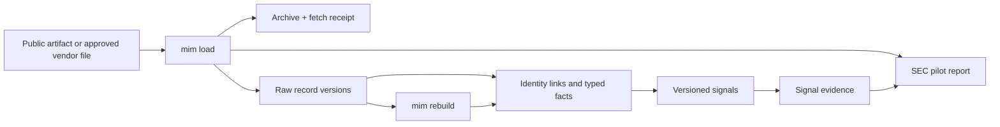

# Project goal and architecture

**Goal.** Maintain an evidence-backed PostgreSQL reference database for RIAs. A reviewer should be able to trace a person, company, dated event, or normalized contact field back through the matching decision to the source record and its archived artifact.

The first operating goal is one real SEC insider quarter with reproducible results and a completed filing review. The original build scope includes public and contract-authorized evidence, seven loaders, and offline replay tests. Scoring, outreach, and Helmsted client-data integration belong to later work.

## Read the code in this order

| Area | Entry and responsibility |
| --- | --- |
| Commands | `src/mim/cli.py` owns load, rebuild, audit, reservation, and pilot entry points. |
| Shared ingestion | `src/mim/loaders/sec_ingestion.py` handles content-addressed archives, the load transaction, replay keys, signal evidence writes, and rebuild order across all seven sources. |
| Narrow SEC slice | `sec_form345.py` wires the SEC reader, projection, and detector. `sec_form345_input.py` preserves source rows and footnotes. `sec_form345_projection.py` resolves CIKs and constructs typed trades. `sec_form345_signals.py` reconciles sales and exercises and attaches evidence. |
| Integrity audit | `src/mim/audit/database.py` checks raw provenance, signal evidence, contact dates, and merge cycles. The SEC pilot adds a trade-specific evidence check. |
| Pilot and test isolation | `src/mim/local_postgres.py` starts a socket-only database and applies the migrations for both the test suite and the pilot. `src/mim/audit/sec_pilot.py` verifies the table state and writes the review package. |
| Other sources | Each loader owns its source-specific parsing and attribution rules. The handoff describes the implemented gates and their evidence boundaries. |

`core.raw_records` hashes source payload versions. `core.fetches` records the input receipt and archive SHA-256. `core.record_links` explains entity attribution, and `core.signal_evidence` ties each signal to the rows that support it. Original artifacts retain file bytes and raw payloads retain the source fields consumed by the loaders. Rebuild clears derived tables and replays raw evidence in arrival order before reconciling signals. It preserves soft-merge pointers when both endpoints can be recovered from evidence. Identifier lookups follow these pointers once the relevant identities exist. Other manual changes need durable source evidence to survive rebuild. Government CSVs stage bounded COPY batches while keeping the whole artifact transaction atomic.

## Keep the code easier to audit

- Use the unified `mim` commands for operational work. The pilot and the tests now share the same local database setup.
- Keep the source parser, identity projection, and detector recognizable in the SEC path. Their tests make it possible to change one layer and identify what changed in the audit output.
- After the real SEC pilot, compare the two SEC TSV readers before extracting another shared helper. Consolidate only the behavior verified by fixtures and the real quarter. Keep source-specific header and attribution rules near their source.
- Add a `#GOAL` header to executable code and migrations. Put operational instructions in the README or the pilot guide and rules that explain evidence in this architecture document or the orchestrator handoff.
